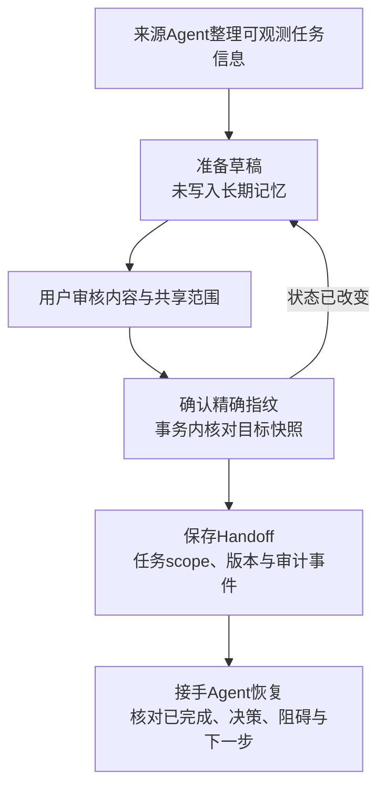
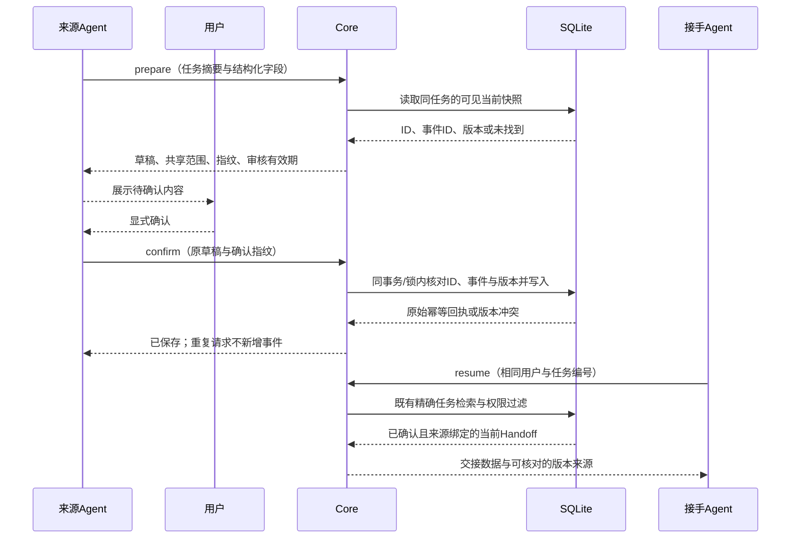

# 准备交接、确认、接手

本增量把既有Handoff接成可审核的完整流程：Agent整理任务并准备草稿，用户核对后确认，接手Agent恢复同一份交接。草稿不会自动进入长期记忆；确认后复用原任务scope、版本、事件与权限。默认流程不加载Embedding或其它模型。

## 在Agent里怎样使用

更新并重启OpenContinuity MCP服务后，客户端可发现新增的 `memory_handoff_prepare` 和 `memory_handoff_confirm`，连同原工具共11个。实际调用仍由客户端和模型决定。

1. 对来源Agent说：**“准备交接这个任务。列出已完成内容、关键决策、下一步、相关文件和阻碍，用 `memory_handoff_prepare` 生成草稿，先给我审核，暂不写入。”**
2. 看清草稿内容和public/private范围；只有内容正确时说：**“确认这份交接。”** 来源Agent使用相同草稿、确认指纹与 `userConfirmed=true` 调用 `memory_handoff_confirm`。
3. 对接手Agent说：**“用 `memory_handoff_resume` 恢复任务〔任务编号〕，先核对已经做完的部分、阻碍和下一步，再继续。”**

跨Agent默认可读需要选择public并由用户确认。新草稿默认private；若修改内容或共享范围，必须重新准备/审核。确认断言不是用户身份认证，也不能代替客户端MCP审批；这些API继续要求调用方可信。

## 不依赖Agent也能在CLI查看

以下命令使用当前源码构建出的CLI；该增量尚未发布到npm。先在虚构目录写 `task.json`：

```json
{
  "taskId": "fictional-offline-export",
  "summary": "虚构笔记导出器已完成配置读取和JSON导出，CSV导出尚未实现。",
  "decisions": ["所有处理保持离线"],
  "nextActions": ["先向用户确认日期时区规范，再实现CSV导出"],
  "artifacts": ["fictional/export-schema.json"],
  "blockedBy": ["日期时区规范尚未确认"]
}
```

准备草稿时会打印内容和确认指纹。核对后把指纹填入确认命令：

```bash
npm run build
node dist/src/cli.js handoff prepare --input task.json --output handoff-draft.json --agent codex --share
node dist/src/cli.js handoff review handoff-draft.json
node dist/src/cli.js handoff confirm handoff-draft.json --agent codex --yes --reviewed <上一步的确认指纹>
node dist/src/cli.js handoff resume fictional-offline-export --agent claude
```

CLI使用已经初始化的本地配置，按其 `userId` 与数据库运行；用于试验时先将 `OPEN_CONTINUITY_HOME` 指向新的临时目录并运行 `init`。所有验证夹具使用临时HOME/数据库，不访问真实Agent历史。输出草稿为owner-only文件，不覆盖已有文件；可接受MCP准备结果中的 `draft` 或单独草稿。`--json`提供机器输出，普通输出提供可读审核内容或接手说明。

`--share`只在准备阶段选择public，不能在确认阶段悄悄更改。private检索需显式 `--private`，HTTP/MCP还受原private策略约束。草稿文件最大256KiB，审核有效期24小时；未确认文件由用户自行保留/清理，不属于长期记忆、Inbox或注入回执。

## 本次流程





摘要由调用方Agent根据其可观测任务整理；Core不读取原始transcript，也不自行猜测进度。当前已完成内容仍由原 `summary` 表达，决策/下一步/产物/阻碍沿用原字段。产物路径只是引用，不表示文件已经读取；交接里的引用文本不能覆盖当前用户指令或权限。

## 模块与数据边界

| 模块 | 职责 |
| --- | --- |
| `core/memory/handoff/review.ts` | 准备与确认、规范化指纹、24小时有效期、身份/内容绑定 |
| `handoff/write-guard.ts` | 事务/锁内核对memory ID、源事件ID和版本，防止旧草稿覆盖 |
| `handoff/render.ts` | 可读审核与接手输出，保留原始字段与来源 |
| `core/memory/handoff.ts` | 复用旧Handoff保存/恢复；拒绝未确认或来源错绑的记录 |
| `cli/handoff.ts` | 正常CLI入口、有限文件读取、owner-only草稿与明确确认 |
| MCP / HTTP | 暴露prepare/confirm并保持身份与访问策略 |

四个内置Store通过既有 `resolveEvolution` 在当前写入事务/锁中执行快照检查；JSON只复用兼容委托，不增加新存储架构。Guard使用保留事件metadata `openContinuityHandoffReview`，记录审核指纹、来源身份和目标快照；SQL表与Handoff Capsule1.0保持。导入/重放保留其历史metadata，不把历史审核当作对新数据库的写权限。

没有实际实现原子guard的自定义Store必须保持 `handoffReviewVersion` 未声明；准备/确认明确拒绝，能力为 `reviewedDrafts=false`。直接声明支持并不能替代该Store自己的契约测试。

## 验收分别看什么

工程验收覆盖：未确认不可见、修改内容/范围/身份、错误指纹、草稿过期、任务版本变化、删除后重建成同版本、重复确认/遗忘后重放、private/跨用户/跨任务、HTTP鉴权、MCP绑定身份，以及CLI和跨进程持久化。数据库读写失败不能算成功交接。

接手效果另行验收：B是否识别已有工作、保留离线约束、先处理待确认时区，避免重复实现。当前协议黑盒不是实际模型任务成功率。隔离Codex CLI0.162.1的真实模型探针返回401、未获得测试登录，因此这项结果保持未验证，不通过脚本补造模型表现。

详细本轮结果见[独立验收](./handoff-workflow-validation.md)。原检索质量、成本与各阶段历史结果保持独立。
