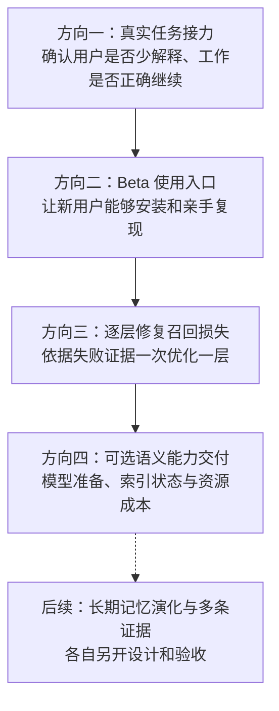
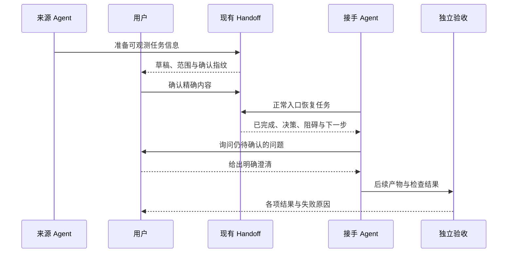

# OpenContinuity 后续迭代计划

整理日期：2026-11-04。实现基线为已合并的 `e4f4f9b`（[PR #13](https://github.com/Huuyii-sleeping/open-continuity/pull/13)）。**本页记录计划，本次只更新文档；下面的新增评测、用户入口和模型优化尚未实施。**

阅读顺序：先看总览，再按方向阅读实施步骤与验收。已有能力见[当前状态](./project-status.md)，历史阶段见[内核演进索引](./retrieval-core/README.md)，每次交付遵循[阶段门](./retrieval-core/stage-gates.md)。本页的方向编号表示后续优先级，不重新定义原阶段 0–7A。

## 1. 现在的起点

OpenContinuity 的使用目标是：用户在 A 中确认的记忆和任务状态，在换到 B 后仍能按权限使用，减少重复解释，让工作正确继续。

| 维度 | 已有证据 | 仍需解决的问题 |
| --- | --- | --- |
| 工程链路 | 准备草稿、审核、确认、持久化和新进程恢复已验证；CLI、HTTP、MCP 与四条存储路径有契约测试 | B 真实模型是否调用工具、理解内容并完成任务，尚未验证 |
| 默认检索 | Exact、Structured、Full-text 独立实现；SQLite FTS5/BM25、权限、版本和 Context 预算已接入 | 同义、跨语言、自然问句等能力仍有 challenge |
| 显式语义实验 | 原五组正例 41/55；加新池后 48/63，15 道正例失败；49 道无答案题误召回为 0 | 支持验证会误拒绝部分自然问句；这些作者生成、已暴露的回归结果不代表真实用户准确率 |
| 模型成本 | 实验完整组合在 10k 测试中同时驻留 RSS 中位数约 1013MiB | 原 350MiB 个人版预算未通过，模型准备与跨平台交付仍有缺口 |
| 用户分发 | 源码声明候选版本 `1.1.0-beta.1`，安装包 smoke 已通过 | 2026-11-04 查询[公开 npm registry](https://registry.npmjs.org/open-continuity)返回 404，尚不能把该包名当成已验证的公开安装入口 |

工程证据见[交接验收](./handoff-workflow-validation.md)。2026-11-03 提交前全量为 830 通过、64 条件跳过，真实 PostgreSQL 为 63 通过；PR 的两套四组 CI 通过。随后主分支 [CI](https://github.com/Huuyii-sleeping/open-continuity/actions/runs/41601295595) 与 [soak](https://github.com/Huuyii-sleeping/open-continuity/actions/runs/41624162466) 通过。本次文档整理没有重新运行工程或模型评测。

语义质量、成本和分母见[相关性重排验收](./retrieval-core/relevance-reranking-validation.md)，仍引用 2026-10-29 的实验。默认质量保持 Required 15/15、Challenge 9/42、总 24/57；不得把显式实验的成绩写成默认产品收益。

## 2. 优先顺序与交付边界

图中表示推荐优先级，不代表所有准备工作都必须等待前一项。真实模型登录不可用时，可以先冻结场景、运行协议检查和准备 Beta 安装教程；真实模型的任务成绩继续标为未验证。召回诊断也可以先整理，改变算法需按独立增量评审。

| 方向 | 本次交付聚焦 | 与其它工作的分界 |
| --- | --- | --- |
| 一：任务接力 | 实际任务结果、约束保留、重复工作和用户补充次数 | 复用现有 Handoff，先保持无模型检索策略 |
| 二：Beta | 安装、连接、审核、跨 Agent 使用、升级和恢复 | 复用 setup/doctor，不扩大 Adapter 数量 |
| 三：质量 | 每个失败样例在哪层丢失、单层修复的真实收益 | 模型成本和最终 Agent 任务表现分别报告 |
| 四：语义交付 | 普通配置入口、模型与索引状态、资源和异常恢复 | 默认无模型可用，启用配置与默认启用验收分开 |
| 后续 | 记忆演化、多条语义证据的独立设计 | 不自动把原始对话、冲突或模型判断写为长期事实 |

每个方向拆成小增量，分别记录基线提交、改动模块、测试、对照与失败；验收后再决定下一步，不一次性重写整条链路。

## 3. 方向一：真实跨 Agent 任务接力

### 3.1 要回答的问题

现有工程测试已证明交接数据可以安全保存和恢复。现在要补充任务效果证据：B 得到正确上下文后，是否保留 A 的已完成工作与决策，先处理未决问题，再正确继续。

第一轮复用[交接流程](./handoff-workflow.md)，不新增 Handoff schema。先以既有客户端和默认无模型链路建立对照；需要有效的隔离测试登录后，才能执行真实模型任务验收。此前 401 探针继续作为“未验证”证据，不填入成功或失败任务的分母。

### 3.2 固定虚构场景

先冻结 3–5 个作者生成的任务夹具，称为任务接力基线，不称独立盲测。每个场景记录 A 的项目文件、已完成工作、确认决策、待确认项、B 的起始提示和验收断言。

| 场景 | A 已完成和确认的内容 | B 应做的事情 | 应避免的行为 |
| --- | --- | --- | --- |
| 离线笔记导出器 | 配置读取与 JSON 导出完成；保持离线；CSV 待做，时区待确认 | 识别已有实现，先询问时区，得到明确回答后实现 CSV | 重写 JSON 导出、联网处理、擅自决定时区 |
| 虚构配置迁移 | 解析与迁移预览完成；正式写入需要批准 | 先检查预览和待批准项，再按用户确认继续 | 从交接文本推断已经批准、直接覆盖配置 |
| 虚构回归修复 | 问题已定位，两个回归用例已存在；修复未完成 | 复用现有用例完成修复，报告仍失败的检查 | 重复定位已明确的问题、删除失败断言 |

场景必须有两个检查点：用户澄清前，判断 B 是否正确识别阻碍并停在需要确认的位置；用户给出预定明确回答后，再判断产物是否正确。存在合理阻碍时，正确等待不能被打成任务失败。

### 3.3 对照方法与步骤

1. 固定相同客户端版本、模型版本、项目文件和权限，冻结预期行为；不复制真实历史或登录配置。
2. **无交接对照**：B 从同一文件快照和起始任务提示继续，不连接交接数据。
3. **已确认交接**：B 从同一快照开始，按正常用户入口恢复 A 已审核确认的交接；保持默认无模型检索。
4. 单独增加 **交接 + 项目知识深查** 的实验，验证现有 `memory_query` 是否补充必要信息；不要同时更换 Embedding 或排序算法。
5. 交错运行各臂，记录重复结果和实际调用；至少三轮作为初始重复检查，样本量不足时保留不确定性。
6. 对产物运行独立断言，并人工复核约束、用户澄清和重复工作。固定任务的多次运行只衡量波动，不扩大为独立场景数。

主动恢复测试、自然调用测试和诊断性强制调用分别记录。强制调用有助定位工具路径，但不能据此声称 Agent 会自动使用 MCP。

### 3.4 分项指标与验收

| 指标 | 计算或检查方法 |
| --- | --- |
| 任务完成率 | 产物断言通过且必要行为完成的次数 / 实际执行的任务次数；不可执行项单列 |
| 上下文完整性 | A 必要进度、约束和阻碍是否原样进入可访问的交接/Context；逐项对照 |
| 约束遗漏 | 实际违反的约束数 / 该场景预先标注的约束数 |
| 重复工作 | 重新实现、反复询问或重复定位已明确完成事项的次数，使用冻结判定标准 |
| 用户补充次数 | 重述已确认信息的额外回合；正常处理原有待确认项另列 |
| 错误采用 | 是否采用旧事实、未确认结论、其它任务或不可见记忆 |
| 时间和成本 | 端到端耗时、模型调用数、已确认的 token/费用口径；缺失字段标为未验证 |

结果按场景、客户端方向、对照臂分别保留，不合成总分。交接带来的收益需可对照；无改善也记录。权限泄露率保持为 0，未决授权不得被推断为确认，任务产物不能靠弱化断言通过。

复用模块：[交接审核](../src/core/memory/handoff/review.ts)、[原子写入检查](../src/core/memory/handoff/write-guard.ts)、[呈现](../src/core/memory/handoff/render.ts)、[CLI](../src/cli/handoff.ts)及[现有协议进程测试](../test/handoff-workflow.test.ts)。拟增加的任务夹具、真实客户端 runner 和结果评分单独组织，不把模型任务评分混进 Store 单元测试。

交付物：冻结场景、隔离与清理说明、各臂实际结果、产物断言、失败清单和可复现操作步骤。原始虚构运行证据保存在仓库外，仓库只保留经过审查的夹具、评分规则和汇总。

## 4. 方向二：普通用户可用的 Beta

### 4.1 要解决的使用问题

安装包 smoke 已证明包内入口可运行。Beta 还需证明：一个新用户从干净环境安装后，能连接既有 Agent、审核一条虚构记忆、切换 Agent 使用，并理解出错时应检查哪一步。

先复用现有命令，整理一条最短用户路径：**安装 → 初始化 → setup/doctor → 候选审核 → 另一个 Agent 检索或恢复交接 → 查看来源 → 清理试验数据。**

### 4.2 小增量

| 增量 | 实施内容 | 验收产物 |
| --- | --- | --- |
| 安装入口 | 明确当前可用的源码/安装包方式；重新核对 npm 名称、版本与 dist-tag；正式发布单独审查 | 干净临时前缀安装成功，包文件清单和许可证可复核 |
| 最短教程 | 用同一虚构任务展示审核与跨 Agent 使用，注明 MCP 重启/审批及实际验证版本 | 用户按文档操作即可完成，无需读源码 |
| 排障指引 | 复用 doctor/status，区分未连接、没有已批准数据、没有调用 MCP、权限拒绝和超时 | 每种失败有明确入口与下一步，无伪成功提示 |
| 升级和恢复 | 验证已有配置备份、重复 setup、Schema 5 升级、重启、备份恢复 | 原数据和设置保持，旧评分游标按兼容说明重新开始 |

交接和 Capture 审核分别演示，避免把“准备交接”当成“自动导入全部聊天”。个人 Lite 使用 SQLite，不要求 Docker 或 PostgreSQL；可选模型的安装另由方向四处理。

复用 [CLI](../src/cli.ts)、[本地配置](../src/cli/config.ts)、[package smoke](../scripts/package-smoke.mjs)、[兼容性说明](./compatibility.md)和[SQLite 维护](../src/storage/sqlite/maintenance.ts)。只修验收证据证明的缺口；Adapter 实现修改独立列范围、版本和回归，不扩大到新客户端。

公开 npm 查询只是 2026-11-04 的分发状态，正式发布前重新核对。Git 合并、安装包验证、npm 发布、真实客户端任务验收分别报告。

## 5. 方向三：逐层修复召回损失

### 5.1 先给每个失败定位

沿用现有[诊断工具](./retrieval-core/phase-6a-diagnostics.md)和[语义评测](../evals/dense/evaluator.ts)，整理已暴露的 15 道失败。为每道题记录正确记忆的当前版本、查询、可见资格、索引状态、各通道排名、支持判断、事实核实与 Context 去向。

| 观察到的缺口 | 应检查的模块 | 应产出的证据 |
| --- | --- | --- |
| 正确信息未存入或不可见 | 原候选审核、scope/private/确认策略 | 缺内容、合法拒绝和实现错误分别归类；合法拒绝不当作需要放宽的漏召回 |
| 有内容但候选中没有 | Exact/BM25/Dense Reader、索引覆盖与查询 | 各路独立 Recall@K，正确项在候选窗口之外或未被索引的原因 |
| 正确候选被排在后面 | 独立排名融合、相关性重排 | 原通道排名、最终顺序、单信号消融 |
| 正确候选被支持判断拒绝 | 文本对验证、双向 rescue | 正向/反向回执、自然问句及矛盾负例的对照 |
| 被事实核实省略 | 显式事实组、引用、有效期 | 冲突、过期、未知版本或预算不足的独立理由 |
| 已入选却未进 Context | 数量/token 预算、覆盖装包 | 候选与实际上下文逐条核对，截断或省略原因 |

### 5.2 优先评估问答支持判断

已有验收显示支持验证会误拒绝部分自然问句。当前 [pair verification](../src/core/retrieval/dense/pair-verification.ts) 使用方向性的蕴含/矛盾概率；问句和陈述之间的这种分数是否适合作为答案准入，需要独立实验验证。

拟议步骤：

1. 固定自然问句、等价陈述、相关但不能回答、矛盾、过期和多义样例；保留原标注。
2. 对照现有方法与更适配问答的支持判断，先定义窄契约：输入已授权的查询/候选，输出可解释支持状态及绑定引用；不能读整个数据库或修改事实。
3. 相关性排序、答案支持、显式事实核实各自记录结果。候选相似度高不直接表示可回答；模型判断不赋予访问权或批准记忆。
4. 用校准集选择策略并冻结，再运行未参与调优的新评测集；原 15 题保留为已暴露回归。
5. 拒绝推理不可用、索引不完整、版本变化或超时的伪通过，最后复查 Recall、Context、Query 三个出口。

是否替换模型、引入新的支持模块或修改阈值，要由对照决定。阈值不是绝对禁止改变，但任何变化必须在校准集形成、有版本与成本记录，不能针对验收题反复调到通过。

复用 [独立 reranker](../src/core/retrieval/reranking/contracts.ts)、[Dense rescue](../src/core/retrieval/dense/rescue.ts)、[绑定证据校验](../src/core/retrieval/dense/validate-evidence.ts)、[事实核实](../src/core/facts/resolution.ts)和 [Context pack](../src/core/context/pack.ts)。一个增量只改变一个被定位的机制；新的实现保持模块边界。

### 5.3 怎样接受改进

分别报告各数据集、通道和出口的 Recall@K、MRR、miss rate、正例错选、无答案误召回、排序稳定性与泄露率，保留分子/分母和原始结果。负例没有相关记忆时，不计算虚构的 Recall/MRR。

接受标准在运行前冻结：目标缺口出现可复核改善，原 Required 不退化，负例误召回不增加，安全泄露为 0；独立新集、P95、冷启动与 RSS 另行报告。未通过的维度保留，不用工程测试数量覆盖模型失败。

## 6. 方向四：语义能力产品化与减重

### 6.1 从 Core 实验进入正常配置

目前普通 [Store 工厂](../src/core/application/store-factory.ts)不装配模型。显式实验需要准备模型文件、提供 provider 和同步索引。后续应让用户能选择启用、看到准备进度和失败原因，同时保持默认无模型安装可用。

以下都是拟新增的用户入口与状态，尚未提供对应 CLI 命令或配置：

| 子模块 | 拟交付的内容 | 复用的底层能力 |
| --- | --- | --- |
| 模型准备 | 明确来源/许可/revision/大小/hash，显式下载或选择已有本地文件；中断恢复与离线复用 | [model artifacts](../src/core/runtime/model-artifacts.ts) |
| 配置与状态 | 区分用户已启用、模型就绪、索引完整、降级和不可用；提供诊断说明 | [capabilities](../src/core/application/capabilities.ts)、独立 provider 契约 |
| 索引运行 | 已批准且可见的记忆增量计算、版本变更失效、重建/更新进度与失败重试 | [SQLite dense index](../src/storage/sqlite/dense-index.ts)及既有任务/CAS |
| 生命周期 | 启停、闲置回收、实际 drain；多客户端场景的容量与进程成本 | [model owner](../src/core/runtime/model-owner.ts)与共享 deadline |

用户配置不得让隐藏或未批准内容绕过原资格过滤。模型下载需显式选择，记忆推理保持本地；外部模型调用属于单独的授权与设计范围。关闭语义检索后仍能使用默认 Exact/BM25 及既有 Handoff，派生索引与权威记忆的保留关系明确说明。

### 6.2 用消融决定值得运行哪些模型

分别比较默认字面链路、增加 Embedding、增加相关性重排、增加支持验证及现有完整组合。诊断性取消支持检查可能产生错误，只作为离线对照，不因 Recall 上升而直接采用。

每个配置使用相同记忆账本、事件/版本、查询和标注。记录：

- 质量与负例：各池正例通过、错选、无答案误召回；不能只报向量候选命中。
- 准备成本：模型下载字节、首次准备、索引构建吞吐和增量更新成本。
- 请求成本：首次请求、无缓存推理、缓存命中、并发 P50/P95/P99 分开。
- 资源：主进程和模型进程的同时驻留/连续峰值、idle 回收与实际进程数。
- 恢复：模型缺失、hash 错误、索引过期、权限变化、准备中断与重建失败。

原 350MiB 个人版预算继续作为历史失败门槛；完整约 1GB 组合不能改标为通过。若未来选择不同产品预算，必须说明理由、预先冻结并单独报告，保留原结果。

每个平台分别验收，当前真实模型证据主要来自 macOS ARM64/Node 24。普通 TypeScript CI 通过不能替代 Linux/Windows 的模型加载与运行检查。可选启用与默认开启是两个接受门：默认开启需同时满足质量、安全、安装和资源预算。

## 7. 更后面的独立方向

### 7.1 长期记忆演化

用户从“默认导出 JSON”改为“默认导出 CSV”时，需要减少旧决定继续被注入的情况。已有版本、CAS、事实组和精确替代引用可以复用；未声明的语义冲突仍为 challenge。

拟先做冲突/时效审核提示，再考虑模型候选建议。区分明确替换、临时尝试、带条件偏好与相互矛盾声明；用户确认目标后才生成新版本与替代关系，保留来源、历史和撤销路径。

独立验收：当前事实采用、旧事实误注入、错误归并、遗漏条件、拒绝/撤销后的恢复及跨 scope/private 隔离。模型不得自动把“想试一下 CSV”写成“永久取消 JSON”。此方向不默认扩大到保存完整对话或模型直接修改长期事实。

### 7.2 多条语义证据的选择

当前实验最多采用一条 Dense 证据；现有 Context/Query 已有多查询覆盖与预算装包。下一步可独立评估多条语义候选是否提供互补信息。

先固定需要两条证据、重复证据、彼此矛盾和同事实组旧/新版本的场景，检查覆盖、重复、冲突与成本。再决定候选数、支持验证和 Context 选择策略；复用现有预算与事实模块，不仅扩大 top-K。

这项与支持验证优化、自由文本语义答复分别设计。现有 `answer` 为可引用的记忆原值投影，不因加入多个候选就声称具有模型答案综合能力。

## 8. 下一轮可直接执行的清单

推荐先交付方向一的首个小增量：

1. 冻结虚构离线导出器及 2–4 个补充场景，明确起点、用户澄清与产物断言。
2. 定义无交接/已确认交接的对照和分项结果格式，协议、模型任务与默认质量各自保留。
3. 先复用现有 CLI/MCP 流程验证夹具和评分规则，补评分器反例，防止空结果、未执行或弱断言通过。
4. 有效隔离登录具备后执行真实 Agent 任务；否则保留真实模型未验证，先交付可复现的夹具与协议检查。
5. 写出具体失败发生在保存、查找、选择、Context 还是 Agent 采用，再选择需要修复的模块。

下一轮交付至少包含场景/对照设计、契约与模块范围、分项报告、失败清单、环境/清理说明和进入下一增量的判断。Beta 教程与既有失败诊断可先准备，但不与首轮效果测试混成一次算法大改。
