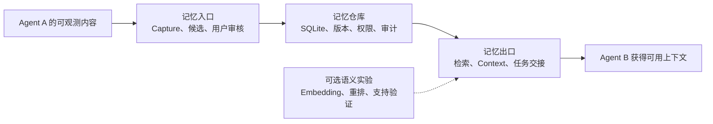

# OpenContinuity 当前状态与下一步

状态核对：2026-10-30。本文以当前开发工作区为准；交接增量工程验收见2026-10-30记录，语义模型质量/成本对照仍为2026-10-29记录。实现、默认启用、真实客户端验证和发布是分别确认的状态，下面不把它们合成一个“完成度”。

**当前定位：共享记忆与任务交接的基础已实现；语义检索在显式实验中跑通；下一步集中验证跨 Agent 任务接力的使用效果。**

当前已新增[准备/审核/确认/接手流程](./handoff-workflow.md)：普通CLI与MCP/HTTP入口已经实现，原子确认复用既有存储。最新工程、原检索回归和真实模型验证状态见[本轮验收](./handoff-workflow-validation.md)；真实模型探针认证不可用时保持未验证。

## 1. 用户最终应该得到什么

用户在 Agent A 中确认的偏好、项目约束和任务进度，在换到 Agent B 后仍可按权限使用，减少重复解释。长期记忆可查看、修改、追踪版本或遗忘。Embedding 的作用是补充不同说法之间的查找能力。

前三个模块的职责和工程契约已有实现。真实客户端可观测范围与验证程度见[兼容矩阵](./compatibility.md#adapter-development-status)；Agent 是否调用MCP、是否正确采用上下文，仍需实际使用路径验收。

## 2. 能力分别处于什么状态

| 部分 | 已经实现 | 使用入口与边界 |
| --- | --- | --- |
| 本地记忆存储 | SQLite事务、幂等、版本、事件历史、CAS、导入导出 | Lite默认SQLite，无需另起数据库服务；JSON兼容，Team PostgreSQL仍为预览 |
| 记忆入口 | 三个既有Agent的Capture、短期Inbox、候选、批准/拒绝 | `setup`、`capture`；只有公开扩展面暴露的内容可读，候选审核后进入长期记忆 |
| 默认检索 | Exact、Structured、Full-text独立通道；SQLite FTS5/BM25、短查询fallback、真实排名融合 | `memory_recall`、`memory_context`、`memory_query`；Structured只提供资格证据，权限在候选截断前过滤 |
| 事实与上下文 | 显式事实组/有效期/替代版本、预算装包、原值与版本引用 | 只核实显式声明；尚不自动理解所有语义冲突或生成自由文本答案 |
| 任务交接 | Handoff字段、审核草稿、精确内容确认和事务内目标快照检查 | prepare/confirm/resume和普通CLI；任务scope，按 `handoff:<taskId>` 恢复；旧create兼容保留 |
| 下一轮注入 | 已批准public且workspace可见的少量记忆，预算和fail-open | 既有Injection Hook；不是全部记忆或完整历史自动注入 |
| 运行与排障 | deadline、容量/drain、模块与线路测试、质量/安全/性能分项评测 | 已验证部分故障与恢复；SQL硬取消、断电保证、生产SLO不由这些测试证明 |
| Embedding/Dense | SQLite可重建向量任务/索引、事务外计算与版本核对、独立余弦候选 | **Core显式实验、默认关闭**；需准备模型文件、装配provider并同步索引，普通安装没有语义开关/自动模型交付 |
| 相关性重排与支持验证 | 独立模型模块、有限授权窗口、绑定回执、保留已验证基线 | **显式实验、默认关闭**；相对相关性和文本对支持不证明事实真伪或授予权限 |

Capture批准流程、模型候选准入与访问控制是不同边界。Injection与Dense要求已确认的可见内容；普通Recall/Context按其请求和消费者确认策略执行。身份仍由受信任调用方提供，完整多租户身份认证尚未实现。

## 3. 前面的阶段分别解决了什么

| 阶段 | 交付内容 | 当前结论 |
| --- | --- | --- |
| 0：基线 | 质量、安全、稳定性、成本分别记录 | 有可复核对照，不能用总测试数代替效果 |
| 1：存储 | 写入、重复请求、版本、分页、过滤及恢复契约 | 核心存储语义已有工程验证 |
| 2：召回 | 统一评分命中契约、SQLite真实BM25排名、通道分离 | 默认候选可追溯，语义能力另行实验 |
| 3：选择 | 通道融合、资格过滤、显式事实核实 | 支持确定性选择，未声明事实仍有边界 |
| 4：上下文 | 预算选择、覆盖、充分性、确切版本引用 | 能形成受预算约束的证据包 |
| 5：可靠性 | 执行预算、容量、进程恢复及失败回执 | 已覆盖指定失败场景 |
| 6：诊断 | 按入口/通道定位失败、可选拼写fallback及消融 | 拼写默认关闭；人工同义词实验已撤销 |
| 7A：模块化 | Core、各存储和内部线路拆分、依赖门禁 | 便于分别调试和验证 |
| 后续语义增量 | Embedding接入、索引缓存、双向补召回、独立重排 | 工程链路跑通，质量与成本仍未支持默认开启 |

完整设计与各次历史证据见[阶段入口](./retrieval-core/README.md)。历史文档保留当时结果，本页用于回答“现在在哪里”。

## 4. 已知问题与证据

| 问题 | 最新证据 | 后续如何判断改进有效 |
| --- | --- | --- |
| 仍会漏召回 | 原五组正例41/55；加新池后48/63，共15道正例失败，主要表现为支持验证拒绝 | 保留旧标注，逐题定位候选、排序、验证与Context；用新增未参与调优的场景复验 |
| 模型组合偏重 | 10k测试完整组合同时RSS中位数约1013MiB；原350MiB个人版预算不通过 | 单独做模型/线路消融，记录收益、首次延迟与驻留内存后再决定启用方式 |
| 模型交付未产品化 | 当前通过显式Core装配与本地模型模块使用 | 模型准备、启停、索引状态、更新恢复和失败降级需要正常用户入口及验收 |
| 真实接手效果尚未形成独立基线 | 工程Handoff和部分真实客户端smoke有证据；它们不等于B完成了后续任务 | 分开记录上下文完整性、调用行为、Agent后续任务结果与用户补充说明次数 |
| 各客户端验证程度不同 | Codex有真实持久化/交互smoke；Claude的模型支持Stop/非空Injection闭环仍有验证缺口 | 固定实际版本，使用虚构workspace；缺失/不可用明确标为未验证 |

最近的[语义实验验收](./retrieval-core/relevance-reranking-validation.md)中，原五组39/55→41/55，两个旧错选被修正，无答案误召回保持0/41；新248条候选池保持7/8，没有新增收益。三轮最终选择一致。这些是固定、作者生成且已暴露的数据，不能直接当作真实用户成功率。

默认无模型路径的 `eval:quality` 仍为Required15/15、Challenge9/42、总24/57；`eval:suite` 为185/185。全量工程测试每轮802通过、60条件跳过。**模型实验收益、默认质量和工程通过数分别查看。** 本轮整理没有重新执行这些模型评测，数字引用2026-10-29验收。

## 5. 下一阶段：跨 Agent 任务接力

接下来只集中验证一个体验：**用户确认交接后，B得到A的必要进度、约束和阻碍，并继续完成任务，用户不必重新讲一遍。**

Handoff已经有创建/恢复实现，无需重新建立交接协议，也不要求Embedding才能恢复。精确任务恢复、相关项目知识的深搜、Agent实际采用证据是三种需要分别测量的行为。

| 子步骤 | 本次确定的下一步范围 | 验收产物 |
| --- | --- | --- |
| 接力场景与基线 | 先用一个完全虚构项目，固定A完成内容、决策、阻碍、B应做的下一步及禁止行为 | 场景说明、入口、预期结果、隔离与清理方式；此步骤不改召回策略 |
| 正常入口的完整流程 | 复用既有创建/恢复工具、setup与权限；先查完整流程哪里需要用户反复解释或开发脚本 | 可亲手复现的A→确认→B流程；只修被证据证明的缺口 |
| 接手效果验收 | 工程黑盒与真实Agent结果分别运行；先建立默认无模型对照，再测显式语义实验 | 分项结果：约束遗漏、重复工作、旧事实采用、错误注入、补充说明次数、任务完成与成本 |

示例项目为完全虚构的离线笔记导出器：A已实现配置读取与JSON导出，决定默认离线；CSV导出待做，日期时区规范待用户确认。用户确认交接后，B应识别已完成部分、保留离线约束，先处理待确认的时区问题，再继续CSV任务。具体夹具与断言在下一阶段冻结，本页只是设计范围，不是执行通过记录。

验收时分开记录“不调用工具”“有调用但没找到”“有结果但Context漏掉”“收到正确Context但未采用”“后续产物不正确”。模型或客户端未运行不能算成功；不把一个成功演示当作成熟验收，也不为提高分数放宽批准、scope或private边界。

## 6. 怎样决定后续调优

| 观察到的失败 | 优先检查 |
| --- | --- |
| 必要信息没有被保存 | Capture可观测范围、候选与审核、显式交接内容 |
| 已保存但没找到 | 查询、资格、索引状态、Exact/BM25/Dense候选 |
| 候选有正确项却选错或被拒绝 | 融合、重排、支持验证、显式事实核实 |
| 入选证据没有进入上下文 | 预算与覆盖装包、交接呈现 |
| 正确上下文没被采用 | 客户端调用与实际消费行为 |
| 使用成本过高 | 分线路消融、模型生命周期、窗口与资源预算 |

每次优化都先写清要修的具体失败，保留前后对照，再核对质量、安全、稳定性与成本。暂不扩大到新Adapter、Team向量部署、图谱/多跳或全面模型归并；发现实际失败后再调整优先级。语义模型安装和成本优化保留为独立待办，不阻止先验证已有默认交接链路。

当前开发工作区最近的检索增量仍为未提交修改；发布与远端CI需要另行验收。本轮交付是状态整理与下一步范围，功能实现记录继续以各设计/验收文档为准。
