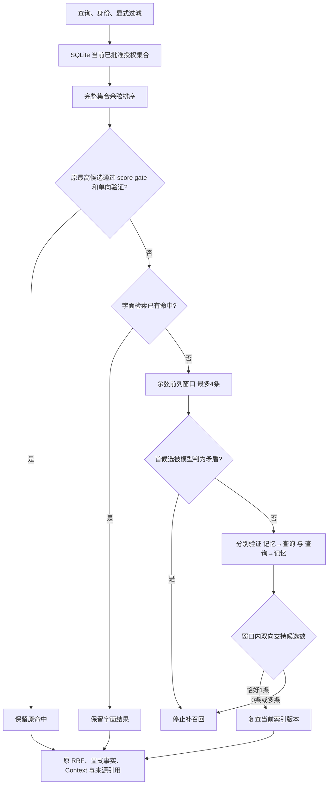
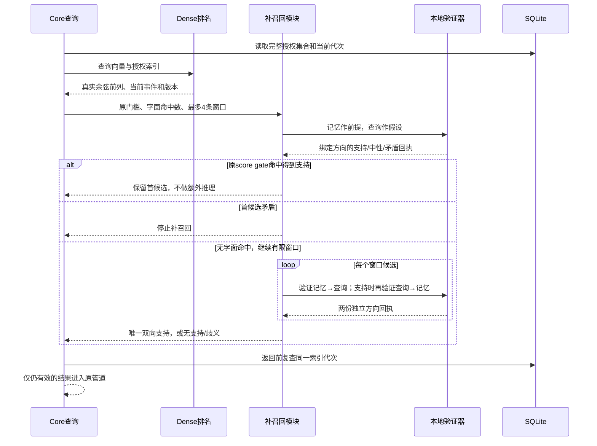

# 双向补召回：有限候选窗口与最终准入

这是显式 SQLite Dense 实验的一个小增量，默认服务继续使用 Exact / BM25。它处理一种具体漏召回：余弦最高的正确内容低于原 0.62 门槛，或首候选只有中性支持，后面的正确内容被漏掉。原命中保留；补召回不能绕过权限、批准或模型矛盾。



图中的“支持”是同一模型按同一阈值给出的文本关系判断；它不证明内容真实，也不能替代问题相关性排序。双向策略更保守，会漏掉只在一个方向蕴含的概括、自然问句和省略信息。

## 谁负责什么

| 模块 | 职责 |
| --- | --- |
| `storage/sqlite/dense-index.ts` | SQL先过滤 user/agent/task/private/确认状态及显式过滤；绑定当前事件、版本、索引代次 |
| `retrieval/dense/ranker.ts` | 比较完整授权集合；真实余弦排名及稳定 tie-break；沿用既有缓存 |
| `retrieval/dense/rescue.ts` | 独立窗口编排与纯决策：保留、矛盾停止、双向支持、唯一准入 |
| `dense/rescue/contracts.ts` | 中立的窗口回执契约，避免公共契约依赖具体实现 |
| `dense/local-pair-verifier.ts` | 明确方向的模型调用与判断缓存；不读取数据库或改变事实 |
| `dense/validate-verification.ts` | 校验方向、模型/策略、访问指纹、查询/正文指纹、来源事件和版本 |
| `dense/retriever.ts` | 组合上述模块，共享 deadline；返回前再次检查模型身份、预算和索引代次 |

## 一次补召回的数据流



正向、反向使用同一冻结标准：entailment ≥ 0.5，contradiction < 0.5。原 score-gate 的 hybrid 保留0.62门槛；miss-only还要求margin ≥ 0.14、至少两个比较候选。显式补召回的候选生成可越过score gate，最终准入必须通过两次判断。原策略的数值门槛、标注、记忆内容和用户确认均未修改。

## 预算与可解释回执

默认 `candidateSelection:"score_gate"` 仍最多验证一条。显式 `bidirectional_rescue` 只允许 `hybrid` 与支持反向调用的 typed verifier；默认最多四个候选，可设1–4。最坏为四次正向加四次反向推理，全部使用同一个剩余 deadline；反向只验证正向已支持的候选。底层推理超时后继续占用容量，关闭等待真实计算结束，迟到结果不会进入输出。

`dense.rescue`包含版本、窗口ID顺序、双向支持ID、原因、完整性和窗口外数量。`verificationBudget`分别报告正向、反向次数及未验证数量；正反向回执都绑定当前来源。`windowComplete`只表示配置窗口，不是全库语义覆盖。拒绝批次沿用 `status:skipped`，窗口外信息保留在回执中，不用空结果声称完整比较或准确拒绝。

方向进入缓存键，反向回执不能当成正向证据；内容、访问条件、模型或版本变化也不能复用。策略版本和窗口预算进入游标指纹，切换策略需从第一页重查。这个增量不改变旧 score-gate 或默认字面游标指纹。

```ts
const dense = new DenseRetriever(index, embeddingProvider, {
  mode: "hybrid",
  admission: frozenDensePolicy,
  pairVerifier: verifier, // 必须明确支持 query_to_memory
  candidateSelection: "bidirectional_rescue",
  maxVerificationCandidates: 4,
});
```

模型准备、校验与加载仍由用户显式配置。InMemory、JSON、PostgreSQL没有内建 Dense 线路；没有新增生产 inference 依赖、模型下载、人工同义词表或 Adapter 设置。默认开启、通用问句 reranker、独立盲测、跨平台和资源交付仍待后续验证。[工程、质量、安全与成本](./dense-rescue-validation.md)分开查看。
