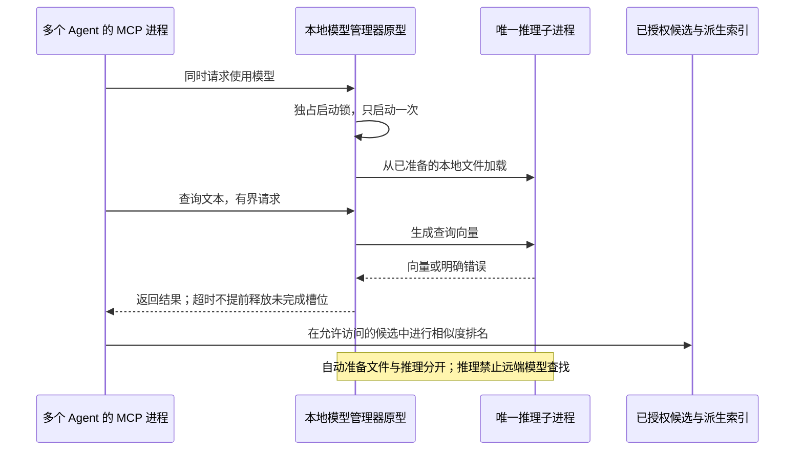

# 个人版本地 Embedding：可行性验证

后续成本与准入优化见[本轮结果](./embedding-refinement.md)。本文保留首次实验数据，不将后续改善覆盖到历史结果。

2026-10-27/28，macOS ARM64、Node 24.20.0、CPU 两个推理线程。结论：**无需额外部署模型服务的本地推理与共享进程方案可以运行；当前候选组合还不适合直接默认开启。** 首次下载不够可靠、通用依赖较大、模型驻留内存明显；未经相关性准入的 Dense Top-K 会破坏已有负例和 Required 验收。

这是仓库外的独立原型，不是生产 Embedding 的交付。当前 `semantic=false` 保持，公共检索、默认排名、数据库 schema、模型安装器、Adapter 和原评测标注未修改。没有 commit、push、PR 或外部数据读取。

## 验证的运行形态

模型和 npm 依赖首次仍需要下载。原型使用固定模型 revision、文件大小和上游校验值，支持已有完整文件复用及 `.partial` 恢复；10 个文件最终校验一致，篡改配置反例被校验器拒绝。启动时再次验证缓存、可恢复的生产安装状态机、许可分发和升级协议尚未实现。

文件准备也补了纯 Node 原型：空模型目录中下载并校验 E5 的 5 个文件约 9.30 秒；缓存复核约 62ms，另一个中断夹具通过真实 HTTP Range 恢复。使用纯 Node 准备的目录加载并推理成功，观察到远端 fetch 尝试 0。Python 只用于前期实验编排，不是这一运行路径的依赖；但正式用户安装命令仍未实现，不能把该原型当作开箱产品。

共享原型用 owner-only Unix socket 与私有临时目录；模型进程不直接查询用户数据库。四客户端并发自动启动、模型请求、容量拒绝、关闭清理已经实测。旧锁、模型崩溃后的自动重启、Windows IPC 和多 MCP 生命周期的真实集成仍待实现。

## 安装与来源

| 项目 | 实际观察 | 限制 |
| --- | --- | --- |
| 第一次 npm 准备 | Transformers.js 4.3.1 大包下载 `EIDLETIMEOUT` | 不声称干净首次安装可靠通过 |
| 恢复模型下载 | 连接中断后恢复，10 文件校验通过 | 安装器仍是原型；失败日志保留 |
| 3.8.1 安装 | 约 24 秒，已有部分 npm 缓存 | 依赖审计出现 2 项 high，不作为推荐交付组合 |
| 4.3.1 重试安装 | 成功；本轮 npm audit 0 项 | 有已有缓存；只证明本机这次安装 |
| 纯 Node 准备模型 | 空模型目录的 5 个文件校验/本地推理通过 | 已有固定清单及本机 Node，不是全新系统验收 |
| 4.3.1 的依赖目录 | 约 471 MiB | 包含通用浏览器推理与图像依赖，不是 npm 压缩包大小 |
| 每个候选模型 | 约 129.1 MiB，含 tokenizer 与 q8 权重 | 两个候选分别准备，产品无需同时安装两个 |

候选为 `Xenova/multilingual-e5-small`（revision `761b726dd34fb83930e26aab4e9ac3899aa1fa78`）和 `Xenova/paraphrase-multilingual-MiniLM-L12-v2`（revision `2c4055b12046f11709e9df2c122e59ffbdc2f900`），均输出 384 维向量。E5 使用上游要求的 `query:` / `passage:` 前缀；两者使用 mean pooling 和归一化。超出验证的输入 token 预算明确拒绝，不静默截断。

上游 [E5 模型卡](https://huggingface.co/intfloat/multilingual-e5-small) 声明 MIT，[MiniLM 模型卡](https://huggingface.co/sentence-transformers/paraphrase-multilingual-MiniLM-L12-v2) 声明 Apache-2.0；转换仓库的许可与重分发说明仍需要发布前核对。模型二进制没有进入仓库。Node CPU 预编译支持见 [ONNX Runtime 文档](https://onnxruntime.ai/docs/get-started/with-javascript/node.html)，不代替我们的跨平台安装验收。

## 冷启动、热运行与内存

以下使用 4.3.1 + ONNX Runtime 1.30.0，两个模型各三次新进程、每次预热 5 次后测 50 个短查询。首次请求、模型加载和热请求分开，文件系统缓存没有清空。

| 模型 | 三次进程启动到就绪（ms） | 三轮热请求 P95 中位数（ms） | 热运行结束时进程 RSS（MiB） |
| --- | --- | --- | --- |
| E5 small q8 | 2072.5 / 447.5 / 433.3 | 3.75 | 759.6 / 724.5 / 720.4 |
| 多语言 MiniLM q8 | 409.2 / 397.9 / 392.5 | 2.35 | 756.0 / 725.0 / 692.4 |

这些是短文本向量生成及 IPC 耗时，不是完整 Recall/Context/Query 的生产延迟。300 次同输入重复向量一致；空输入、超长输入拒绝后可以继续正常请求。禁用模型远端查找及 Node fetch 后，观察到 fetch 尝试 0；没有进行操作系统级断网或完整系统网络审计。

内存分阶段观察表明，模型加载增加了 JS heap 与原生内存，不只是权重文件体积；显式 GC、降低 ONNX 图优化并关闭内存 arena 没有在该探针中显著降低 RSS。`dispose` 后 RSS 也未立即下降，终止模型子进程才确认退出。这些是进程 RSS 与采样，不是物理内存独占值或长期峰值承诺。

冷启动通常超过现有 200ms Injection 预算。后续设计不能把首次下载或模型冷加载直接放进 Hook 的关键路径；模型未就绪时应保持原检索并如实报告 Dense 未参与。

## 多进程共享

三轮，每轮四个独立客户端同时自动启动，各做 10 次真实模型请求，共 120 个响应：

- 每轮只有 1 个启动者和 1 个模型进程；向量一致，推理未请求远端模型。
- 四客户端调用 P95 为 10.36 / 12.49 / 11.07ms；包含排队、IPC 与实际推理，不等于四路 CPU 并行。
- 模型 RSS 为 723.0 / 612.0 / 714.9 MiB，broker 约 51 MiB，四客户端 RSS 合计约 203 MiB。
- 另一组四模型独立加载的 RSS 合计约 1994 MiB。RSS 合计会重复统计共享页，不可当作真实物理内存节省比例；模型实例数确实由 4 减为 1。
- Unix socket 权限 0600。显式注入模型前 100ms 等待，八请求中四个返回忙碌；5ms 调用超时后仍保留未结束工作槽位，工作结束再恢复容量。该故障测试不证明 ONNX 硬取消。
- 三轮关闭后均确认 broker 与模型进程退出。自动 idle 卸载、崩溃重启与旧锁恢复尚未交付。

## 质量对照：有收益，也有退化

保持 `core-baseline-v1` 的 20 个旧题及全部原标注。另有 13 个在查看质量结果前冻结的虚构开发题，包含一个 14 记录的共享噪声池、8 个语义/跨语言正例、4 个负例与一个权限矩阵；这些不是盲测保留集。

两模型 × 33 题 × Recall/Context × 三臂（原实现、Dense-only、实验融合）形成 396 行观察，不是 396 个独立问题。既有 SQLite 写入/权限过滤、当前版本物化、事实核实及 Context 打包复用；Dense 和融合在仓库外重放，Context 明确使用 input-order 消费实验候选。没有伪装成生产 `full_text` 通道，也没有新增公共 Dense 契约。

实验融合为 Exact 优先、BM25 + Dense 的 RRF，K=1/3/5，每通道上限 50；没有相关性阈值，也没有人工别名、模型改写或 reranker。完整原始候选、cosine、标签与失败都保留。

| 旧 20 题 / 入口 | 原 Recall@5 | E5 实验融合 | MiniLM 实验融合 |
| --- | --- | --- | --- |
| Recall | 0.6765 | 1.0000 | 1.0000 |
| Context | 0.5882 | 0.8235 | 0.8824 |

| 旧 20 题 / 指标 | 原实现 | E5 实验融合 | MiniLM 实验融合 |
| --- | --- | --- | --- |
| Recall MRR@5 | 0.6471 | 0.9118 | 0.9412 |
| Recall miss | 0.3000 | 0 | 0 |
| Context miss | 0.3889 | 0.1667 | 0.1111 |
| Recall 误选 / 返回条目 | 2/16 | 6/16 | 6/16 |
| Context 误选 / 返回条目 | 2/13 | 10/25 | 9/25 |
| Recall Required 通过 | 9/9 | 6/9 | 6/9 |
| Context Required 通过 | 10/10 | 7/10 | 7/10 |

MiniLM 的新增池 Recall@5 从 0.1111 到 1.0000、MRR@5 从 0.1111 到 0.8611；E5 Recall@5 到 0.7778。必须同时看退化：两个模型都在旧负例 3/3、新负例 4/4 返回无关近邻，原实现均为 0。精确内容的近似干扰、否定、无证据等原有失败原样保留，没有重标为通过。

因此 **无相关性准入的 Dense 融合不通过现有 Required 标准**。不能用 Recall@5 提升掩盖误召回。后续应独立设计 Dense 的触发/接受/弃用条件，并用开发与独立验收数据校准；本次未事后挑阈值以消除失败。

权限按当前 SQLite 资格过滤先限制集合，再进行模型排名。旧/新夹具中 user、agent、task、private 各分母为 1+1、Context userConfirmed 为 2+1，泄露均为 0；Recall 按原语义允许未确认记忆，确认泄露分母为 0，不伪称零泄露。`private-similar-memory` 的退化是返回无关 public 内容，不是 private 泄露。

这次未执行真实 Hook，不能把 Context 误选率包装为实际 Injection 泄露或模型生成回答的忠实性。排名跨库重建稳定、真实用户泛化、来源真伪、语义事实裁决仍未得到证明。

## 向量容量成本

MiniLM 实际编码 10,000 条不同编号的虚构短文本，批量 8，总耗时约 21.89 秒。仅构建内存 Float32 索引，没有生产 SQLite 向量 schema 或写入同步。

| 记录数 | 384 维 Float32 数据大小 | 查询向量 + 全扫描 + 排序 P95（ms） |
| --- | --- | --- |
| 1,000 | 1.46 MiB | 3.19 |
| 10,000 | 14.65 MiB | 5.93 |

每规模预热 5 次、测 50 次。只有一次建库/编码，不是三轮容量门禁或生产 SLO；没有加入数据库 IO、权限索引、版本同步、引用或并发。该 workload 模型 RSS 约 553–554 MiB，不用它替换冷加载/短请求约 692–760 MiB 的观察。派生向量体积较小，主要驻留成本来自推理运行组合。

## 工程复测与交付判断

`npm run typecheck`、`npm test`、`npm run eval:quality` 均通过。完整测试 621 通过、59 条件跳过；本轮未重新启动 PostgreSQL 容器，也未新增真实 Agent 测试。原 quality-v1 Required/Challenge 保持原口径，不能用模型实验覆盖它。原型另做语法、真实推理、超长输入、校验反例、并发启动/容量/关闭验证。

当前可以继续做产品化验证的部分：固定本地模型、不依赖外部服务、自动准备文件、唯一共享模型进程。正式接入前仍需要：

1. 缩小默认运行库/模型的安装与驻留成本；建立面向个人版的预算后再验收，不能事后把观测值当预算。
2. 对 Dense 做相关性准入、负例拒绝与确定性融合；旧 Required 必须保持，不能只看正例收益。
3. 完成恢复安装、启动复核、缓存/模型版本管理、idle 进程回收与崩溃恢复。
4. 干净环境 Windows/Linux/macOS 安装与 Node 22/24 验收。当前只证明本机已有 Node 的可行性。
5. 单独实现派生向量与记忆版本/幂等任务的同步、删除/恢复/模型升级，以及公共能力/游标演进。当前原型没有这些存储语义。

原始脚本、固定模型清单、两个运行库 lock、安装失败与重试、runtime/shared/quality/capacity/integrity JSON 在本轮仓库外验证目录。公开文档只记录可复核结论，模型、数据库、机器日志和本地配置均不进入提交。
