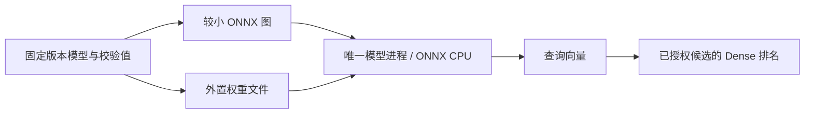
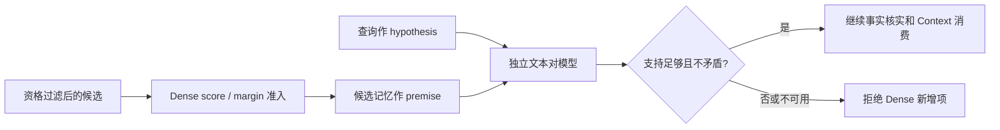

# 本地 Embedding：加载优化、模型验证与文件完整性

2026-10-28，macOS ARM64 / Node24.20.0。接续[成本与准入实验](./embedding-refinement.md)。本轮把 embedding 的活跃内存和平台运行文件降到提前设定的预算内；验证了文本对模型能进一步拦截否定/条件冲突，同时保留其质量与资源代价。**Embedding 加载成本改善已经得到实测；轻量且可靠的完整语义检索仍未达到默认启用条件。**

新增 staged Core 文本对验证和本地模型文件完整性模块，均可独立测试。模型权重、派生 ONNX 文件、运行库缓存和试验脚本仍在仓库外；当前默认 MemoryService、生产依赖、schema、原标注、Adapter 和权限不变，`retrieval.semantic=false`。

## 1. Embedding：保持权重，优化加载



原始 MiniLM q8 权重按 ONNX 标准外置数据格式重新封装：图引用权重文件、offset 和 length，大权重使用 64KiB 对齐，形状/axis 等小常量保留在图内，避免模型加载器的 shape inference 错误。没有修改张量值、重训或改检索标注。原始和外置文件的每个权重 hash 分别记录。

109 条虚构/Unicode 文本中，分词 ID 一致，向量最大坐标差 `1.49e-7`、最低 cosine 约 `0.999999565`。这是固定文本的数值兼容证据，不是任意输入的数学等价证明；特殊控制 token 继续明确拒绝。

推理运行缓存只保留本机平台实际需要的文件，已实测加载和推理。ONNX 原 npm 包及上一轮安装未修改；任务缓存中移除了一个未被绑定库引用的重复 dylib，单独验证后继续使用。当前只有实验性的按平台准备缓存，没有公开安装命令或跨平台安装验收。

### 三轮同机配对

两臂保留同款权重、分词/池化、CPU 两线程、相同短查询；每臂新进程，预热 5 次后测 50 次，顺序 Before→After、After→Before、Before→After。OS 缓存未清空。

| 指标 | 上一轮 inline 窄组合 | 本轮外置权重组合 |
| --- | --- | --- |
| 三轮驻留 RSS（MiB） | 433.02 / 433.16 / 433.52 | 195.72 / 195.95 / 195.86 |
| 三轮 RSS 中位数（MiB） | 433.16 | 195.86 |
| 短请求 P95（ms） | 2.234 / 2.202 / 2.205 | 2.423 / 2.394 / 2.221 |
| P95 中位数（ms） | 2.205 | 2.394 |
| 运行文件 + 一款模型 | 416.84 MiB | 174.97 MiB |

驻留成本下降，不宣称提速。文件按逻辑字节计，不是 npm 下载压缩大小；RSS 不等于独占物理内存。原前置预算为文件≤500MiB、驻留中位数≤350MiB、观测 maxRSS≤512MiB、就绪中位数≤1000ms、短请求热P95中位数≤25ms；本轮 embedding 路径在本机通过。首次下载、模型校验、冷加载与数据库读取不在热请求成本里，不能放进 200ms Hook 并承诺一定完成。

另试“按 input-id 读词向量行”时保留了全部张量，数值检查通过，但内存并未显著改善，因此没有作为本轮选定路径。已有外置权重足以改善 embedding 加载。探索失败与更慢结果原样保留。

## 2. 候选验证：相似度与文本关系分开



`src/core/retrieval/dense/pair-verification.ts` 只验证前序准入的一个已授权候选，不能补候选或扩大权限。回执绑定 memory ID、查询内容指纹、记忆内容指纹、验证模型指纹和策略指纹；输入是有限且归一化的 entailment/neutral/contradiction 概率。未获得模型证据时明确 `verification_unavailable`，不把失败当作通过。

模型不是 embedding，也不生成回答。NLI 有方向性，使用“记忆作依据、查询作待判断内容”；反向结果仅作可选诊断，不倒置 premise/hypothesis。支持分数不足或矛盾分数达到门槛时拒绝。它仍是有误差的文本关系模型，不提供事实真伪、来源认证或提示注入防护保证；自然问句也不完全符合 NLI 陈述式任务的原始定义。

### 不同模型的结果分开

Dense 分数/差距沿用上一轮校准策略，模型封装变化重新绑定指纹；NLI 在观察新池结果前固定 `maxContradiction=0.5`、`minEntailment=0.5`，未按新失败回调阈值。

旧 18 题验收作为已暴露回归，新建并冻结 24 题池：12 正例、12 无证据/否定/条件/引用负例。另保留原校准18题。全部是作者生成的虚构数据，不称独立盲测。三轮固定模型重载共 180 次观察，各组分母不合并成总分。

| 分项 | Dense 准入 | 小型多语言 NLI | 较强多语言 NLI |
| --- | --- | --- | --- |
| 旧验收正例 | 5/11 | 4/11 | 5/11 |
| 旧验收负例误选 | 2/7 | 0/7 | 0/7 |
| 新池正例 | 4/12 | 4/12 | 4/12 |
| 新池负例误选 | 5/12 | **4/12** | 0/12 |

小模型不能可靠识别条件反转、“真实资料 vs 虚构样例”和引用反例，质量门禁失败。较强模型保留 Dense 找到的正例，并在本轮新池拒绝全部错误新增项，三轮选中集合与拒绝原因一致；仍有 8/12 正例未被召回，不能声称完整语义召回成熟。前序被拒绝的候选未交给 NLI，不用验证模型掩盖 Dense miss。

小模型为 [multilingual MiniLMv2-L6 NLI](https://huggingface.co/MoritzLaurer/multilingual-MiniLMv2-L6-mnli-xnli) 的固定 ONNX 转换版本，较强模型为 [mDeBERTa-v3-base NLI](https://huggingface.co/MoritzLaurer/mDeBERTa-v3-base-mnli-xnli) 的固定公开 q8 文件。源文件 size/hash、模型 revision、标签与分词配置分别核验。直接推理与原 ONNX 路径的固定 28 对测试概率差为 0；这证明推理装配一致，不证明模型准确率为 100%。公开模型许可与派生文件重分发仍需发布审查。

### 质量通过不等于适合个人版默认

| 组合 | 平台运行文件 + 模型 | 活跃 RSS 观察 | 判断 |
| --- | --- | --- | --- |
| Embedding 单模型 | 174.97 MiB | 配对中位数 195.86 MiB | 本机资源预算通过 |
| Embedding + 小 NLI | 279.00 MiB | 约 336MiB | 小 NLI 新负例失败 |
| Embedding + 较强 NLI | 502.12 MiB | 三轮约 640.38 / 640.86 / 640.84MiB | 超过组合≤350MiB、文件≤500MiB预算 |

较强模型的进一步线性量化让文件变小，但运行内存上升到约 737MiB；关闭 prepacking/改变图优化也未满足目标。结果未删，不采用这些组合。不能为通过资源门禁提高预算，或只报告单模型内存而隐藏同时驻留的另一模型。

## 3. 文件准备：加载之前做完整性检查

`src/core/runtime/model-artifacts.ts` 新增显式目录与固定清单的验证：

- 绑定模型与清单指纹；拒绝空清单、重复条目、越界总量、非法大小/hash、绝对路径和 `..` 等路径穿越。
- 拒绝缺失/长度错误/被篡改文件和文件 symlink，拒绝 parent symlink 指向缓存外部。
- 通过打开的文件句柄以 64KiB 缓冲计算 hash，并重新检查大小；不把模型文件全量读入 JS 内存。
- 外部错误只返回脱敏原因，不带模型解析输出、路径或文件内容。

实际 embedding、小 NLI、强 NLI 的 3 组图/权重文件校验通过；同长度篡改反例拒绝。它提供文件完整性，不认证发布者；验证之后到原生模型再次按路径打开之间的竞态仍需安装目录所有权/锁或句柄交接设计，不能由此声称全面安全认证。完整下载/升级状态机仍未实现。

## 测试与未完成项

两个新模块独立测试：

```bash
npm run test:core -- --module=retrieval --route=dense-pair-verification
npm run test:core -- --module=runtime --route=model-artifacts
```

默认检索不使用本轮两个模块；旧字段、游标、授权、schema 与 npm 依赖保持。`npm run typecheck`、`npm run check:architecture`、`npm test`、`npm run eval:suite`、`npm run eval:quality`、`npm run benchmark:lite -- --memories=10000 --iterations=100` 及两条分线路命令成功。完整测试 664 通过、59 条件跳过；文本对线路11/11、模型文件线路12/12分别有报告。原 quality 的 Required/Challenge 仍保持原口径，未重新启动真实 PostgreSQL 或实际 Agent smoke；模型试验不替代原质量评测。

本轮外置模型也经现有 LocalModelOwner 做真实 idle 退出/后续重载验证：四个并发调用只加载一次，闲置与最终关闭确认进程退出。Windows/Linux/Node22、真实 Hook、自动安装命令、跨 MCP 守护进程恢复、向量版本/删除/恢复同步仍未验证。

当前可以继续产品化的基础是低成本 embedding 加载、已有 owner 生命周期、绑定回执的文本对验证和流式文件校验。默认开启仍被“轻量模型的误判 / 较强模型的成本”阻挡，需要继续独立验收；较强模型的本轮 0/12 负例不是任意真实查询的保证。
