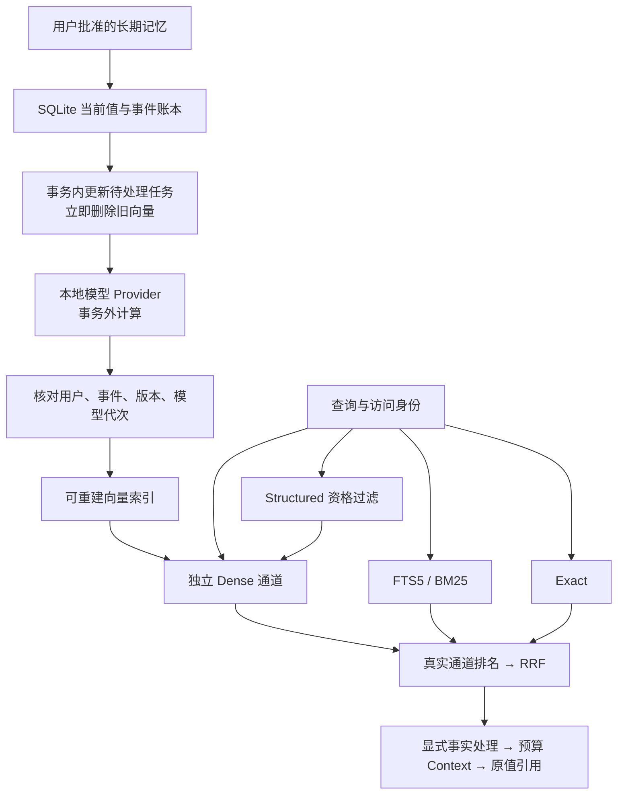
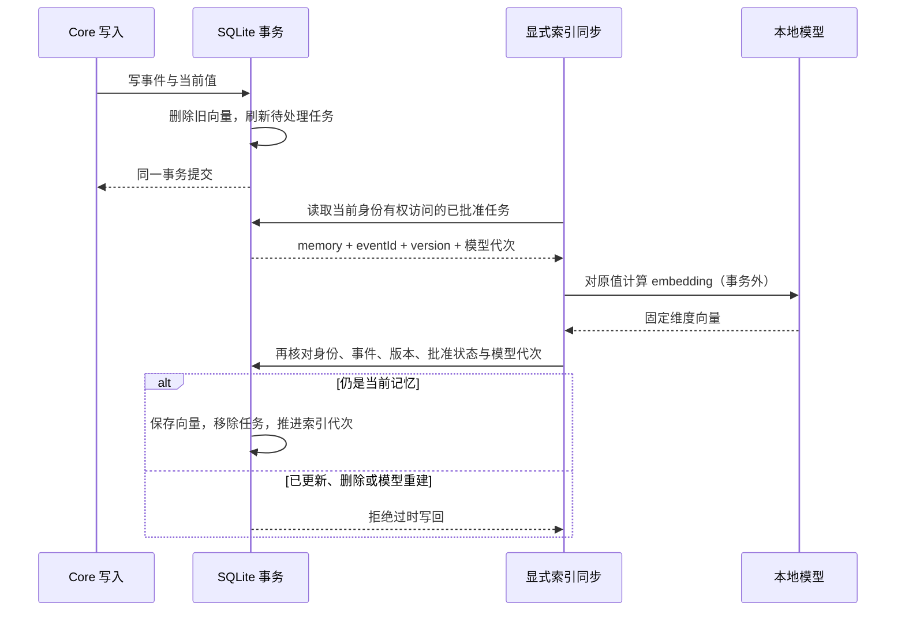
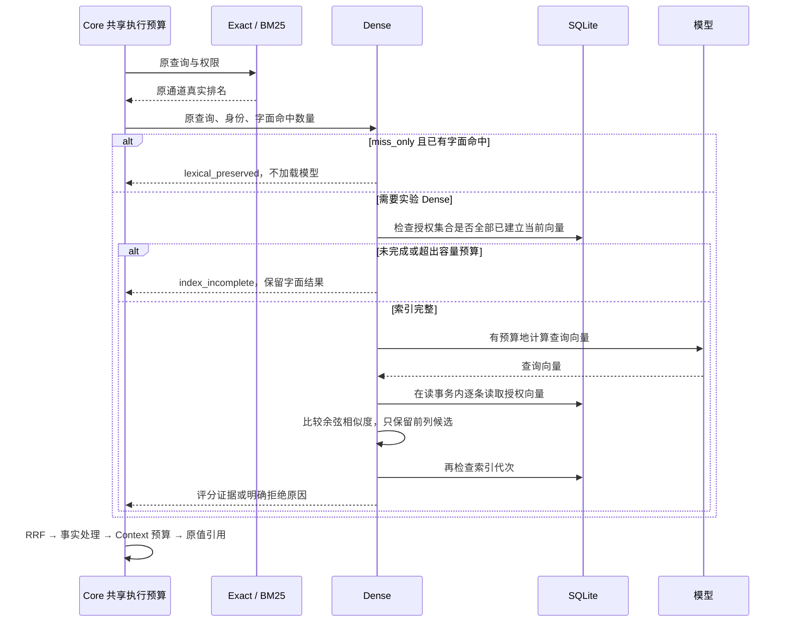

# Embedding 实验接入：Core 与 SQLite

已把真实本地模型接到 SQLite → Dense → Recall / Context / Query。入口是显式 Core 构造策略，默认安装与 MCP/HTTP/Hook 仍使用原来的 Exact、Structured、FTS5/BM25。模型无需 Docker 或常驻第三方模型服务；本轮使用预先校验的本地缓存，尚未交付面向用户的一键模型安装。

## 模块与数据流



Structured 不贡献查询相关性。Dense 使用真实余弦相似度，保留模型指纹、通道排名和选择原因；模型分数不表示事实真伪或用户授权。

| 模块 | 实现 | 职责 |
| --- | --- | --- |
| 模型接口 | `retrieval/dense/index-contracts.ts` | 显式本地 loader；模型、维度和文本版本固定；会话负责释放资源 |
| 模型生命周期 | `runtime/model-owner.ts` | 共用加载；最多 4 个未结束模型调用；超时仍占模型槽；闲置 60 秒关闭；服务关闭等待底层完成 |
| 派生索引 | `storage/sqlite/dense-index.ts` | 可选表/触发器、授权过滤、版本 CAS、代次、完整性与流式读取 |
| 独立召回 | `retrieval/dense/retriever.ts` | 查询 embedding、完整授权集合比较、有界前 100 名、准入及故障回退 |
| 组合与解释 | `retrieval/pipeline.ts`、`dense/validate-evidence.ts` | 真排名融合、证据校验、实验游标绑定；原 Context/Query 消费契约延续 |

## 写入与索引一致性



向量只编码原值：字符串直接使用，结构值使用 JSON。不生成人工同义词，不把原始对话放入索引。重复写入与重复任务不产生重复向量；更新、撤销批准、删除会使旧向量立即失效。来源由 `sourceEventId + version` 绑定。

可选表是 `memory_dense_config`、`memory_dense_jobs`、`memory_dense_vectors`，不改变权威账本的 schema 版本。只在 `enableDenseIndex()` 时安装。模型切换必须显式 `reset:true`；同模型重建也更换 epoch，旧连接失效。重开服务可继续未完成任务；JSON 导出不携带派生向量，导入后可重新计算。停用召回不会自动移除已安装的派生表和触发器。

## 查询、准入和回退



- `miss_only` 是实验的保守模式：保留合格 Exact/BM25 命中；无字面命中时，要求至少两个候选，最高相似度 ≥ 0.62、领先第二名 ≥ 0.14，最多补一个。以上阈值沿用前期冻结策略，没有根据本次结果调整。
- `hybrid` 是显式消融模式：相似度达到阈值的 Dense 候选独立进入 RRF。当前质量门禁失败，不能作为推荐默认策略。
- SQL 先过滤 `userId`、Agent/Task scope、private 和批准状态，再比较排名。Dense 永远只索引/返回已批准记忆；`includePrivate:true` 仍需满足用户与 scope 边界。
- 索引覆盖检查不把部分索引当完整集合。扫描上限默认 10k、可显式限制，硬上限 20k；超出预算返回明确 fallback。原值过长或特殊控制 token 不被静默截断；模型拒绝时保留任务并回退。
- 默认模型调用预算 1000ms，并服从 Core 请求的剩余预算。局部模型失败保留字面结果；整个请求耗尽预算时沿用原来的超时行为。超时不表示底层推理已被强制取消。
- 读取索引使用事务快照；查询模型计算前后及返回候选时核对代次。整个异步 Recall/Context/Query 不是跨模块单一数据库事务。
- 可选 verifier 只能否决候选。本轮没有把较重 NLI 设为默认依赖，也没有声称解决否定、引用或意图一致性。

## 如何显式接入

```ts
const index = sqliteStore.enableDenseIndex(provider.model);
const dense = new DenseRetriever(index, provider, {
  admission: {
    version: "dense-admission-v1",
    modelFingerprint: provider.model.fingerprint,
    minScore: 0.62, minMargin: 0.14, minimumCandidates: 2,
  },
});
const service = new MemoryService(sqliteStore, { experimentalDense: dense });
await service.synchronizeDenseIndex({ userId, agentId });
const result = await service.recall({ userId, agentId, query });
await service.closeGracefully();
```

Provider 的 `load()` 返回带固定 `model`、`embed(texts, mode)`、`close()` 的本地会话。加载器必须验证实际文件和运行配置，不能只自报一个指纹。Core 接口支持不同本地实现，当前真实证据仅来自固定多语言 MiniLM q8、384 维、CPU 模型；没有默认 inference npm 依赖。

`synchronizeDenseIndex` 是 Core 实验入口，单批最多 100 个任务，`remaining` 是本批预算内观察到的剩余任务数，不是全库总数；失败保留任务、停止继续派发。没有新增公共 MCP 工具、HTTP/CLI 参数，也没有触碰 Adapter 或真实数据库。

回执新增可选 `dense`、`cosine_similarity` 和 `retrieval_dense`。只有显式装配的服务声明 `semantic=true` 与 `experimentalDense.status=experimental`；这表示配置能力，不能代替模型健康检查。Dense 覆盖不表示语义问答就绪，coverage 使用 `candidate_query_matches_not_answerability`。默认服务的能力与游标指纹保持原样。

实验游标额外绑定模型、策略、epoch 和全局索引代次。任意记忆更新、索引写回、模型重建后，需要从第一页重新查询；默认游标不能混用。全局代次是保守设计，其他身份的写入也可能使实验游标失效。

## 本轮结果与限制

测试与分项数据见 [实验接入验收](./embedding-integration-validation.md)。真实模型跑通不等于默认接入质量通过：保守模式补回语义正例，也引入否定误召回；10k 仍是线性扫描。模型安装恢复、跨平台原生运行、独立盲测、意图判定、向量索引加速和默认开启策略留给后续迭代。
