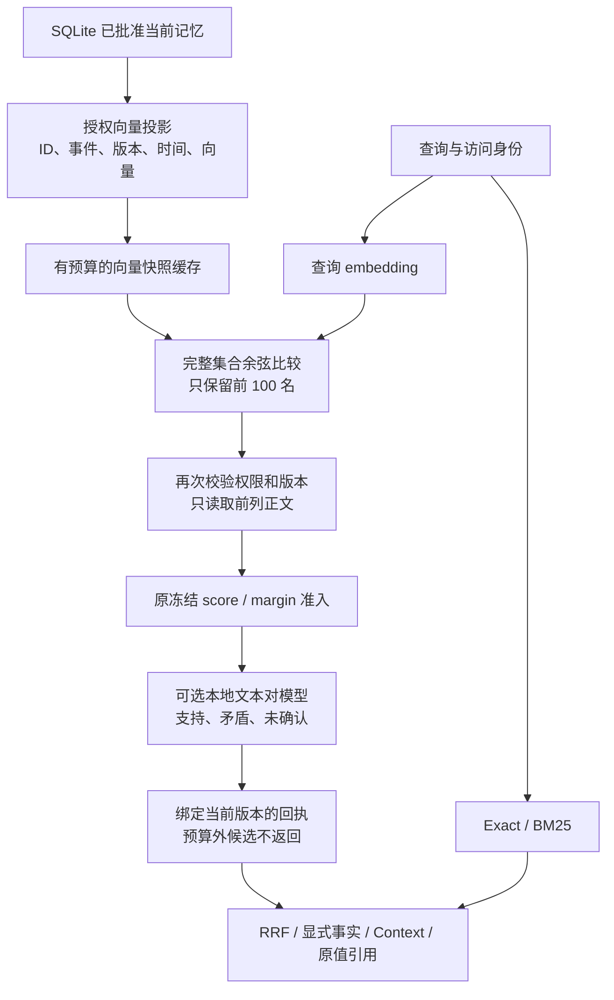
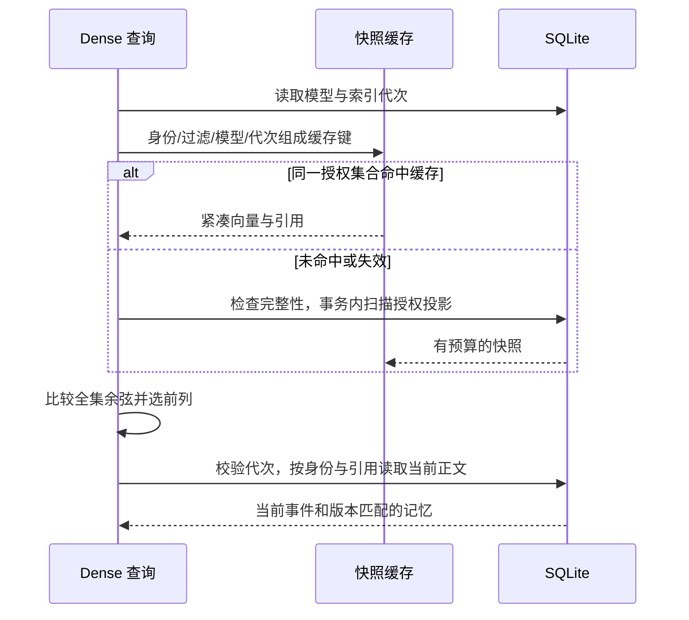
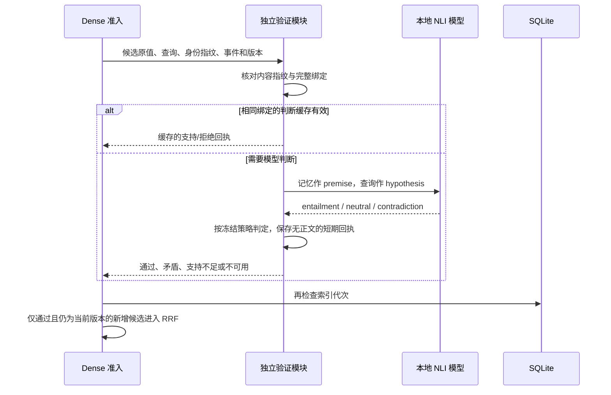

# Dense 增量：向量投影缓存与独立模型验证

后续[双向补召回](./dense-rescue.md)是独立可选增量；本页描述的 `score_gate` 默认仍保持单向验证与原阈值，不能把两种策略的预算或成绩混在一起。

接续 [实际接入](./embedding-integration.md)。本轮交付两个独立模块：降低重复召回的数据库/解析成本；为新增 Dense 候选提供绑定版本的模型验证。默认服务仍不加载模型，不增加安装依赖，不修改 Adapter。



## 向量线路：减少重复解析

| 部分 | 实现 | 职责 |
| --- | --- | --- |
| 投影与正文读取 | `storage/sqlite/dense-index.ts` | SQL 先过滤身份/scope/private/批准状态，只扫描向量与排名字段；前列正文再校验同一代次、事件和版本 |
| 排名 | `retrieval/dense/ranker.ts` | 对完整授权集合计算真实余弦；保留最多 100 个候选；未提供投影接口的自定义 Index 保留流式兼容路径 |
| 缓存 | `retrieval/dense/snapshot-cache.ts` | 保存 Float32 向量、平方范数与引用，不缓存正文或查询；按身份、过滤条件、模型及代次隔离 |

默认缓存预算 24MiB、最多 2 个快照、TTL 60 秒；预算统计包括向量/范数字节和保守的引用开销估计，不是 RSS 保证。超出预算或 `maxBytes:0` 继续使用投影流式扫描。20k 的比较硬上限不变，未完成索引仍拒绝。



更新、删除、撤销批准、模型重建会改变代次，下一次查询先拒绝旧快照；向量表的增删改也由触发器推进代次，另一连接直接修改或损坏向量不会绕过缓存失效。TTL、LRU 淘汰和关闭会清零缓存向量/范数。全局代次仍是保守设计，其他身份写入也会使快照失效；整条异步 Query 不是单一事务。

缓存保持同一余弦公式和稳定 tie-break，**仍是精确线性比较，没有 ANN、近似采样或降低过滤标准**。质量对照与不同向量的契约测试分别确认 Legacy、冷投影和热缓存的选择/评分一致。

## 验证线路：相似与支持分开

| 部分 | 实现 | 职责 |
| --- | --- | --- |
| 窄接口 | `dense/verification/contracts.ts` | 本地模型会话、绑定输入/回执；旧 `pair-contracts.ts` 保留类型 re-export |
| 模型与判断缓存 | `dense/local-pair-verifier.ts` | 惰性共用加载、有限未结束任务、超时保留容量、关闭 drain；缓存模型判断，不缓存正文/查询 |
| 回执校验 | `dense/validate-verification.ts` | 校验模型、策略、身份指纹、记忆 ID、事件、版本、查询/正文指纹和概率判定 |
| 服务组合 | `dense/retriever.ts` | 只验证已授权、已准入的新 Dense 候选；通过后携带回执进入原管道 |



原冻结门槛不变：Dense score ≥ 0.62、margin ≥ 0.14、至少两个比较候选（保守模式）；NLI contradiction < 0.5、entailment ≥ 0.5。默认每次最多验证 1 个候选，显式可设 1–4；预算外候选不被算作“模型拒绝”，回执单独记录 `notVerified`。

验证调用默认 1000ms，遵守整个查询剩余预算；最多 2 个未结束模型任务、闲置 60 秒释放。判断缓存最多 128 条、TTL 60 秒，键同时绑定记忆 ID、事件、版本、访问身份、查询/正文指纹及策略。错误/不可用不进入判断缓存，不能冒充通过。关闭时等待底层推理结束，并阻止迟到结果重新写入缓存。

可选 `pairVerifier` 是本轮的结构化模型路径；旧布尔 `verify` 回调只保留实验兼容，二者不能同时使用。新增回执进入 `ScoredSearchHit.verification` 和 `MemoryRetrieval.evidence`，Recall、Context、Query 可看到具体模型、判断与来源版本；根回执分别显示排名缓存和验证预算。模型/策略/预算变化使实验游标重新开始，默认游标不变。

这只是**候选支持判断**：不修改记忆、不替用户批准、不提高事实权威，不是 semantic reranker、真伪认证或通用 Prompt 注入防护。自然问句与 NLI 陈述式训练任务存在差异，有关的证据也可能被误拒绝；不能把模型蕴含分数当作通用问答相关性。

## 显式实验配置

```ts
const verifier = new LocalDensePairVerifier(pairProvider, {
  version: "dense-pair-v1",
  modelFingerprint: pairProvider.modelFingerprint,
  maxContradiction: 0.5, minEntailment: 0.5,
});
const dense = new DenseRetriever(index, embeddingProvider, {
  admission: frozenDensePolicy,
  snapshotCache: { maxBytes: 24 * 1024 * 1024, ttlMs: 60_000 },
  pairVerifier: verifier,
  maxVerificationCandidates: 1,
});
```

加载器必须校验实际模型文件和运行指纹。本轮使用此前已校验的本地模型缓存；未新增生产 inference 依赖、模型下载器或 Agent 配置。预热是显式开发/验收入口，不能把预热后的数字称为冷请求成本。

当前较强验证模型能降低测试中的错误新增项，但本身约 474–480MiB，且新池出现正例损失；默认开启条件仍不满足。分项数字、复现与剩余挑战见 [本轮验收](./embedding-optimization-validation.md)。
