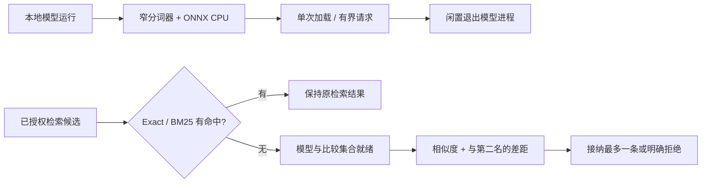
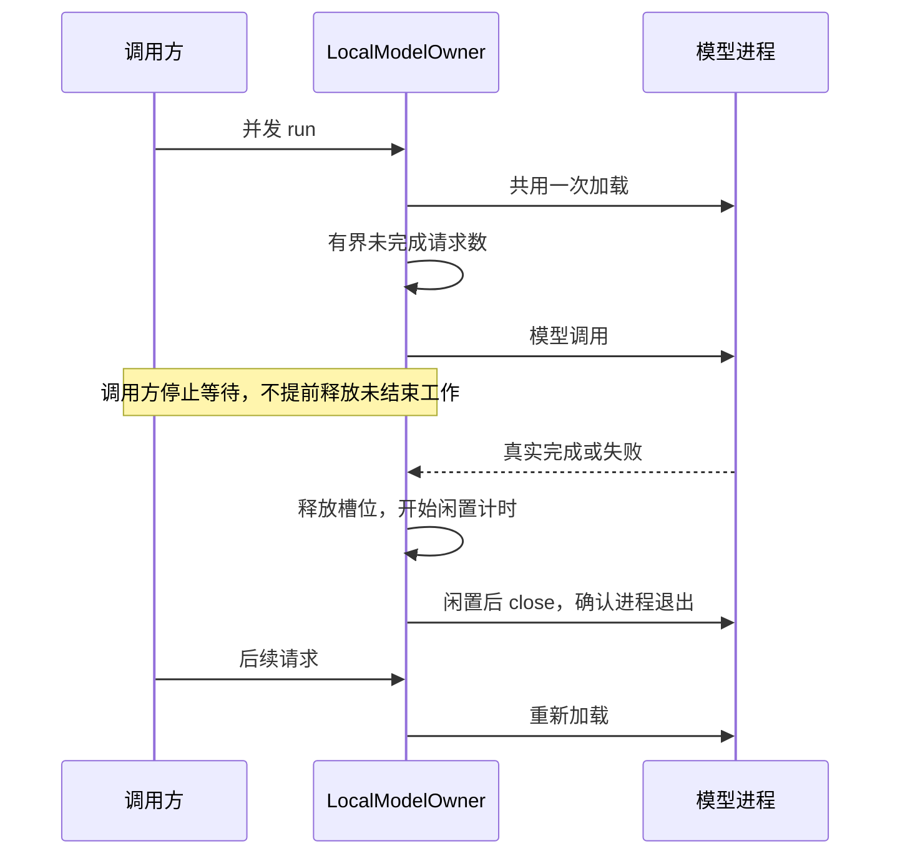

# 个人版 Embedding：成本优化与相关性准入

后续[加载与文本对验证](./embedding-hardening.md)进一步降低 embedding 成本，并分别记录不同验证模型的准确性/资源代价。本文仍保留当轮 433MiB 与否定误召回结果。

2026-10-28，本机 macOS ARM64 / Node 24.20.0。接续[可行性实验](./embedding-feasibility.md)，本轮分别优化运行成本和 Dense 准入。**安装文件与内存减少；旧 Required 保持；新验收的否定误召回和提前设定的内存预算仍未通过，所以不默认启用。**

生产没有新增模型依赖、Dense 通道或向量 schema。新增两个独立的 staged Core 模块，可以单独测试；具体模型推理仍在仓库外原型运行。没有修改旧标注、权限、Adapter、Capture、Injection 或 Agent 配置，没有 commit/push。

## 做了哪两件事



权限和确认先决定允许参与排名的记录；相似度不能提高权限，也不能证明事实正确。图中的 Dense 分支只在独立实验中装配，当前 MemoryService 仍使用原通道。

## 1. 模型成本：减少通用依赖，按需释放进程

保留同一款多语言 MiniLM q8 权重，换成直接 ONNX 推理和 SentencePiece 分词，移除运行链路中的通用 Transformers.js、浏览器推理和图像处理依赖。SentencePiece 读取约 4.83 MiB 的原始词表，避免构建大规模 JS 词表对象。

109 条虚构及 Unicode 文本的 token ID 与官方 tokenizer 完全一致；同批次向量与原运行组合最大坐标差约 `1.49e-7`，最低 cosine 约 `0.999999565`，通过提前固定的数值兼容检查。特殊控制 token 的处理与原分词器存在差异，因此原型明确返回 `UNSUPPORTED_SPECIAL_TOKEN`，不静默生成不同含义的向量。完整任意输入兼容仍未成立。

原模型计算图已经是先 Gather、再 Dequantize，未修改权重或计算图。关闭预打包、图优化等级和 WASM 路径只作为探索保留；正式比较使用通过数值校验的 native/all 组合。纯 WASM 推理约 980 MiB RSS，成本更高，排除该候选。

### 成本结果

| 项目 | 原通用组合 | 窄运行组合 |
| --- | --- | --- |
| 运行库 + 一款模型文件 | 591.09 MiB | 416.84 MiB |
| 三轮配对热运行 RSS 中位数 | 724.83 MiB | 433.80 MiB |
| 三轮配对短请求 P95 中位数 | 3.23ms | 2.85ms |

文件使用同一口径的逻辑字节数，包含 npm 的平台文件，不是压缩下载大小。配对顺序 Before→After、After→Before、Before→After，各用新进程，预热 5 次后测 50 次相同查询；较慢的 lean 轮次 3.51ms 保留，不由小幅延迟变化宣称稳定提速。RSS 不是独占物理内存或长期峰值。

测量之前固定了个人版实验预算：运行文件 + 模型 ≤500 MiB、三轮驻留 RSS 中位数 ≤350 MiB、观测进程 maxRSS ≤512 MiB、就绪中位数 ≤1000ms、热请求 P95 中位数 ≤25ms。独立三轮就绪约 421ms、热 P95 约 2.18ms、最大观测 RSS 约 434MiB，其它项通过，**驻留内存超过 350MiB，因此资源总门禁失败**。没有事后提高预算。

### 闲置回收的代码

`src/core/runtime/model-owner.ts` 提供 `LocalModelOwner`，通过 `LocalModelSession` 窄接口接收模型加载、调用和资源关闭；Core 不依赖 ONNX 包。



加载失败释放槽位，可重试；关闭失败保留 ownership 并 fail closed，避免再启动一份模型。主动关闭先 drain 当前工作；并不保证底层 ONNX 硬取消或有界 drain。模块尚未装配到默认 MemoryService/真实 MCP 生命周期。

真实模型试验中，四个并发请求只加载一次，闲置后确认进程退出；后续请求启动新模型进程并返回相同向量，最终关闭也确认退出。100ms 是测试间隔，不是产品默认值。这个机制减少闲置驻留，不能把仍存在的活跃内存预算失败改成通过。

## 2. Dense 准入：不把最近邻自动当作相关证据

`src/core/retrieval/dense/admission.ts` 是纯决策模块；不读数据库、不调用模型，也不做词典/同义词规则。输入必须已经过身份、scope、private 和确认过滤，来自同一模型空间；比较不完整时拒绝。

规则按次序执行：

1. 原 Exact/BM25 有资格命中时保持原结果，防止 Dense 绕过事实拒绝、Context 预算或扩大无关候选。
2. 模型未就绪、无候选、只有一个候选或比较被截断时明确拒绝。
3. 第一名 cosine 必须达到阈值，且与第二名差距足够大；最多接纳一条。

回执包括 `reason`、第一/第二名分数、差距、模型指纹和策略指纹。混用模型、重复 ID、非有限分数及非法参数拒绝；分数没有“真实”“权威”含义。候选数量/完整性是该 staged 契约的前提，不能用任意抽取的小集合冒充全局第二名。

### 阈值与验收分开

新建两个不同噪声池：校准 18 题、验收 18 题，每组 11 个语义/跨语言正例、7 个负例。数据在观察模型分数前冻结；作者生成的拆分仍不是独立盲测。阈值只使用校准池，在预定网格中选择“零新增误选下，正确新增最多”的策略，之后冻结，再执行验收和原 20 题；不按验收失败回调参数。

本次 native/all 组合得到 `minScore=0.62`、`minMargin=0.14`，这些是实验参数，不是通用默认值。模型指纹还绑定权重、分词/池化、运行时和执行选项；其它模型或配置需重新校准。

| 分项 | 原检索 | 准入实验 |
| --- | --- | --- |
| 校准池正例命中 | 0/11 | 5/11 |
| 校准池负例误选 | 0/7 | 0/7 |
| 独立验收池正例命中 | 0/11 | 5/11 |
| 独立验收池负例误选 | 0/7 | **2/7** |
| 原基线 Recall Required | 9/9 | 9/9 |
| 原基线 Context Required | 10/10 | 10/10 |

原基线 Recall@5/MRR@5 保持 0.6765/0.6471，Context 保持 0.5882/0.5882；原 miss/误选/旧 Challenge 不变。保守策略拒绝单候选，因而没有把旧语义单记录题硬编码通过。原 user/agent/task/private/Context 确认夹具没有越界返回；分母很小，不代表全覆盖或真实客户端安全验收。

两个失败题分别是否定“保留还原副本”与“未经批准直接持久化”。它们与正向记忆语义很近，cosine 和排名差距均可很高。**阈值与 margin 能减少无关近邻，但不能判断否定意图是否一致。** 相比前轮无阈值融合，本次保护了旧 Required、拒绝更多无证据问题；仍不满足默认开启标准。

## 工程与后续边界

Dense 准入和模型生命周期分别有独立测试线路：

```bash
npm run test:core -- --module=retrieval --route=dense-admission
npm run test:core -- --module=runtime --route=model-owner
```

两模块覆盖加载竞争、容量、调用方超时/底层未结束、idle/drain/失败关闭，以及 score/model/policy/比较完整性拒绝。真实模型的分词/向量兼容、资源和数据对照在仓库外单独报告，不用假模型测试冒充实测。

本轮 `npm run typecheck`、`npm run check:architecture`、`npm test`、`npm run eval:suite`、`npm run eval:quality`、`npm run benchmark:lite -- --memories=10000 --iterations=100` 及上述两条线路命令全部成功。完整测试 641 通过、59 条件跳过；Dense 线路 12/12、模型 owner 线路 8/8，分别输出报告。原 suite/quality 的 Required 与 Challenge 保留原口径；未重新执行原生 PostgreSQL 或真实 Agent smoke。

Lite 单轮基准 Exact/FTS/Context 的 P95 分别为 2.258/4.708/3.873ms，保留 max 与原输出；本轮没有同口径 Before，因此它是运行记录，不是默认检索提速或性能回归门禁。模型配对成本使用另一套工作负载，不能混比。

Windows/Linux/Node22、模型安装器/升级、跨 MCP 单实例崩溃恢复、向量版本/删除/恢复/索引同步均未交付。当前不新增 Docker、Ollama 或模型为个人版默认依赖，`memory_capabilities` 返回的 `retrieval.semantic` 仍为 false。下一步需要进一步控制活跃内存，并独立评估意图一致性的判断方法；不能继续依靠加大 cosine 阈值来宣称解决所有误召回。
