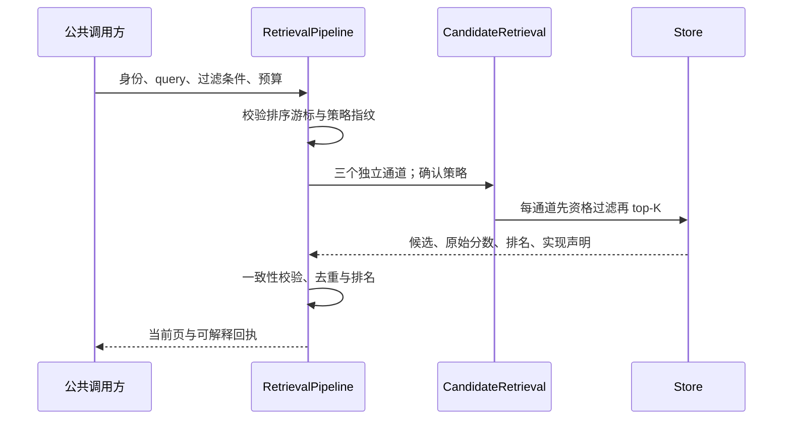
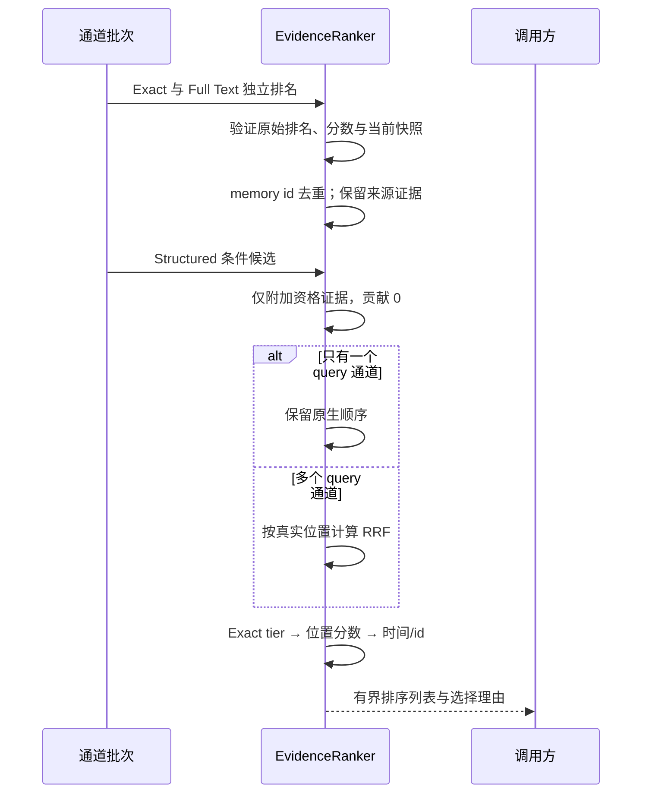

# 阶段 3 首个增量：公共排名与证据

本页记录 3A/3B 首次交付及当时的剩余工作。当前 [3C 显式事实模式](./phase-3c-fact-design.md) 已完成本地验收；未声明的语义冲突仍是 Challenge。

阶段 2 复测通过后，按用户授权继续实现。**公共接入、排名融合与回执已实现；跨 key 事实裁决仍未完成，阶段 3 不整体宣称完成。** 验证见 [本轮结果](./phase-3-validation.md)。

## 3A：接入与证据契约

四个内置 Store 的文本 Recall/Context/Query 进入 `CandidateRetrieval`，无 query 的列表/History 保留原路径。旧自定义 Store 或自定义 `MemoryRetriever` 使用原兼容路径，不产生新版排名能力声明。

| 回执 | 含义 |
| --- | --- |
| `evidence[].score` | 原始 BM25 模型/值/方向，或无分数 null；不归一化为概率 |
| `channelRank/rankMeaning` | 原通道位置及意义；Structured 位置保留，不重编相关性排名 |
| `evidence[].contribution` | 通道的 `1/(rrfK+rank)` 值；Structured 为 0 |
| 既有 `score/channels/ranks` | 保留数值兼容；score 是位置分数，不是原始 BM25 |
| `scoreModel/fusedScore` | 单通道 `rank_reciprocal/null`；多通道 `rrf/实际融合值`；Query 为 `query_sum/null` |
| `exactTier/selectionReasons` | 精确 key 优先、单通道原生顺序、融合、结构资格、当前快照等理由 |
| `channelResults/truncated` | 独立通道执行/跳过、实现、数量与截断；不声称全库 total |

Query 保留每个 signal 的 query/stepId，跨子查询累积的位置分数与单次通道 RRF 明确区分。Context item 携带同一 evidence 元数据；渲染给模型的 JSON 行格式仍按原预算策略。

## 3B：确定性排名

代码：[融合](../../src/core/evidence-ranking.ts)、[管道](../../src/core/retrieval.ts)。

1. Exact/Full Text 形成 query 候选，按 memory id 去重。同一通道重复项只计第一次；跨通道保留各自证据。
2. Structured 只给已匹配的候选附加资格证据，贡献为 0。没有 query 命中时不能把同 kind/scope 的任意记录补成答案。
3. 一个 query 通道直接保留其原生顺序。两个 query 通道才按实际 `channelRank` 使用 RRF；原始不同模型分数不直接相加。
4. Exact tier 优先于文本候选；tier 内按位置分数降序，最后 updatedAt/id 稳定破平。没有 confidence/freshness boost。
5. 每个 id 的当前快照必须一致。版本/事件/内容不一致报脱敏 STORAGE_ERROR；Query 跨子查询混合版本也拒绝，避免拼出一条不存在的记忆。

`candidateLimit` 1–100，默认 Lite 50、Team 100；默认 `rrfK=60`，必须有限且至少 1。`exactPrecedence=false`、`fusion=best_rank` 是显式消融选项。Structured boost 上限为 **0**。公共输入进入候选路径后同样受 2048 个 JS 字符、32 个空白项、NUL 限制。

查询 cursor v2 编码 exactTier、score、updatedAt/id；指纹包含版本 `core-ranking-v2`、身份/过滤、启用通道、候选预算、RRF 参数、融合、Exact 和确认策略。允许改 page size；旧版、跨条件/策略游标需从第一页重启。整个分页集合限于各通道 top-K；truncated 表示更远的候选未包含。稳定分页不提供并发 snapshot。

确认-required Context/Query 把策略传给原生存储，在 top-K 前过滤；普通 Recall 与普通 Context 的默认确认策略不变。旧自定义 Store 保留消费者末端过滤兼容行为，不能宣称已实现原生确认-before-budget。

## 3C：当前事实与剩余工作

本节保留首个增量时的状态。后续显式事实实现与新的验收看 [3C 设计](./phase-3c-fact-design.md)：可验证声明的字面冲突/替代可处理；没有声明的语义冲突仍为 challenge。3C 的政策/预算也加入查询指纹，旧 text-query cursor 重启。

已验证同 key 替换的 current version、supersedes 和不同 scope 的独立身份；不复活被遗忘内容、不合并相同文本的不同 id。混合快照拒绝是工程一致性，不能替代语义事实判断。

不同 key 的 stale/current 冲突仍为 Challenge，当前事实选择仍 6/9。下一增量需要独立设计事实组、显式有效期/替代关系、冲突与不确定性回执，并在固定标注和新增专项上验证。不能仅凭更新日期裁决。Context 的用途/确认/范围权重仍可能改变 Recall 顺序，消费者证据选择归阶段 4；当前不是完整 Answer 管道。

SQLite BM25 使用全表统计；Core 依赖可信入口身份，workspace 在 Adapter/Injection 边界。原生 PG 工程验证、pg-mem 质量和部署成熟度分别说明；未引入 embedding、模型或新 Adapter。
