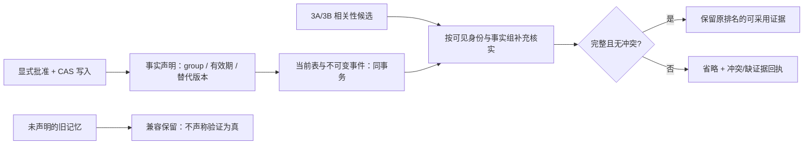
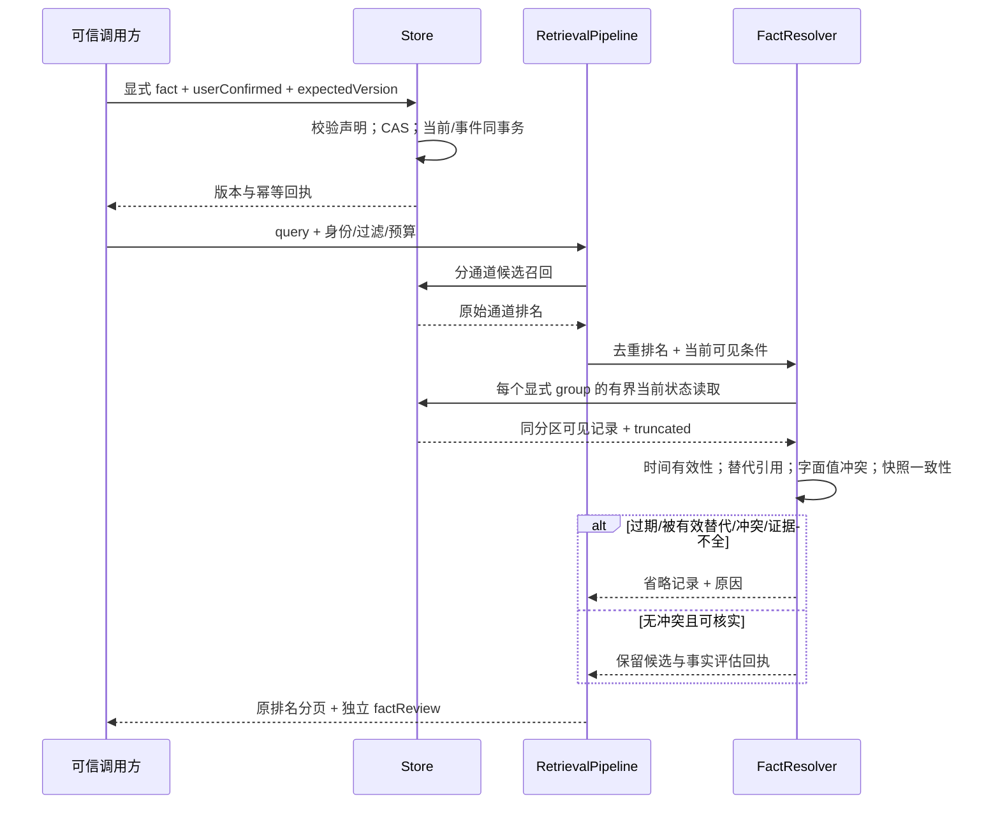

# 3C：显式事实有效性与保守裁决

状态：显式声明模式已实现并完成本地验收，结果见 [3C 验收](./phase-3c-validation.md)。不是语义真伪判断，也不是完整 Answer 管道。

## 一张图看职责

## 声明与边界

- `fact` 是可选的一等字段，不从任意 metadata、文本相似度或时间猜测。`group` 是调用方声明的精确标识，包含业务实体、属性、适用条件；条件不同必须用不同 group。
- group 的实际分区包含 user、scope、task/ownerAgent、kind；相同 group 不跨分区归并。private 与确认继续约束补充核实；query/key 约束最终候选而非组证据，避免按 key 查询藏掉同组冲突。补充记录不新增为答案。
- `validFrom` 包含起点，`validUntil` 不包含终点；都是带时区的 ISO 时间。未给时间表示未声明该端点，不以 updatedAt 代替有效期。
- `supersedes` 指向另一条记忆的 memoryId、sourceEventId、version。它是显式声明，**不是修改目标的跨记录事务**；读取时必须核实可见的确切目标版本，未核实不能作为裁决依据。
- 新增/修改/移除 fact 都需要 userConfirmed 与 expectedVersion；CAS 只保护本记录，事件记录声明变化。旧数据不自动回填。分数与 confidence 均不能充当事实真实性概率。
- JSON Store 与显式 SQLite transfer 共用 ledger codec：旧无声明 ledger 保持兼容；含声明的 v2/Package 1.1 明确拒绝降级。引用目标版本变更后需要显式更新声明，不以历史版本冒充当前替代依据。
- 旧自定义 Store 无事实组契约时，写入前拒绝新 fact，并由能力发现明确返回不支持；支持者的 event/current 回执也要保留声明，否则返回存储契约错误，不静默成功。配置能力不等于连接/迁移就绪。

## 数据怎样流转

## 裁决规则与非目标

1. 补充读取只核实，不把不匹配 query 的兄弟记录新增为相关候选。替代者未命中时允许无答案，不伪造召回成功。
2. group 超预算、目标不可见/不存在/版本改变、循环替代都产生不确定性；不能用截断集合中的第一条当权威结论。补充查询失败是存储错误，不伪装为空组。
3. 只有在有效期内的显式声明能产生替代作用；未来生效的记录不会提前淘汰现在的事实。多个未被替代的不同 JSON 值构成保守字面冲突，不凭“更新”或“高分”选赢家。
4. 相同 JSON 值只标记可见一致性，不合并 id、不推断来源独立性。单一有效声明也仅代表可见声明，不代表客观真相。
5. 未声明的旧记忆保持原公共结果；原跨 key stale/current challenge 不改标注、不补写 fact 来制造改善。新声明专项另测收益与误拒绝。
6. 查询游标绑定事实政策版本与预算；读取仍是 live/current，不是并发或时间快照。Context 的目的权重、压缩和 Answer 留给阶段 4。

## 独立验收

工程：四存储的持久化、幂等、CAS、事件导入导出、权限、组预算、迁移/回滚和错误传播。质量：原固定基线保持；新专项独立报告有效事实选择、冲突拒答、缺证据拒答、错误省略。安全、稳定性、性能单独查看；原生 PG 工程不替代 PG 质量或部署成熟度。
