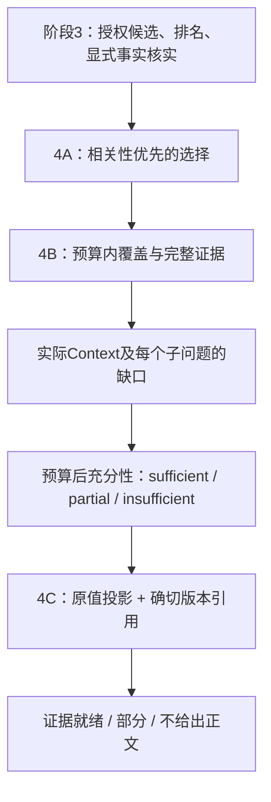

# 阶段4：上下文与可引用证据答复

**目标：让真正送入上下文的证据，与覆盖判断、答复内容和引用一致。** 本阶段实现的是确定性、原值投影的证据答复，不是模型语义问答或完整成熟RAG。4A先独立验收，4B/4C沿用同一边界。

当前确定性增量已完成本地验收，独立结果见[阶段4验收](./phase-4-validation.md)，与阶段5共同交付的提交前复测见[阶段4/5复测](./phase-45-pr-validation.md)。是否合并以对应PR及远端CI记录为准；本地验收不代表飞书同步，后续能力仍需独立设计和授权。

## 总览：每层只负责一件事

| 部分 | 解决的问题 | 不负责 |
| --- | --- | --- |
| [4A](./phase-4a-context-selection.md) | Context不让额外权重盖过相关性 | 新召回、语义打分 |
| [4B](./phase-4b-budget-and-coverage.md) | 预算内证据覆盖；有召回不等于有上下文 | 全局最优压缩、语义充分性 |
| [4C](./phase-4c-evidence-answer.md) | 原值答复、版本引用、部分与拒绝采用 | 生成式总结、客观真伪、历史因果解释 |

公共入口仍是 `memory_context` / `memory_query` 及对应HTTP接口，不新增工具、不直接扫描Store回答。预算、身份、private与确认规则不放宽，Agent的审批与Hook fail-open保持原边界。`memory_recall`不受消费层策略改动。

## 一个例子

查询明确拆成“alpha”和“beta”。检索找到三条alpha、一条beta，预算只装两条：4B可选择一条alpha和一条beta，而不是都装alpha；如果beta太长装不下，明确标记beta缺口。若任何证据都装不下，Query返回`insufficient`，答复为`abstain`，正文/引用均空。每条可用记忆原值关联memoryId、sourceEventId、version和内容指纹。

“覆盖”只表示既定检索子查询有实际入选的匹配记录，不表示内容在语义上回答了问题；`evidence_ready`也只是这套契约就绪。历史审计id/版本没有投影为时间线时，答复保持partial，不伪造历史结论。

验收必须分开看工程、原公共质量、4A/4B机制、新答复契约、安全、稳定性与性能。语义改写/跨语言、held-out、来源认证、精确tokenizer和性能SLO仍未实现；引用结构正确不能代替来源可信。
