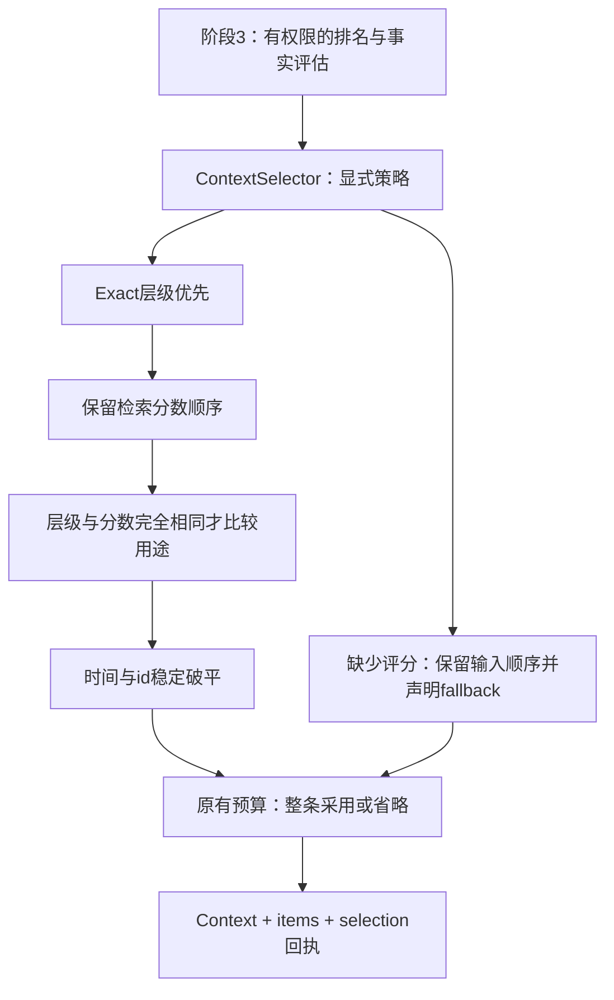
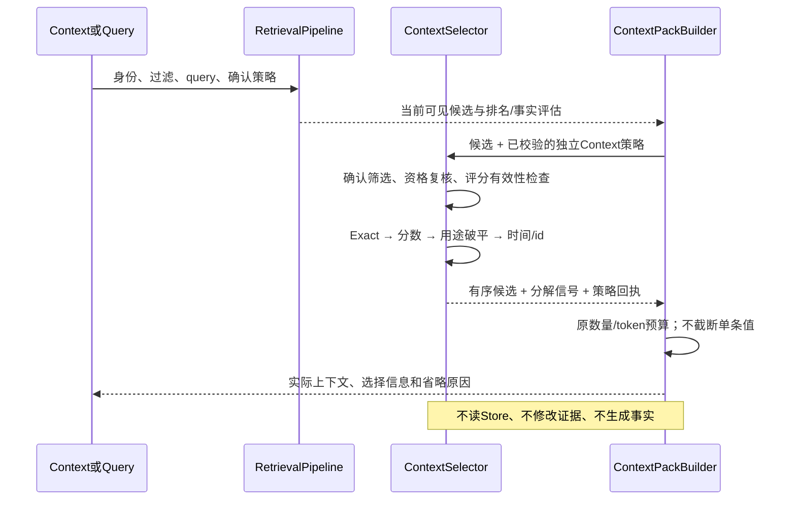

# 4A：相关性优先的上下文选择

本页保留4A首次增量的职责和当时剩余项；当前4B/4C的覆盖装包/预算后充分性/引用已在[阶段4](./phase-4-context-and-answer.md)单独实现，历史验收数字不覆盖。

阶段 4A 只回答：**已召回且可用的证据，按什么规则进入 Context？** 不新增召回器、事实推断、压缩或模型回答。[验收结果](./phase-4a-validation.md)单独记录，不将机制夹具成绩冒充公共检索质量。

## 一张图看设计

## 三种策略

| 模式 | 排序 | 用途、scope 与确认状态 |
| --- | --- | --- |
| `relevance_first`（默认） | exactTier → retrieval score → 用途 → updatedAt/id | 用途只破完全同分；scope/确认不加分 |
| `relevance_only`（消融） | exactTier → retrieval score → updatedAt/id | 用途不影响排名；scope/确认不加分 |
| `legacy_weighted`（显式兼容） | 原 `score×1000 + task/agent + 确认 + 用途` → updatedAt/id | 保留旧行为，也保留可能反转相关性/Exact层级的限制 |

用途沿用原固定表，最大 12，但默认只作为序数 tie-break，不能加到相关性分数上。两个分数即便很接近，只要不完全相同就不允许用途反转。`exactTier` 只使用上游明确提供的值，不从 `channels` 猜测；显式关闭 Exact 优先不会被 Context 偷偷打开。

资格过滤仍由 Store 在候选预算前执行。默认普通 Context 允许未确认记录，确认-required 消费者继续收紧；`includePrivate=false` 不允许 private，true 也不扩大 user/agent/task 分区。Context 额外检查已返回的 scope/private/显式字段，异常时报脱敏存储错误。`ResolvedMemory` 没有 userId，用户身份仍依赖可信入口与 Store，本阶段不声称实现入口认证或 workspace 核验。

任何一条可用输入缺少 retrieval score 时，整个批次使用稳定输入顺序，不把未知值当作 0 与已评分候选混排。已有 legacy 检索器提供的位置分数仍标为 `legacy_positional`，不声称原生相关性。NaN、Infinity、负分或非法 Exact tier 拒绝；RRF 位置分数不是概率，也不是原始 BM25。

## 数据怎样流转

代码：`src/core/context-selection.ts` 维护可校验、冻结的策略与选择；`context-pack.ts` 继续负责原渲染和预算。Query 复用相同选择器，不共享隐藏加权规则。策略在 Core 构造时配置，MCP/HTTP query 不能传入新策略来改变身份或权限。

## 回执与兼容

- 新增 `ContextPackResult.selection`：版本、实际模式、排序规则、priority模型、用途/加分边界、缺分fallback及确认筛选计数。
- `items[].selection`：原输入位置、明确Exact层级、检索分数/模型、用途偏好。确认筛掉的记录不输出id、key或正文；只输出计数。
- `priority` 仍是数字；默认改为检索位置分数，而非旧加权总分。完整顺序依赖多级比较，不能仅以 priority 重建。fallback的priority为输入位置分数；兼容模式保留旧单位。
- `reasons` 原字符串保留为证据/资格说明，不能再将 `user_confirmed` 或 `task_scope` 当作加分证明。真正的作用看 selection 与策略版本。
- JSON行格式、数量/token默认预算、查询cursor、存储schema不变。默认 Context 顺序可变，严格依赖旧排名的 Core 使用方需显式配置 `legacy_weighted`。
- HTTP/MCP能力发现使用实际服务的策略与预算，而非仅依赖profile；它不是连接、迁移或认证就绪证明。

## 如何验收与尚未做的事

原 `core-baseline-v1` 和 `quality-v1` 标注不改。`eval:context` 另测8个虚构证据矩阵，同集合比较默认、关闭用途及旧加权模式，分别输出 quality、ablation、stability、latency；每题5次只是技术重复。跨四存储及可选原生PG测试检查公共Context/Query接入与权限、确认-before-budget、预算省略，原生PG工程不替代其公共质量评测。

本阶段不消除上游所有不相关命中，不增加语义理解，不合并相同值的不同记忆，不做tokenizer精确计数，不改变事实裁决。4B继续处理证据覆盖与预算；当前Query的sufficiency仍看召回集合，可能出现“Context空但召回充分”。4C才建立答复、引用与证据不足契约；faithfulness仍未实现/未评估。
