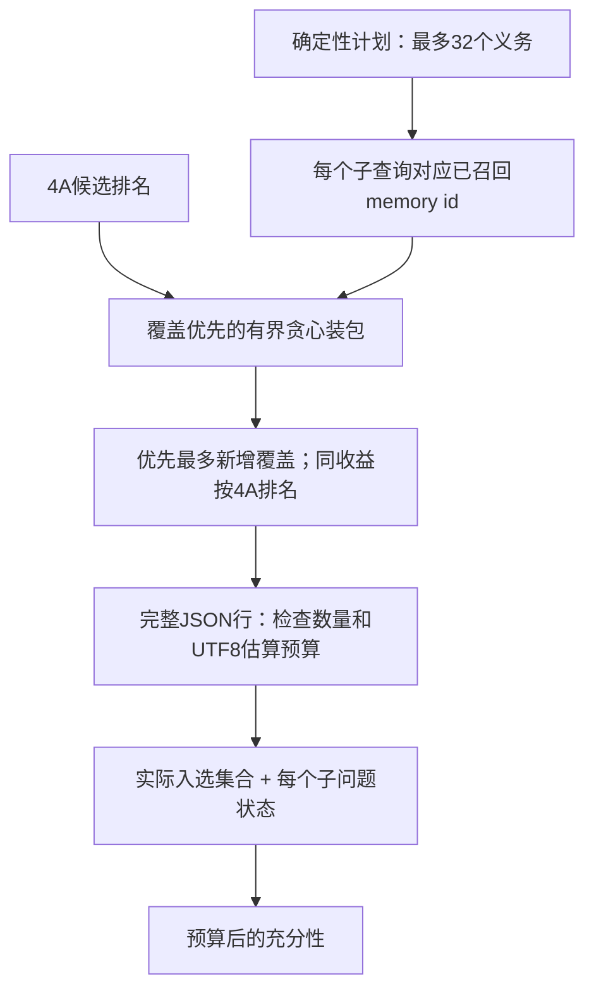
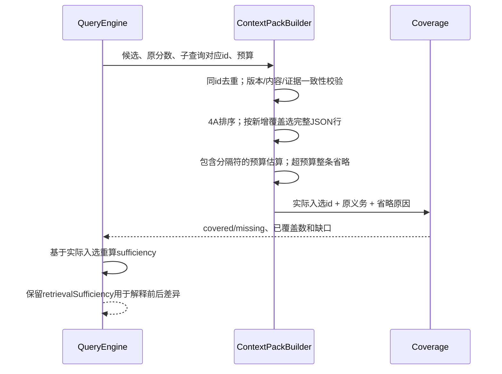

# 4B：预算内证据与查询覆盖

## 设计

Query默认`queryPacking=query_coverage`，Core可显式设`rank_only`消融。它是消费目标，不伪装成新的相关性分：覆盖优先阶段可以采用排名较低、但覆盖另一个子问题的候选。一次记录能覆盖多个子查询时只装一次。覆盖义务由计划/实际检索生成，不接受模型提交任意授权外的memory id。

贪心选择最大新增查询覆盖，同收益保留4A排名；大记录装不下就整条省略，再尝试其它候选。完成覆盖后按4A补充剩余记录。算法不保证全局最优或语义答案完整，不使用embedding、模型或切片总结。普通`memory_context`没有多查询要求，仍按4A顺序装包。

## 数据流

## 契约与边界

- `contextPack.coverage`为`context-coverage-v1`，包括子查询、原匹配数、实际入选id、covered/missing及原因。原因区分未命中、预算、事实不能采用、确认筛选及超时；确认筛掉的id不在结果中出现。
- `sufficiencyVersion=budgeted-context-v1`。原`sufficiency`改为预算后数值：匹配数、证据数、最小要求、执行中断、历史缺口都依据实际可用内容。`retrievalSufficiency`保留旧召回集合口径，避免把两层糅合。
- 空上下文为insufficient；有部分证据但缺问题/最小数量/执行完成/历史正文/候选截断时partial。候选或计划预算上限不能用“一条命中”冒充完整集合。只省略冗余记录但仍满足全部明确义务时可以sufficient；该词不表示语义可信度。
- 原`utf8_bytes_v1`估算、默认token/数量预算不变，整个JSON行连同换行计费，不截断否定、条件、有效期或嵌套对象。它不是特定模型tokenizer。
- 同id同证据只装一次；不同id即使值相同也不语义归并。同id不同版本/内容拒绝。结果对象是独立副本，不让调用方反向修改原证据。
- Query总deadline包括事实核实及装包；装包后若到期不返回正文，明确超时缺口。同步SQL/JS不能硬取消，现有deadline是停止等待/结果采用边界，不是硬实时保证。
- 历史扩展当前仍是审计元数据，不在上下文正文，所以不能作为“回答历史”的充分性依据。4C清楚声明该限制。

代码：`context-pack.ts`负责装包，`context-coverage.ts`负责去重/义务/覆盖一致性，`agentic-query.ts`负责计划、执行与双口径充分性。没有更改存储schema、查询游标或Adapter。
