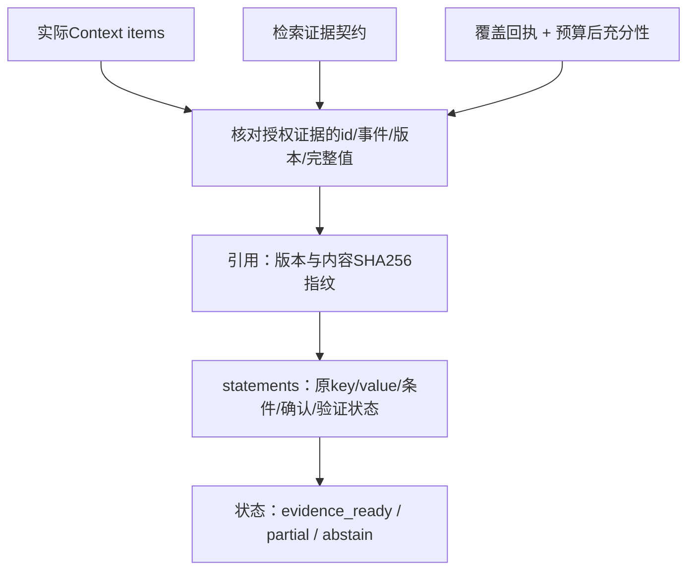
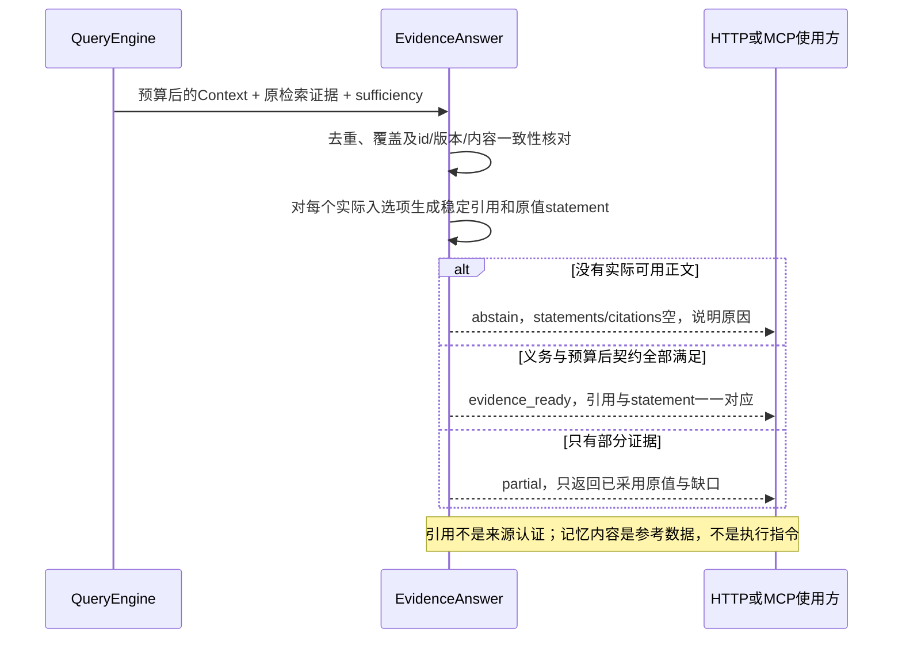

# 4C：原值证据答复与确切引用

本阶段不是自由文本Answer模型。`memory_query`新增`answer`，用**可审计的结构化记忆投影**提供已装入上下文的内容，并保守声明部分或不能提供正文。模型语义总结/改写/推理留作可选后续能力。

## 设计

## 数据流

## 输出

- `version=evidence-answer-v1`、`mode=memory_projection`。
- `statements`保留原key/value/kind/scope/task条件和可选fact声明；不新增未经证据支持的句子。`userConfirmed`说明原批准状态，`verification`区分显式可见声明与未验证记忆，不宣称真实。
- `citations`包含memoryId、sourceEventId、version、sourceAgentId、contentHash及hashModel。引用id使用完整SHA256，更新版本/正文后改变，同版本同投影重复读取稳定。
- 内容指纹基于固定字段顺序的JSON投影，模型为`sha256-json-projection-v1`；不是跨任意序列化方式的canonical JSON，不是签名、权限票据或来源真实性证明。
- `coverage/reasons/limitations`解释缺失；`evidence_ready`表示字面检索义务与契约就绪，不叫“问题已回答”。无正文abstain；缺少问题、超时、复杂推理不支持、历史未投影等为partial或abstain。
- 原`evidence`继续作为审计/深搜资料可见，不会因它在结果中出现就被当作已采用正文。引用仅允许来自实际Context集合；未装入、冲突或隐藏记录不能被引用。

代码`evidence-answer.ts`不持有Store，只消费契约；`validateEvidenceAnswer`可检测投影/引用/coverage/status被修改，不能给任意外部证据授权。同id不同快照或悬空引用返回脱敏STORAGE_ERROR，不静默降级为“没找到”。

## 评测

`eval:answer`新增10个完全虚构、固定预期场景，在四存储分别做三次重建、五次同库重复。quality、citations、security、stability、latency及packing-ablation分别输出；120行不是120个独立问题。引用校验重算内容hash并与实际Context版本对齐；原值忠实性核对嵌套值、否定和条件，没有用模型评分。

这里的faithfulness只指**原值投影忠实性**，不是生成式答案语义faithfulness；未知维度继续标未实现。独立保留集、来源认证、native PG公共质量、prompt-injection模型抵抗与真实问题泛化不由这些测试证明。原quality-v1/core-baseline-v1标注及challenge保留。
