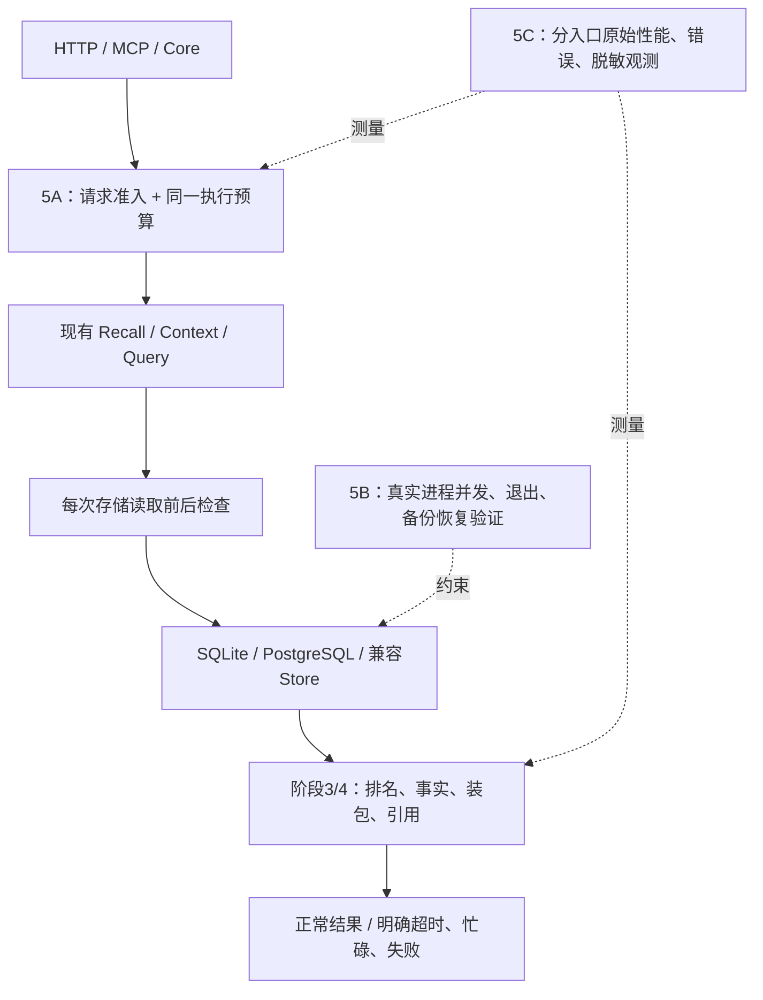

# 阶段5：轻量内核的运行可靠性

目标不是新增召回模型，而是让已有检索/证据链在慢读取、并发、进程退出及容量增长时保持明确的行为。5A、5B、5C分别设计和验收；不引入队列、微服务、Embedding或第三方Agent修改。

| 增量 | 交付 | 明确限制 |
| --- | --- | --- |
| [5A](./phase-5a-execution.md) | 单调时钟deadline、读取容量、关闭drain、明确错误 | 不取消同步SQLite或任意驱动查询 |
| [5B](./phase-5b-recovery.md) | 真实进程崩溃/并发、Query持续运行、原生PG补验 | 不证明断电、磁盘故障或所有读取快照一致 |
| [5C](./phase-5c-observability.md) | 独立容量/并发/长记录原样本与固定回归门禁、可选元数据observer | 不提供跨机器生产SLO或监控后台 |

权限、scope、userConfirmed、显式批准、事实声明和引用契约保持。普通Recall仍允许未确认记录；严格消费者不放宽。workspace仍由Adapter边界实施，身份仍须可信入口绑定。JSON仅兼容，不建设新索引或持久化架构。

实现入口是`MemoryService`，直接使用Store/旧自定义Retriever不自动具有这套运行保护；能力发现说明范围。现有事务/CAS/幂等/备份复用，没有把测试新增包装成新存储能力。设计、故障收益、性能成本和质量回归分别记录，不混成总分。

验收结果见[首次独立记录](./phase-5-validation.md)与[提交前完整复测](./phase-45-pr-validation.md)。阶段5确定性范围不意味着完整生产认证或语义RAG已完成。
