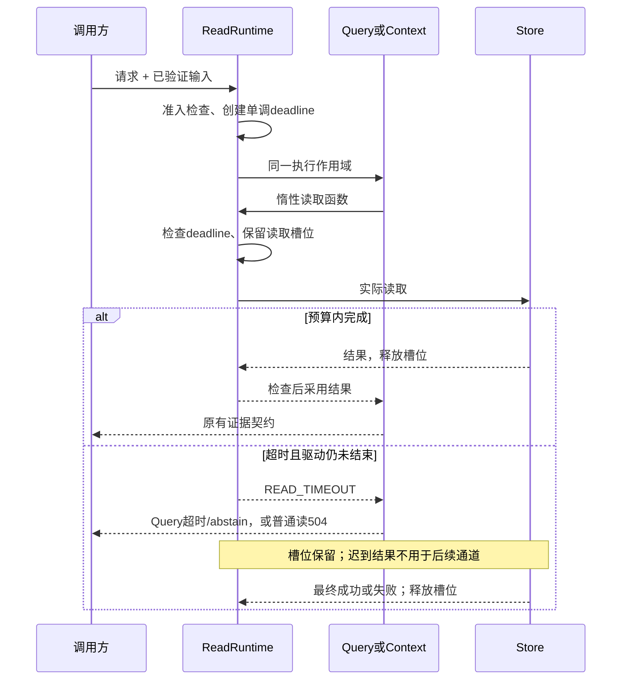

# 5A：执行预算、容量与故障边界

`read-runtime.ts`为每个MemoryService维护请求数与未结束读取数。使用AsyncLocalStorage传递同一个`ReadDeadline`；`performance.now()`不受系统时间调整影响。Query每个步骤和Store读取共享deadline，传入惰性函数，先检查再发出读取，完成后再次检查。

## 契约

- 默认普通Recall/Context/History/Handoff读取预算1500ms；Query仍使用原Profile默认/最大超时。构造策略可配置普通读预算，范围10–30000ms；不是新增HTTP/MCP请求参数。
- 每Service默认最多16个活动读请求、8个未结束Store读取。满载立即`RUNTIME_BUSY`/503，没有隐藏队列或自动重试。多个请求各自的deadline独立，不是用户/租户配额。
- 普通读超时`READ_TIMEOUT`/504；Query保留结构化`stoppedReason=timeout`、`insufficient/abstain`和空正文/引用。存储故障保持错误，不能伪装“未命中”。正常无命中仍是成功空结果。
- 读取包括legacy lookup、list、candidate、history和fact group；不改变内容、评分或cursor。Query渲染/hash后还检查超时，避免迟到正文。
- Query策略与运行策略校验、复制、冻结；discovery反映实际构造策略，而不是Profile猜测。
- `close()`进入closing，拒绝新读写；仍有读写时返回busy。`closeGracefully(5000)`只对本实例drain进行有界等待，结束后仅关闭一次。超时不强制释放活跃连接；迟到读写仍需实际结束。HTTP/MCP入口关闭失败使用固定脱敏信息，不丢失Promise异常。

## 数据库限制

SQLite仍为同步SQL，重查询/锁等待会阻塞事件循环，timer不能抢占。完成后拒绝迟到结果能保证“不采用”，不保证“按时返回”。`busyTimeoutMs`是可选Store构造参数，只调整初始化后的锁等待，默认仍5000ms；初始化迁移重试不受请求deadline控制。

PostgreSQL默认工厂Pool增加max=10、获取连接2000ms、server statement_timeout=5000ms、lock_timeout=2000ms。这些限制独立于请求deadline，不能声称精确取消；自定义Pool须自行配置和转发销毁连接。写入不套读超时或自动重试，未知提交继续按原幂等键核实。

永不结束的自定义驱动会永久占用槽位：这是明确拒绝新增工作，不是故障自愈。未加入worker SQL隔离、驱动硬取消、分布式配额或无限重试。

## 验证

`test/read-runtime.test.ts`覆盖准入、共享预算、同步阻塞、迟到成功/失败、错误区分、策略冻结、关闭和元数据observer；真实PG慢查询另测。`eval:reliability:faults`对同一未结束驱动比较四次请求和迟到后读取数，不把技术重复当独立故障样例。
