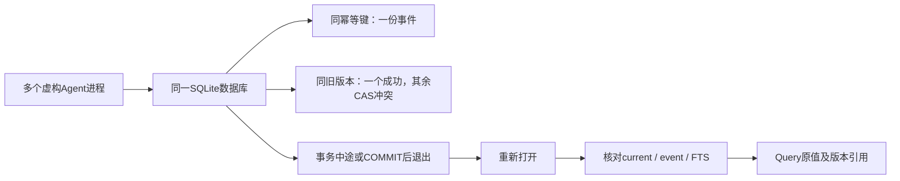
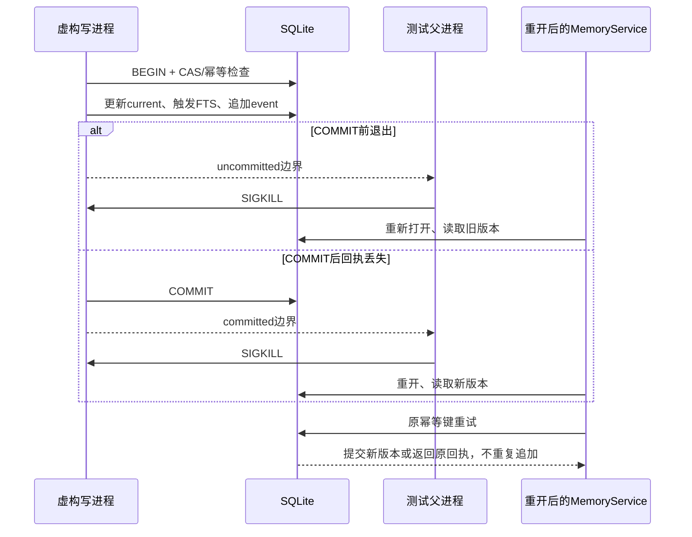

# 5B：并发、进程退出与恢复

复用阶段1的事务、CAS、幂等和WAL备份，不重写存储。新增真实进程证据检验它们经过阶段3/4后仍然成立。

## 事务数据流与故障点

## 独立测试

`reliability-sqlite.test.ts`在显式临时目录运行：

- 四进程相同创建请求：一次新写入，三次duplicate，一条审计事件。
- 四进程同expectedVersion：一个成功，三个VERSION_CONFLICT。
- 实际Store的COMMIT前/后强制退出；重开检验current对应event版本/值、FTS内容/孤儿项、旧/新关键词查询及原幂等键重试。
- 写锁等待失败不产生半份事件；释放锁后可显式重试。
- 写进程更新时读取Query：返回的引用必须对应该次Context快照；检测到跨通道版本混杂则明确STORAGE_ERROR，不能默默返回混合证据。
- WAL活动时备份到新文件；遗忘后恢复到另一新路径，验证事件、版本、FTS及private过滤。禁止覆盖现有目标。

`test:reliability:soak`默认1000循环，每轮四个Query，定期CAS更新及幂等重试；检查引用/严格确认/各scope和槽位释放。它是有限持续回归，不叫长期生产认证。

原生PostgreSQL仍由一次性loopback/tmpfs容器运行共享契约、事务恢复和慢查询补验；pg-mem只保留兼容质量证据。所有数据完全虚构，不读取默认数据库或Agent历史。

## 不提供的保证

SIGKILL不是断电；SQLite同步模式仍NORMAL。没有验证磁盘丢写、文件系统损坏、跨进程读快照或任意备份并发发布。当前分页仍live keyset；一次Query一致性检查不是时间快照/线性一致。恢复函数不是自动回滚用户数据库，仍需用户显式操作与原确认边界。
