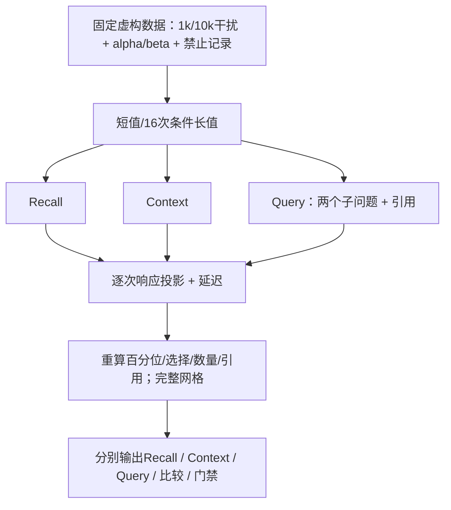
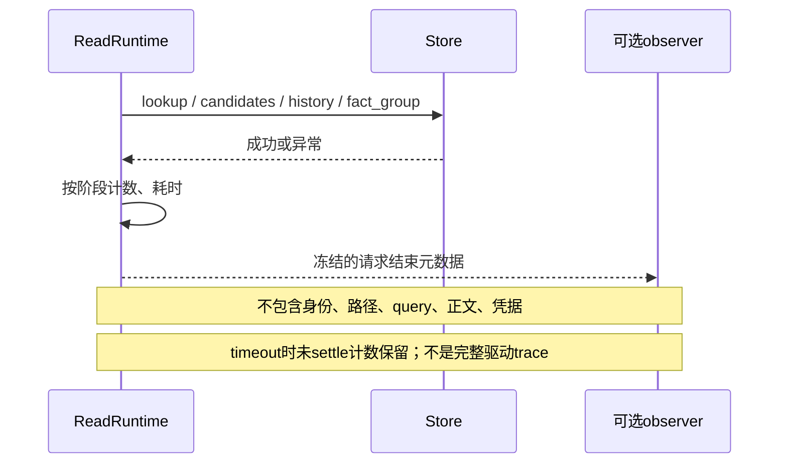

# 5C：容量、性能与脱敏可观测性

不建立监控后台或持久日志。新增独立虚构workload，测量运行保护的真实成本；正常负载任何错误、超时、忙碌或错误选择都使门禁失败。

## 测量契约

`npm run eval:reliability -- --report-dir=<new-dir>`：SQLite 1k/10k、每容量三次重建，短/长值，提供并发度1/4；每入口每格预热10次、采样100次。共72行、7200次正式响应；重复不是独立问题。长值仅重复虚构条件，测试JSON/hash成本，不生成新语义标注。

每行保留所有延迟样本、P50/P95/P99/max、completed/busy/timeout/failed/invalid、计时器让出延迟和RSS采样最大值。RSS不是精确峰值；提供并发请求仍是单进程同步SQLite，不是SQL并行或多进程吞吐量。读取结果投影保留key/预算/版本引用，可重算判定，不只相信布尔passed。

报告比较要求同评测器、设置、环境、完整网格；重算分位数、计数和投影。Recall允许未确认夹具，Context/Query要求确认，安全期望不能混用。

**正式测量前固定的工程回归规则**：同workload三轮P95的中位数不超过参考中位数×1.5+0.5ms。单轮不建立该门禁；不能删慢样本或事后降低阈值。该规则用于同主机虚构回归，允许噪声和有限保护成本，不是生产延迟SLO。原benchmark:lite另行前后比较，不替换数字。

## 可选observer

MemoryService最后一个构造参数可注入`ReadRuntimeObserver`，默认关闭、不落盘；关闭时不收集阶段统计。

元数据只有operation、outcome、总耗时、读取数、活动数及阶段started/settled/failed/duration。observer异常不影响读结果，异步回调拒绝被观察；调用方仍应使用轻量非阻塞回调，同步阻塞observer不受硬时间保护。没有日志传输、外部遥测或用户原文指纹。

故障对照、持续运行、质量和性能各自有报告，不用某个通过数字替代未执行维度。
