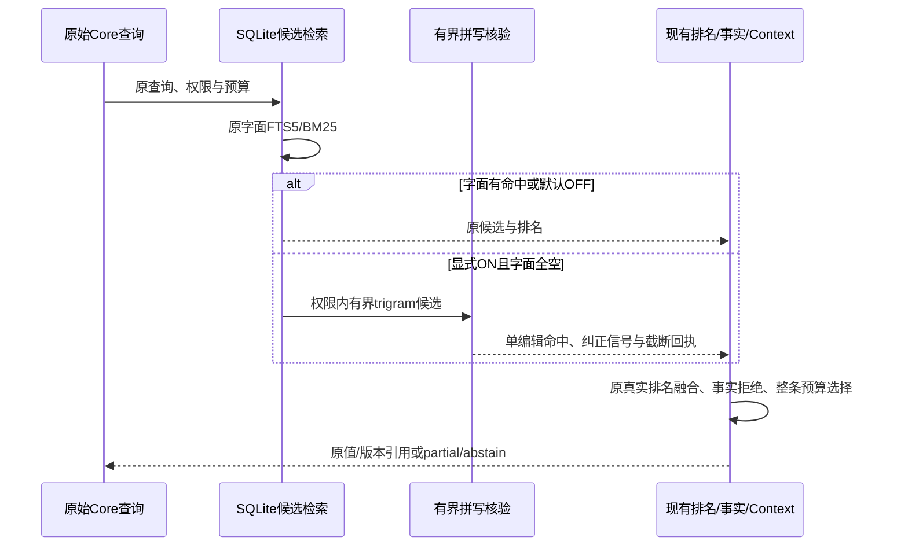

# 阶段6：诊断、可选拼写容错与接受决策

阶段6轻量增量已实现并完成代码验收：6A定位具体失败层，6B实现有界英文单编辑fallback，6C对照收益、误召回、安全、稳定与成本。**默认开启门禁不通过，因此保持OFF**；不是语义RAG、embedding或模型重排完成声明。

## 三部分各自做什么

| 部分 | 技术实现 | 交付的判断依据 |
| --- | --- | --- |
| 6A诊断 | 被动记录真实三通道调用；单独有界扩窗/排名重放；重算标注、预算与确切版本引用 | 区分没召回、窗口截断、排错、预算省略、事实拒绝，不把所有失败归为排序 |
| 6B可选容错 | SQLite字面全空→英文词资格→原权限SQL+trigram探测→其余词精确、一个词一次编辑核验 | 返回纠正词/编辑类型/真实编辑距离及上限回执，仍属full_text，不冒充BM25或语义分数 |
| 6C接受决策 | 同源码、权限、预算的OFF/ON消融；原题、新题、成本分开；完整性/默认启用两个门禁 | 收益、错误选择与慢样本同时展示，不能以工程命令exit0隐藏ON质量失败 |

6B只有Core构造参数`lexicalFallback: "latin_one_edit"`可选；默认OFF，没有新的公共工具参数/CLI/环境变量。至多8词、100次候选检查（重复也计数）、64KiB/256词核验；只支持一个5–32字符英文query词的一次编辑，须共享trigram，不保证找回所有单编辑。原字面有命中就原样返回，不扩展。

实现主线在`src/core/lexical-fallback.ts`、SQLite`spellingFallback`、候选/排名回执、Retrieval策略指纹及实际能力发现；诊断/消融在`evals/diagnostics`、`evals/lexical`。SQL先过滤原user/agent/task/private/显式scope/确认策略，之后才限制probe。普通Recall允许未确认内容的既有行为与严格Context/Query的确认策略分别测试，不全局改语义。

## 质量：默认行为与可选收益分开

冻结参考为阶段4/5已合并的`91aa7d3aa090720158e6d1bcac817a3d9888a961`，开发分支`codex/diagnostics-6a`。主分支参考与当前**默认OFF**公共baseline前后480行、四存储诊断前后及再次重建均0退化；原Required/标注/相关性等级不改。6A旧20题、开发8题、固定验收10题分区，不混为一份质量分数。

下表是SQLite旧20题的**显式ON消融收益，不是默认产品提升**。两批独立实验结果一致，每批每题三重建、每次三重复。

| 指标 | OFF | ON |
| --- | --- | --- |
| Recall@3 / MRR@3 | 67.65% / 64.71% | 73.53% / 70.59% |
| Context Recall@3 / MRR@3 | 58.82% / 58.82% | 64.71% / 64.71% |
| Context nDCG@3 | 57.63% | 63.51% |
| Context miss（相关记忆计数，三重建） | 21/54 | 18/54 |
| Context错误选择（返回记忆计数，三重建） | 6/39 | 6/42 |
| Context通过的不同问题 | 13/20 | 14/20 |
| 原固定验收10题Context通过 | 5/10 | 6/10 |

收益来自原两题拼写错误（旧题与固定验收各一题），三入口都能找回，原38题未观察到逐题退化。错误选择的分子6没有减少，比例变化只是多找回正确项扩大分母，不能据此声称误召回风险降低。

新增16题单独报告：五题单编辑/大小写短词锚点由0/5→5/5；两题合法词歧义由0个错误→2个错误，在Recall/Context/Query都暴露。`planet→planer`、`dessert→desert`有真实词义差异，不改标为“成功纠错”。另保留无共享trigram、同义及跨语言Challenge；字面保护、多编辑、缺锚点、数字/短词边界与安全另列。两题错误就足以拒绝默认启用。

新题是已暴露、完全虚构的固定验收，不是盲测或真实查询泛化证据。每批6C原38题/新16题各自OFF和ON，合计972观察行、2916技术响应；技术重复不是不同问题。实际输出/实际候选/独立探测安全统计分别为零泄露，分母零仍记未覆盖；事实拒绝、原值与引用校验、重复/重建稳定性通过。工程完整性通过，ON新题质量门禁失败原样保留。

## 性能：正常查询与宽probe分别看

旧`benchmark:lite`同机10k/100请求、三组参考/当前配对；下表为三轮P95中位数（ms），不是提速或SLO承诺。

| 默认OFF工作负载 | 参考main | 当前 |
| --- | --- | --- |
| Exact Recall | 1.927 | 1.844 |
| FTS Recall | 3.643 | 3.444 |
| Context | 3.731 | 3.567 |

全部原轮次保留，当前首轮FTS P95=5.583ms，比参考首轮3.300ms慢；不能只摘中位数宣称提速。

6C专项每批1k/10k×三轮×四工作负载×OFF/ON，共48行、4800正式延迟样本，另20次/格预热。字面命中、可纠正缺失、真实缺失均满足预先预算；10k宽trigram噪声两批都超出`ON≤OFF×2+2ms`。

| 10k宽probe | OFF P95中位数 | ON P95中位数 | 预先阈值 | 结果 |
| --- | --- | --- | --- | --- |
| 第一批 | 0.136ms | 2.606ms | 2.272ms | 失败 |
| 第二批 | 0.200ms | 3.144ms | 2.400ms | 失败 |

限制100次JS核验不能保证SQLite内部索引/排序成本，也不能硬取消同步SQL。性能与合法词歧义共同阻止默认开启；不调高事先阈值或删除慢样本。

## 工程验收

冻结源码/测试/评测/package/锁/tsconfig的26个正式命令串行全部exit0；此前开发日志保留，不混作最终代码证据。Node24.20.0，同一主机。

| 检查 | 结果 |
| --- | --- |
| typecheck | 包括diagnostics/lexical所有入口，通过 |
| 受影响测试 | 11文件211项，连续三轮通过；新增25项诊断/容错/评测验收测试增量 |
| npm test | 511 passed / 59 skipped / 0 failed |
| eval:suite | 185/185；泄露0/40；Injection P95 2.715ms |
| eval:quality默认策略 | Required15/15，Challenge9/42；安全0/6，旧语义失败不改标 |
| baseline/四存储diagnostics | 主分支前后及重建比较全部通过，0退化 |
| eval:lexical | 两批有效工程实验；默认开启拒绝，ON负例与成本失败保留 |
| 显式事实/证据答复专项 | 192行/120行通过，事实状态及引用独立核对 |
| Query/Capture soak | 各1000轮通过；Query每轮四次请求及周期CAS/幂等验证 |
| 原生PostgreSQL | 一次性本地PostgreSQL17.11，58/58通过，tmpfs夹具清理确认 |
| benchmark:lite | 三组10k/100配对，原始慢样本保留 |
| release:check | 类型/构建/全测/评测/生产依赖审计/包清单/隔离tarball smoke通过 |

59个默认skip中的58项已在本轮原生PG专项单独通过，另1项为既有pg-mem保留JSON键限制，没有新增skip。原生PG证明工程契约，不代表pg-mem质量是原生PG检索质量认证。未运行远端Ubuntu/macOS×Node22/24 CI，不进行提交/推送/PR/合并或npm发布。

实现冻结指纹：`953ccbc51b1a252252e6d3a95c5f2e8313f42fc95c575aa747f4bb053324ef21`。所有报告/原样本/完整命令/退出码在仓库外保留；哈希可复核，不是来源签名。所有测试数据完全虚构、数据库显式临时路径；不读取用户真实Agent历史/默认数据库，不复制其它worktree未提交改动。

## 明确没有完成的能力

中文改写/分词、同义、跨语言、模型重排、向量、自动语义事实归并仍未实现。现有版本引用说明“来自哪份记录”，不是客观真伪或完整身份认证。没有新Adapter、schema迁移、JSON架构扩展、云端依赖或飞书写入。

设计与验收口径见[6A](./phase-6a-diagnostics.md)、[6B](./phase-6b-lexical-fallback.md)、[6C](./phase-6c-acceptance.md)。历史6A独立交付结果见[6A验收](./phase-6a-validation.md)。

## 2026-10-26 补记：撤销人工别名

按用户决定撤销未发布的6D人工词对实验：删除10个专属源码、测试、数据集和设计/验收文件；移除扩展分支、公共类型、回执、能力字段及评测命令。旧构造配置仍含`termAliases`时返回`VALIDATION_ERROR`，不静默忽略。没有持久化迁移；适用旧别名游标需从第一页重启。6A–6C及6C空网格/零样本校验保持。

| 分项 | 本轮结果 |
| --- | --- |
| 类型/构建/测试 | typecheck、build、npm test通过：518 passed、59 skipped、0 failed；受影响10文件151项通过 |
| 默认质量/安全 | suite185/185、安全0/40；quality Required15/15、Challenge9/42、安全0/6，miss21/36、false injection0/6未变 |
| 直接前后对照 | 同评测器/锁/Node/标注：四存储公共baseline各480行，质量/安全/稳定性指标一致；38题diagnostics各1368行/4104技术响应，0退化 |
| 游标兼容 | 同一虚构SQLite库验证默认及显式拼写游标相同并可续页；适用旧别名游标读取前拒绝。比对稳定证据字段，单独校验每次调用的evaluatedAt时间 |
| 6B/6C试验 | eval:lexical工程完整性通过，合法词两个反例及10k宽probe成本失败保留，默认开启仍拒绝、默认OFF |
| 包交付 | 隔离smoke:package通过；清理构建后无别名模块残留。未重跑完整release:check/soak、原生PG或远端CI |

25项别名专属测试随功能撤销，补5项撤销契约；测试数量减少不是质量提升。59项skip保持原状，其中58项原生PG本轮未复跑，另1项为既有pg-mem限制。四存储质量中的PostgreSQL仍是pg-mem证据。

10k虚构记忆、每入口100请求，三组串行配对保留全部P50/P95/max。P95中位数：Exact `1.819→1.845ms`、FTS `3.395→4.181ms`、Context `3.742→3.338ms`。首轮Exact后测`6.119ms`也保留；FTS中位数增加，不能据此宣称删除带来提速、稳定性能不退化或生产SLO。此处为描述性测量，没有补设宽松阈值。

源码/测试/评测/配置冻结指纹：`3f2fcdcacb6a03aa604a3e0a313c49a8b3e51190a64215d4a2c25540d697da4a`。直接删除前快照、原始报告和失败均保留在仓库外；未提交/推送/PR。飞书对应6D图文与状态同步撤销，6A–6C保留。模型辅助查询改写仅为后续方向，未接入模型、Embedding或向量库，不把Challenge硬改为通过。
