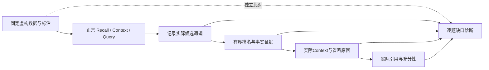

# 6A：逐层失败归因

目标：回答“哪些查询失败、证据在哪一层丢失、下一次应该改哪一层”。本阶段只新增离线虚构评测，不修改生产召回、排序、权限、预算、事实裁决或公共回执。

诊断分为：字面匹配未观察到、候选窗口截断、Top-K排名、Context选择/预算、显式事实拒绝、入口运行失败及无法归因。没有候选时，排序标注虽不满足，不能归因为排序错误。正式输出、实际候选及独立诊断重放的安全比例分开；未观察到的策略不合格记录单独列出，不能仅凭缺失证明它原本有字面匹配而被过滤。被标注为不相关的结果不一定是权限泄露。可同时存在多个问题，不强行只贴一个标签。

记录实际调用的channel、rank、raw score/match；Structured只作为资格，不计入问题候选。对候选缺口可以在**诊断重放**中把同一通道limit扩至100，不能改变正式结果；若重放仍截断，只能说未观察到，不能声称没有匹配。Context的入包前排名使用同策略生产Retrieval的独立重放；Query使用返回的evidence，原始结果和重放不混用。

旧`core-baseline-v1`的20题标注、Recall/Context设置保持，并增加独立Query观察；后者不是旧baseline指标。`quality-v1`含Capture，14题检索已原样在core baseline保留，Capture问题不归入本内核分析。新增虚构集分开发诊断与固定验收两部分；同一实现者能够看到验收题，所以必须标为**已暴露的固定验收集**，不是独立盲测/held-out泛化证据。运行前冻结标注；后续6B不能修改旧题/标准或按验收题硬编码规则。

每存储/入口/数据分区独立输出候选、排名、Context、事实、安全、稳定性、小样例延迟及逐题诊断。无综合总分；技术重复不算独立问题。质量Challenge失败如实保留，不阻断“诊断工具正确”的门禁；Required失败、泄露、原值/版本/引用不一致、运行异常及报告伪造必须阻断。

必须用反例测试诊断与报告校验：缺行、错分母、伪造pass/标签、错版本/引用、缺候选、将Structured伪装召回、截断误判、权限过滤误判为漏召。源码/锁/标注/评测器指纹记录并复核。数据库只在显式临时路径创建，报告只包含虚构标签，不输出真实环境路径/Prompt/数据库内容。

Context报告记录实际UTF-8字节数，独立重算`ceil(bytes/4)`与使用预算；Query正文引用与选中版本/原值投影指纹对齐。它验证当前确定性结构，不证明模型语义充分性或内容客观真伪。当前校验器可以发现字段级伪造/不一致，源码和报告指纹不是对任意恶意重写的数字签名或来源认证。

6A完成后提供失败分布和可复核例子，6B优化范围另行确认。无模型、embedding、新Adapter、生产日志或飞书写入；本地实现不自动授权commit/push。
