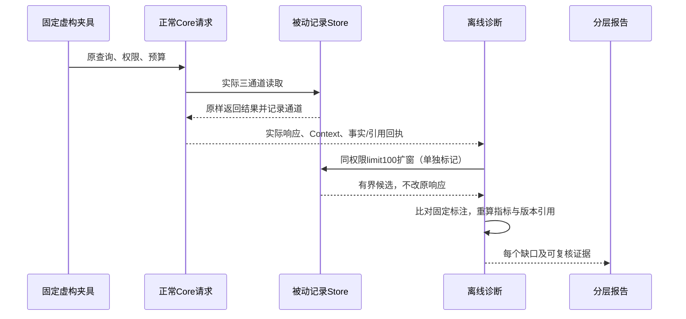

# 6A独立验收与瓶颈（2026-10-26）

本文保留6A单独交付时的历史快照与数字。“生产src未修改”仅指该快照，不代表后来6B/6C的合并开发范围；整阶段当前结果见[阶段6验收](./phase-6-validation.md)。历史报告不能与已增加纠错回执的评测器混比。

本阶段交付离线逐层诊断，不交付检索策略优化。基线为阶段4/5已合并的`91aa7d3aa090720158e6d1bcac817a3d9888a961`；开发分支`codex/diagnostics-6a`，不复制其它工作区未提交内容。生产src、schema、依赖锁、旧数据/标注/评测器均未修改。

## 结果应该怎么看

先选存储，再选legacy/development/acceptance_exposed，最后选Recall/Context/Query。每组有独立候选、排名、Context、事实、安全、稳定性、延迟与逐题诊断，不能混成一个总分。

正式响应安全统计包括Query返回的evidence及省略/事实回执；实际Store候选、独立扩窗/排名重放的安全统计另列，不能把重放观察叫成正式泄露率。策略不合格且未暴露不代表“证明原本匹配然后被过滤”。

## SQLite旧基线：主要缺口在哪里

20个不同问题、三次重建，每次三技术重复；下表按**不同问题数**统计，重叠原因不求和。

| 观察到的缺口 | 不同问题数 | 例子与解释 |
| --- | --- | --- |
| 没有观察到相关字面候选 | 5 | 连写短查询、中文改写、英文同义、错字、跨语言；候选不足不是排序缺陷 |
| 目标已召回，但干扰项排前 | 2 | 测试策略、未声明旧/当前发布事实 |
| 被maxMemories挤出 | 2 | 与上行同两题；是消费时的直接原因，不能遮蔽上游排序问题 |
| 不相关内容被选中 | 2 | 与上述两题重叠，不等于权限泄露 |

Context实际通过13/20；三重建为39/60。InMemory、JSON、PostgreSQL-pg-mem各自12/20：六题未观察到相关候选、两题排序/预算缺口。报告分别保留，不用SQLite成绩代表四存储。

SQLite公共口径保持：Recall@3/MRR@3为67.65%/64.71%；Context Recall/MRR@3为58.82%/58.82%，nDCG@3为57.63%；Context miss21/54、false selection6/39，与冻结参考不变。6A没有提升这些指标，也没有改写旧标注。

## 新数据：开发与固定验收分开

开发8题覆盖整条超预算、数量预算、候选窗口、双主题Query、显式冲突、已过期事实、确认边界和真正无命中。候选窗口反例可在同权限limit100重放找到目标；正式limit2响应保持原样。显式冲突/过期按当前契约正确省略，并独立列出事实原因，不算检索失败。

10个已暴露固定验收题覆盖字面技术词、短中文、同义、错字、跨语言、条件干扰、未声明当前事实、五种权限边界、完整对象投影及双主题预算。SQLite Context通过5/10；三重建15/30。三题没有相关字面候选，两题候选已到但排序/数量预算出错，说明新增数据也能暴露现有缺口，没有被硬编码为通过。它不是独立盲测，不能证明真实查询泛化。

## 下一步优先级：先比较，别猜

1. **查询表达与字面候选缺口**：先做受控实验，区分可通过明确关键词/本地术语解决的问题和需要语义理解的问题；同义、跨语言不能冒充普通关键词优化已解决。
2. **已召回但误选**：在有判别信息的查询上比较低成本机制。不能按key含current、写入先后或固定label硬选答案。未声明关系的旧事实仍需要有效事实声明或明确不确定性。
3. **预算**：当前两题与排序问题重叠，扩大预算可能只是同时塞入干扰，不优先全局调高默认预算。长值和多个真正相关主题则继续按现契约明确partial/abstain。

旧“项目标记”等宽泛查询本身未给目标颜色/可信来源，保留历史Challenge，但不把它当作可仅凭字符串长度证明的权威排序任务。数据缺少判别依据时必须记录局限，不能为了过题降低标注或发明事实。6B具体优化需要另行确认；本阶段不自动进入生产策略改动。

## 验证和证据

使用同一最终评测器在冻结main与当前源码上测量，并再独立重建一次：每批38题×四存储×三入口×三轮=1368行，每行三重复=4104响应。旧20题、开发8题、验收10题分别报告；技术重复不增加独立问题数。完整比较没有退化信号；原公共baseline另行前后对照，不拿新Query口径替代旧Recall/Context。

14个正式命令串行运行，全部exit0且源码/测试/评测/锁保持冻结。开发时补强归因/安全分层及字节预算校验后已完整重跑；之前轮次保留为历史开发证据，不混用最终评测器指纹。环境为Node24.20.0、同一主机。

| 工程检查 | 最终代码结果 |
| --- | --- |
| npm run typecheck | 通过 |
| 专项测试 | 3文件13项，连续三轮通过；诊断4项覆盖多种mutation反例及四存储 |
| npm test | 486 passed / 59 skipped / 0 failed |
| eval:suite | 185/185，泄露0/40；Injection P95 3.040ms |
| eval:quality | Required15/15；Challenge9/42，原失败保留 |
| 原baseline前后 | 480行，0退化/泄露/不稳定观察 |
| 新诊断三批 | 每批1368行/4104响应，全部工具门禁通过，两次对照0退化 |
| benchmark:lite | 10k/100；Exact/FTS/Context P95为1.714/3.249/3.220ms，只是当前单轮虚构性能观察 |
| release:check | 类型/构建/全测/原评测/公开生产依赖审计/包清单/隔离tarball smoke通过 |

59个默认skip为原生PG58项和pg-mem保留JSON键1项。本阶段没有改生产SQL，未重跑原生PG工程专项，不复用阶段5结果伪称本轮执行。生产源码完全相同，不从某次较快的benchmark数值声称6A提速；容量回归/故障/真实客户端验证仍看各自独立验收。

报告校验测试覆盖缺行/重复行、标注/分母篡改、伪造门禁/held-out声明、候选rank/扩窗遗漏、未知或陈旧快照、非法版本、原值改写、预算字节数重算、空查询覆盖伪装就绪。Structured不计问题召回；截断未观察到不称无匹配；无候选不贴排序错误；正式输出与重放泄露分开。所有适用安全比例为0，分母0仍为null/未覆盖。

最终源码/测试/评测/锁/tsconfig冻结指纹：`0eb9d4834c5f0c97ed927e0ec47a591d3e89007ca621631f1d4e8a6a4893f15f`。旧标注与补充题统一数据指纹：`8e451ed3adabc614678c425d8b70ded1b22e6875359a1734bcec265a5f0ad6a0`；评测器指纹：`da70fd1fbdaac3a9ba7464ff026ca05e9e9e9894541950888f7443336883d150`。哈希仅可复核，不是来源签名。

完整命令/退出码、全部原样本、开发轮次和最终报告在仓库外保留，不覆盖旧证据。小样例延迟包括离线记录开销，不是原生产延迟或SLO。未执行真实Agent历史测试/独立盲测/native PG检索质量；不读取默认数据库，不新增模型或Adapter，不进行commit/push、PR合并、npm发布或飞书写入。
