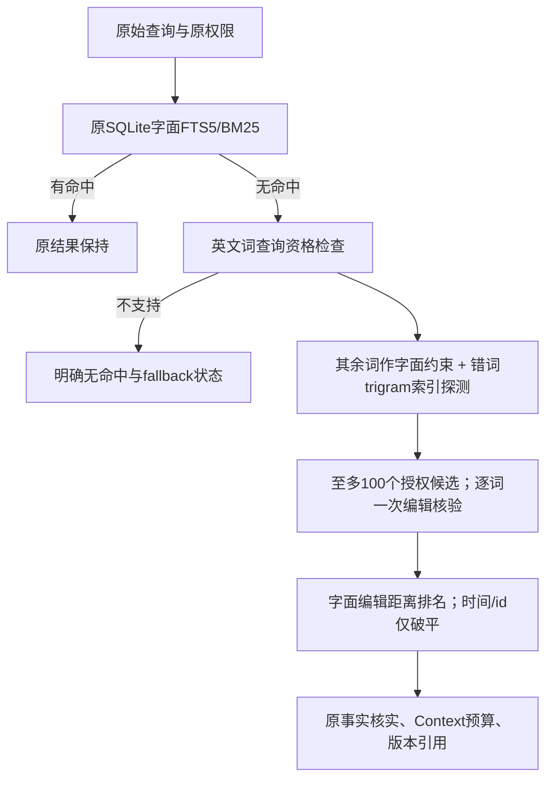

# 6B：有边界的英文拼写 fallback

目标来自6A的“相关候选未观察到”，先解决可解释的英文单词拼写错误。不建立同义词表、不按测试label/项目词写规则、不进行embedding/模型rerank，也不猜中文分词或旧事实。

前置固定边界：ASCII字母词5–32字符可纠错，查询最多8词；最多一个query词允许一次插入/删除/替换/相邻换位，其余词必须作为独立单词精确匹配。不得纠正数字、短缩写、CJK或改写含义。原Literal有任何命中就不扩展。该操作是相似拼写，不是语义理解或置信概率。

探测走原FTS5 trigram索引，与原user/agent/task/private/显式过滤/userConfirmed同SQL约束，资格先于候选窗口。每请求总共最多100次记录检查（跨分支重复也消耗上限）、至多8个分支；每候选最多64KiB文本和256个词，超过上限只跳过并声明截断。原值不截断后注入，所有完整Context/事实/引用规则保持。必须有共享trigram才能进入核验，故部分5/6字母的合法单编辑也无法找回；SQL索引匹配/排序成本不由100次JS检查上限保证。

新匹配证据描述query词/命中词及编辑操作，raw score模型为`token_edit_distance`（lower-is-better，合计一次编辑）；不能把探测BM25或时间序号冒充纠错相关性。fallback状态包含是否使用、原因、探测数量/上限及截断。它仍属于full_text通道，Structured不加分，Exact优先不变。

Core constructor `new MemoryService(store, { lexicalFallback: "latin_one_edit" })`可显式选择该策略；默认`off`。只有声明此能力且启用full_text的SQLite路径能生效，JSON/InMemory/PG及旧自定义检索器保持原兼容语义并明确不支持。不新增CLI/环境变量或公共Recall/Context/Query请求参数。排序回执添加新score/match/fallback字段，游标指纹绑定有效fallback版本/边界；OFF维持原指纹，ON与OFF游标不可交叉复用。发现接口分别报告supported/enabled/version/limits，支持不等于启用。

6C必须验证同数据/同权限/同预算的开关消融、旧标注/固定验收、负例误召回、单编辑/多编辑边界、真实SQLite索引/版本分页/事实、安全与查询超时、1k/10k正常和无命中成本。门禁在测量前固定：原Required/安全不退化；每题旧质量不退化；关闭时原literal集合/顺序一致；无命中fallback专项每workload三轮P95中位数≤literal参考×2+2ms（仅同主机工程预算，不是SLO）。超出时保持可选关闭默认，不事后调整阈值。
