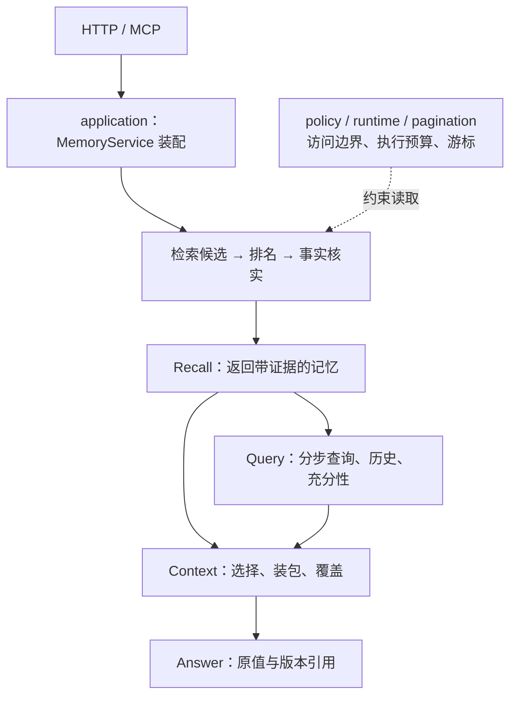
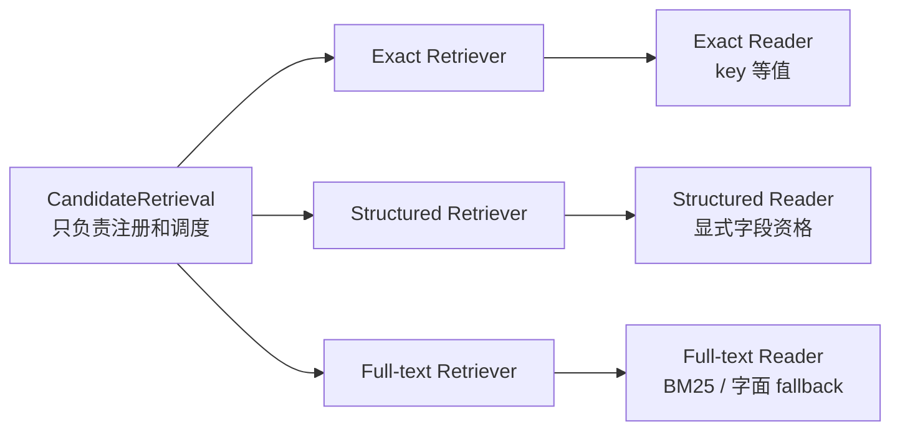
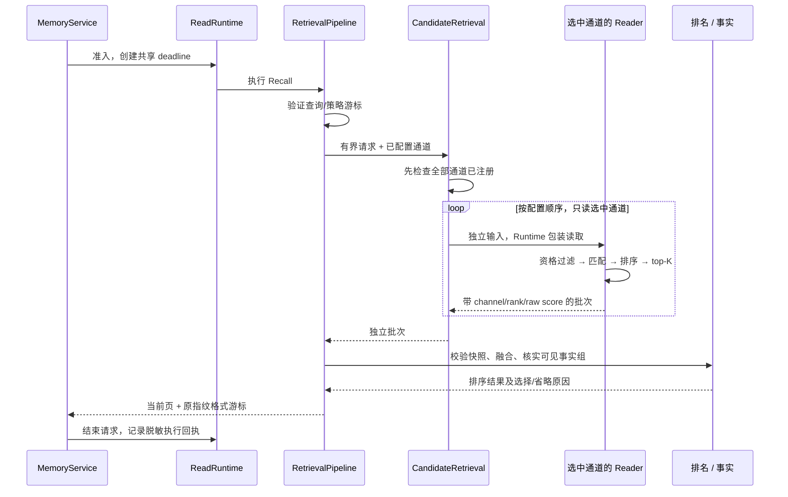
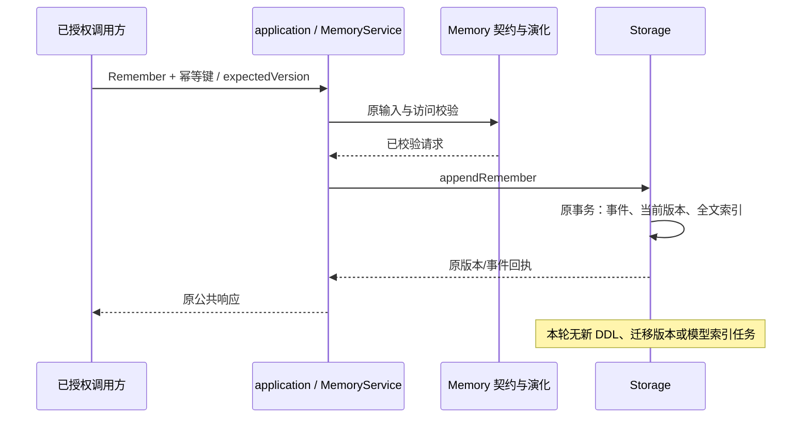

# 7A：模块化内核

本增量把现有内核拆成可独立阅读、替换和验证的模块。保持检索算法及公共行为，再独立接入 Embedding；本轮没有模型或向量索引。

## 1. 总体设计

图描述职责；运行时 Query 会按计划多次 Recall，复核事实，再用 Context 与 Answer 组织输出。原始对话仍经既有 Capture/审核入口，不能绕过批准进入共享记忆。

| 模块 | 负责什么 | 代码入口 |
| --- | --- | --- |
| Application | 组装存储、Runtime、检索及消费者，报告实际能力 | `src/core/application/` |
| Memory / Policy | 事件、写入/版本/幂等契约、可见性规则 | `src/core/memory/`、`policy/` |
| Retrieval | 单通道契约、调度、批次校验、融合与分页 | `src/core/retrieval/` |
| Storage | 持久化、事务、独立查询 Reader、迁移 | `src/storage/` |
| Facts | 可见组核实与保守事实选择 | `src/core/facts/` |
| Context | 排序选择、完整值预算、实际覆盖 | `src/core/context/` |
| Query / Answer | 查询计划与执行、充分性、原值投影和引用 | `src/core/query/`、`answer/` |
| Runtime / Pagination | deadline、未结束工作容量、drain、指纹游标 | `src/core/runtime/`、`pagination/` |

完整文件导航见 [Core README](../../src/core/README.md)。

## 2. 召回模块独立实现

每个 Retriever 只持有一个 `CandidateReader` 函数，不导入另外两路算法。backend 的三个 Reader 在 `readers/exact.ts`、`structured.ts`、`full-text.ts` 中实现；共享 `eligibility.ts` 在 top-K 前处理 user、agent、task、private、确认及显式过滤。Structured 的通道位置仍是过滤顺序，对文本相关性贡献为 0。

| 存储 | 本轮实现状态 | 保留的排序/限制 |
| --- | --- | --- |
| SQLite Lite | 三个独立 Reader；全文、短词与可选拼写实现继续拆开 | FTS5 BM25；原短词字面 fallback；拼写默认 OFF |
| PostgreSQL Team preview | 三个独立 Reader，不依赖额外扩展 | `strpos` 子串 fallback；不宣称 BM25/向量能力 |
| InMemory | 三个独立 Reader，显式所有者/可见性检查 | 兼容子串匹配与稳定顺序 |
| JSON | 刷新 ledger 后委托 InMemory Reader | 仅兼容，不新增索引架构 |

所有路径保持原更新、遗忘、版本、幂等和事务语义。相关性相同时保留 `updatedAt`、id 破平；不把时间顺序标成相关性排名。

## 3. 一次读取如何流转

`CandidateReaderSet` 是可部分注册的映射。显式读取缺失通道会在 I/O 前返回 `VALIDATION_ERROR`；选中 Reader 返回另一通道则为 `STORAGE_ERROR`。服务构造时也核实配置通道，不能伪造不存在的能力。现有通道 union 仍只有 Exact、Structured、Full-text；本轮未增加 Dense。

## 4. 中间层与写入边界

Context 改依赖窄 `RecallReader`；Query 改依赖 `QueryEvidenceReader` 与 `MemoryHistoryReader`。查询计划和充分性判断提为纯函数，原规则不变；Context 不创建具体 Pipeline，Query 不创建具体 Store。Ranker 不再导入拼写算法，只验证其证据契约。

ReadRuntime 同时包装旧 `searchCandidates` 和新 Reader 读取。它们共享请求 deadline 与候选读计数；超时后真正未结束的工作继续占槽位，避免新增接口成为容量旁路。同步 SQLite 的合作式超时仍不能硬中断 SQL。

## 5. 兼容迁移

旧 `src/core/*.ts` 与 `src/sqlite/*.ts`、`src/postgres/*.ts` 保留纯 re-export。旧构造函数与新入口是同一个对象，默认排名版本、指纹字段、响应和数据库 schema 不变。通用数据命令移至 `src/cli/storage/`；原命令路径兼容，具有原有执行副作用。

旧 Store 若提供 `searchCandidates`，服务继续通过明确 legacy bridge 调用它；该方法在内置 backend 中只分派至独立 Reader。这样保留原 wrapper/spy/override 的观察和保护语义。显式传 ReaderSet 或 reader-only Store 可使用窄接口；不能假设新 Reader 自动取代旧覆盖逻辑。

测试按 `test/core/{retrieval,context,query,answer,facts,memory,runtime}/`、`test/storage/`、`test/reliability/` 分组。已有测试内容和辅助 worker 不丢失，package scripts 同步路径。跨源码评测器故意保留 legacy 动态入口，以便对比本轮开始快照。

## 6. 验收与下一步

`check:architecture` 和反例测试阻止数据库/消费者越层、通道互相 import、兼容入口增长业务。它只是依赖门禁，不等于语义、安全或性能证明；新增 Reader 契约、旧接口身份、跨快照游标、全套评测、真实 PG fixture 与安装包 smoke 分开验收，见 [7A 验证](./phase-7a-validation.md)。

下一增量独立接入 Embedding：原记忆/版本/审计继续是权威数据，向量是可重建索引；写入同步、版本核对、遗忘/恢复与模型升级需要单独设计。目标是 Exact + BM25 + Dense 的独立候选通道，Structured 继续承担资格过滤。模型、索引格式、依赖、授权和质量/成本门禁尚未实现或选定，不能从这次目录拆分推断已具有语义检索。
