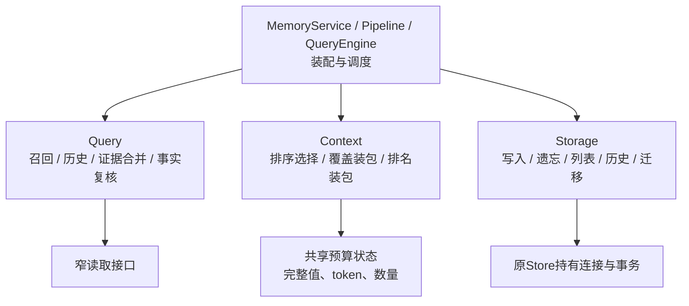
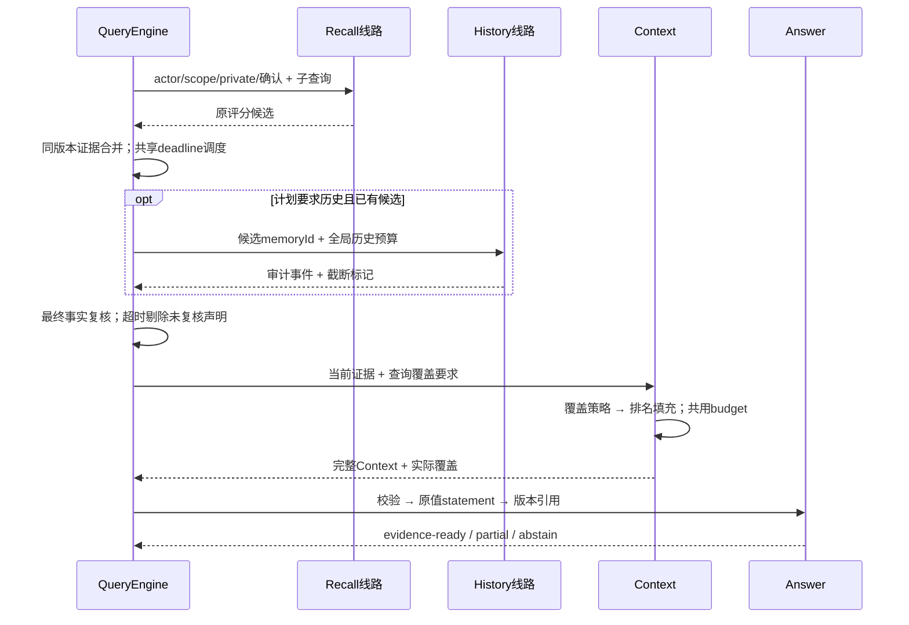

# 7A补全：模块内部线路与分项测试

初次7A分开大模块和三路召回；本次继续拆开各模块内部操作，使实现、接口和测试都能单独查看。公共工具、默认排序、权限、schema和模型依赖保持原状。



| 模块 | 实现线路 | 测试入口举例 |
| --- | --- | --- |
| Memory | merge、演化、ledger、handoff | `--module=memory --route=merge` |
| Retrieval | Exact、Structured、BM25、短词、可选拼写；资格、分页 | `--module=retrieval --route=full-text-bm25` |
| Ranking | 候选一致性、RRF、单路/最佳排名、评分解释 | `--module=retrieval --route=ranking-rrf` |
| Facts | 可见组读取、有效期、引用、字面裁决、结果组装 | `--module=facts --route=references` |
| Context | 选择、rendering、budget、rank/coverage装包、覆盖回执 | `--module=context --route=packing-coverage` |
| Query | planner、recall、history、evidence、fact-review、response、sufficiency | `--module=query --route=history` |
| Answer | 一致性校验、引用、statement、答复状态 | `--module=answer --route=citations` |
| Runtime | deadline、准入/容量、关闭drain、observer | `--module=runtime --route=deadline` |
| Pagination / Policy | 列表/排名游标；访问授权 | `--module=pagination --route=retrieval` |
| SQLite / PG / InMemory | writes、records、readers；SQLite transfer / InMemory replay | `--module=storage-postgres --route=remember` |
| JSON | ledger锁/刷新和兼容委托 | `--module=storage-json --route=file-store` |

完整清单由真实测试文件生成：`npm run test:core:list`。跨存储契约和跨模块集成保留独立分组。



操作模块不能重新开启连接、另建预算或扩大权限。SQL操作仍在Store原事务内完成；PG未知恢复失败继续销毁session，InMemory共用同一状态。Remember/Forget互不导入；PG Remember只接写入需要的接口，没有通用查询/列表接口。

必要的编排和共享状态保留：QueryEngine决定顺序，Context两种策略共用budget，Store持有事务。这是适合本地运行的模块化单体，不新增微服务进程或网络跳转。

```bash
npm run test:core:list
npm run test:core -- --module=query --route=history
npm run test:core -- --module=context --route=packing-budget
npm run test:core -- --report-dir=<仓库外新目录>
```

报告保存原Vitest、`summary.json`与`<module>/<route>.json`，逐测试名称、状态、耗时、失败/跳过/缺失分别列出。源码、测试、夹具、脚本、package与lock指纹在执行前后核对；变化则拒绝验收。没有综合总分。

未知/空选择、零断言、缺失/意外文件、重复结果都有拒绝测试。跳过不能变成通过；失败线路只是观测位置，仍需排查上游契约和具体反例。质量、性能、真实PG及安装包单独验收，见 [结果](./phase-7a-module-routes-validation.md)。
