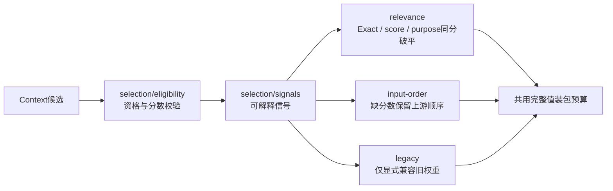
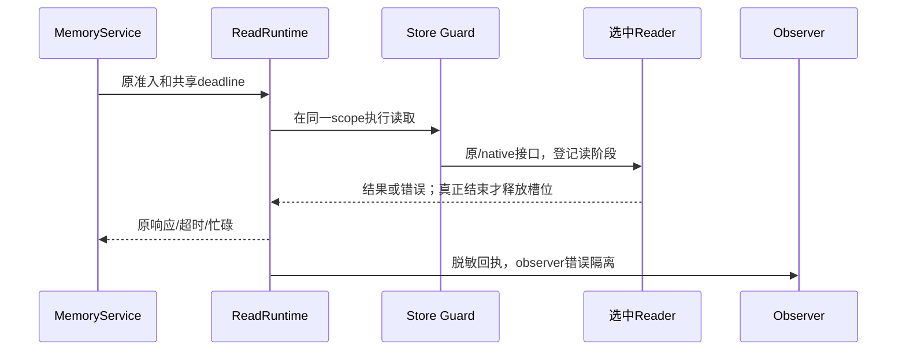

# 7A线路收尾：策略、运行包装与验收缺口

这次补的是上一轮仍有的具体缺口：Context三种选择策略混在一起；Runtime配置、回执与Store包装缺少独立边界；Query收尾需要具体Context类；存储若干线路只有组合测试；同组零断言文件可能被其它文件掩盖。原版本、查询、权限、事务、默认排名和schema保持。

## 策略分别实现



三种排序文件互不导入，selection入口只选择策略。`relevance_only`使用同一相关性比较器，但信号生成时将purpose设为0，避免复制一套排名算法。资格过滤与信号、选择、预算分别测试。旧分数尺度、同分规则与原因字段不变。

## 运行包装与Query收尾

| 文件 | 责任 | 独立验证 |
| --- | --- | --- |
| `runtime/policy.ts` | 原默认deadline/容量配置与校验 | 无数据库配置边界 |
| `runtime/store-guard.ts` | 窄读取包装，原/native Reader统一读阶段 | 实际注册集、legacy override观察 |
| `runtime/observer.ts` | 原脱敏回执的失败隔离 | 同步异常/异步拒绝不影响请求 |
| `runtime/read-runtime.ts` | 请求scope、容量、未结束工作、drain所有者 | 原超时/迟到容量与关闭契约 |
| `query/budgeted-sufficiency.ts` | 预算后的充分性、缺口与截断原因 | 有召回但无Context仍不足 |
| `query/fallback.ts` | 汇总实际降级原因 | timeout/history/insufficient分别保留 |
| `ContextMemoryPacker` | response只依赖完整值装包接口 | 注入窄packer，超时清空答复 |



没有新增另一套预算、队列、数据库连接或身份服务；同步SQLite仍是合作式超时，不声称硬取消。

## 存储与报告

InMemory的Remember、Forget、list、history、replay新增直接契约测试；SQLite新增list/facts/import目标校验；PostgreSQL的Exact/Structured/Full-text、list/facts新增窄port测试。SQL参数/资格及错误边界独立检查，真实数据库契约另外运行，不能用mock证明数据库事务通过。JSON继续兼容，不发展新架构。

`core-contract-map.ts`将主要职责登记到实现和测试，文件缺失在测试前拒绝。登记区分unit、backend_contract、integration，进入报告；不等同于行/分支覆盖，也不穷举所有helper。

报告器修正“同组零断言被其它文件覆盖”的漏洞，并拒绝重复选择、未知status和负耗时。原`operations-read/write`名称仍可用于选择，报告分别显示`history-port/forget-port`。缺失、零断言、跳过都不能变成完整通过。

```bash
npm run test:core:list
npm run test:core -- --module=context --route=selection-relevance
npm run test:core -- --module=runtime --route=store-guard
npm run test:core -- --module=storage-inmemory --route=replay
npm run test:core -- --report-dir=<仓库外新目录>
```

前后质量、分项工程、成本与剩余限制见 [本次验收](./phase-7a-route-completion-validation.md)。Embedding仍是下一独立增量。
