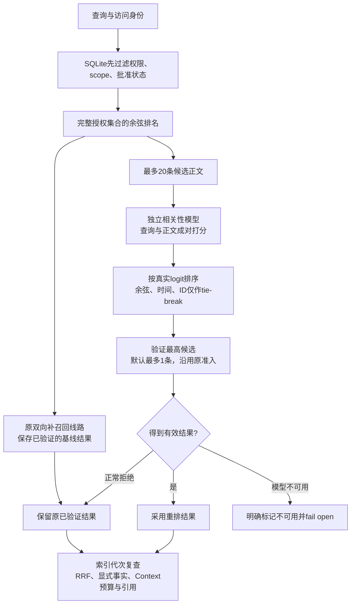
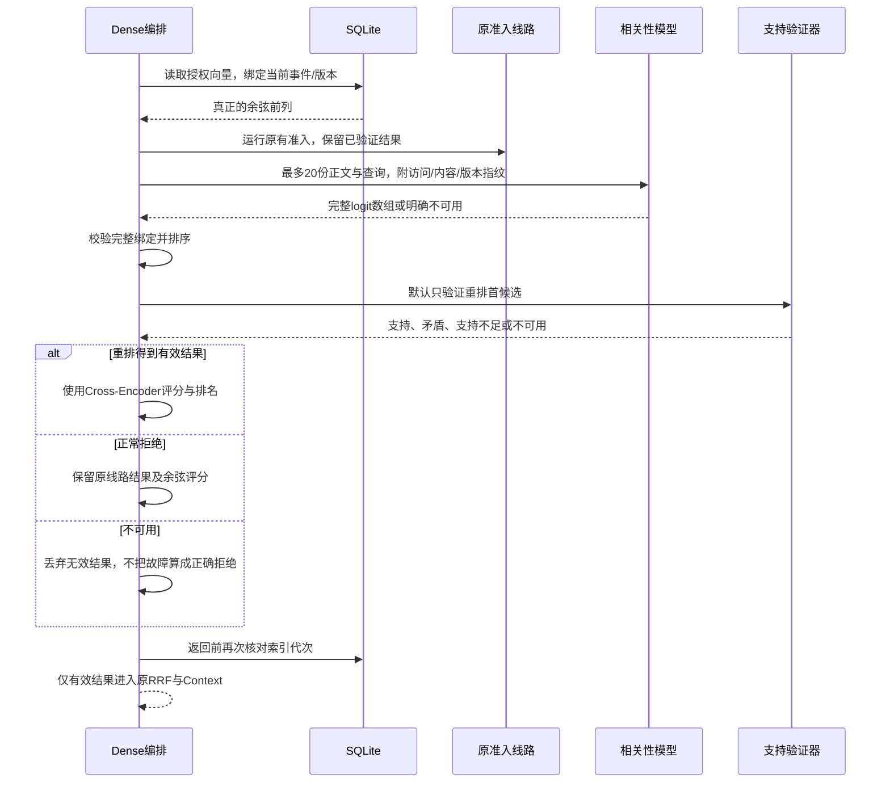

# Dense候选的相关性重排

本增量在显式Embedding实验中增加独立的Cross-Encoder排序模块。向量模型负责找候选，排序模型比较查询与候选正文；原模型验证继续负责支持/矛盾判断。默认Lite不加载这些模型，BM25、权限、批准和事实声明规则保留。



排序模型输出的是相对相关性logit，不是概率、权限或事实权威。没有以logit零点作为通用准入门槛；真正的准入仍沿用原余弦0.62，以及NLI entailment ≥ 0.5、contradiction < 0.5。低于余弦门槛的补召回仍要求双向支持。某些自然问句继续被NLI误拒绝，保留为Challenge。

## 模块职责

| 模块 | 职责 |
| --- | --- |
| `retrieval/reranking/contracts.ts` | 与存储无关的查询/正文、版本引用、原始评分契约 |
| `reranking/local-reranker.ts` | 模型会话、有限未完成任务、deadline、无正文的判断缓存和关闭drain |
| `reranking/validation.ts` | 校验查询/正文/访问指纹、ID、事件、版本、完整评分数组及模型身份 |
| `dense/reranking/order.ts` | 只排序，保持原始余弦信息；不批准或写入记忆 |
| `dense/reranking/selection.ts` | 优先采用已验证的重排结果；正常拒绝时保留已验证基线 |
| `dense/reranking/contracts.ts` | 两条选择线路的回执、预算及原始向量排名 |
| `dense/retriever.ts` | 组合以上模块，统一剩余deadline并在返回前复查代次 |

通用排序模块没有数据库依赖，也不认识某个Agent。当前只装配到Dense候选线路；后续可独立研究BM25候选重排，本轮没有把所有通道耦合到一起。

## 一次请求的流转



保留基线不是绕过拒绝：原线路结果必须已经通过其原准入和当前版本验证。它防止一次正常的重排误拒绝丢掉已存在的正确结果；模型失败、指纹变化、无效数组或代次变化不能冒充正常拒绝。也没有因为相关性分数高而自动替用户批准。

## 预算与解释

默认原线路仍验证最多4条；重排后的支持验证默认最多1条，可显式设1–4且不超过原验证窗口。相关性候选窗口默认20、上限20。两个选择阶段分别记录正向/反向回执和预算，不能只展示最终阶段的次数来隐藏原线路成本。所有异步工作共享同一剩余deadline。

排序器默认最多2个未结束任务，闲置60秒释放；缓存最多64份完整评分回执、TTL60秒，不保存查询或正文。缓存绑定访问范围、查询、候选ID/事件/版本/内容及模型/策略。超时后仍占用真实容量，关闭等实际推理结束，迟到结果不会更新缓存。

采用重排结果时，hit的主评分为`cross_encoder_logit`，同时记录原`cosine.rank/value/modelFingerprint`；保留基线时主评分仍为余弦，`reranking.applied=false`。`chosenRoute`与两组完整验证回执解释选择理由；Query丢掉根回执时，单条证据仍保留绑定的重排诊断。排序稳定性使用logit→余弦→updatedAt→id，时间从不充当相关性主排名。

## 显式装配

```ts
const reranker = new LocalCandidateReranker(relevanceProvider);
const dense = new DenseRetriever(index, embeddingProvider, {
  mode: "hybrid",
  admission: originalDensePolicy,
  pairVerifier: verifier,
  candidateSelection: "bidirectional_rescue",
  reranking: { reranker, candidateLimit: 20, verificationLimit: 1 },
});
```

模型提供者负责加载用户明确准备并校验的文件。实验复用了原MiniLM与NLI缓存，另测试公开[MMARCO Cross-Encoder](https://huggingface.co/cross-encoder/mmarco-mMiniLMv2-L12-H384-v1)的固定arm64 qint8文件；模型用途和原始logit来自该发布者说明。权重放在仓库外，没有新增生产inference依赖、自动下载器或模型服务。

实际开启时，能力回执为`rerank=true`并附实验模型/预算指纹；默认保持false。这是配置声明，不保证模型可用或语义正确。切换排序模型、运行策略或窗口需重新开始Dense分页；未配置重排的游标与默认行为保持。

[分项验收](./relevance-reranking-validation.md)分别记录候选排序、最终召回、旧池/新噪声池、安全、冷准备与重复查询成本。模型安装、跨平台、独立盲测、通用问题验证和默认开启继续保留为路线图。
