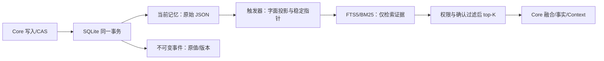
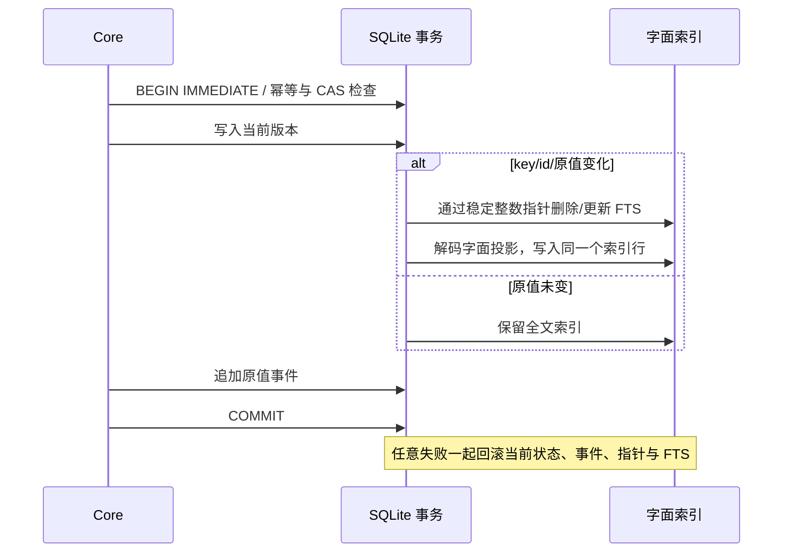

# SQLite 字面值索引：存储与找回增量

本阶段解决两件具体的事：按记忆的真实字面值找回内容，以及减少全文索引维护的扫描与重复写入。原始 JSON、事件、版本、权限和批准策略保持；不增加语义模型或人工词典。

## 设计与数据流

`sqliteLexicalText` 迭代解码 JSON：字符串按原文，布尔/数字/null 按字面值，对象保留字段名，数组不生成数字位置关键词。各片段用换行分隔，NUL 作为分隔符；返回记忆仍读取权威 `memories_current.value`，不会用投影替换原值。

例如原值 `C:\fictional\orbit` 在数据库 JSON 中会转义。以前 FTS 直接索引序列化结果，原文路径可能搜不到；现在索引解码后的路径。反过来，原值中的换行不再把序列化的 `nmarker` 当作真实关键词。原始 JSON 语法本身不再是稳定的全文查询契约，字段精查仍用 Exact/Structured。

`memory_fts_keys` 的整数主键与 memory ID 一一对应，更新/删除通过索引定位 FTS `rowid`，避开在 FTS 的 UNINDEXED `memory_id` 列上扫描。导入替换 ID 时移动映射，备份恢复保留整数主键。只改版本、来源或元数据时继续追加正常事件，但原值未变就不重建 FTS。Dense 的版本失效规则仍独立执行。

代码入口：[索引/迁移](../../src/storage/sqlite/lexical-index.ts)、[FTS Reader](../../src/storage/sqlite/readers/full-text.ts)、[Core 指纹](../../src/core/retrieval/pipeline.ts)、[迁移/回滚测试](../../test/storage/sqlite-lexical-index.test.ts)、[公共入口测试](../../test/core/retrieval/literal-values.test.ts)。

## 迁移与边界

SQLite Schema **4 → 5** 在一项事务内重建派生索引和指针，不改权威 JSON/事件/批准字段。失败恢复旧索引、触发器和版本标记。支持的 Store/迁移连接注册本地确定性 SQL 函数；外部直接 SQL 写入不能绕过该注册。没有新的数据库扩展依赖或独立修复命令。

SQLite 候选回执与实际能力增加 `lexicalIndexVersion: "json-literal-values-v1"`；Runtime 包装保留该字段，评分游标绑定它，升级后从第一页重启。共享数据库的进程应在升级后重启，不承诺旧/新内核的混版本滚动写入。旧内核拒绝 Schema 5，不能删除版本标记来降级；旧备份可由新内核恢复后迁移。

PostgreSQL/InMemory/JSON 继续明确使用原 substring 兼容路径，不宣称新投影能力。跨存储测试检查转义内容的原值、重试、CAS、历史和重开；SQLite 新匹配能力单独验收。手动 Recall 可查看 pending；启用确认策略的 Context/Query 与候选 Reader 按原规则只选确认项，Injection 仍只允许已批准 public。没有扩大身份、scope、private 或确认边界。

## 质量：旧集与新回归分开

Before 为 `97ac3e25` 的干净独立 checkout；After 为本次源码。同一评测器、锁文件、Node 和原标注比较四存储的 `core-baseline-v1` 与 `candidate-v1`，均无回归。原 `quality-v1` 保持 Required **15/15**、Challenge **9/42**、总体 **24/57**、安全 **0/6**；没有默认语义质量提升。

新增 [literal-value-v1.json](../../evals/datasets/literal-value-v1.json) 使用既有 candidate 契约格式：14 个作者生成、已暴露的虚构回归，三个数据库重建、每题五次技术重复。旧源码产出完整报告且无执行错误，但新回归仅 5/14 通过；新实现 14/14 通过。重复不是独立问题，单例字面控制不能替代复杂排名或语义泛化评测。

| 新回归分项 | Before | After |
| --- | ---: | ---: |
| 10 个正例的 Recall@1 / MRR | 50% / 0.50 | 100% / 1.00 |
| 正例 miss rate | 5/10 | 0/10 |
| 4 个转义噪声负例误召回 | 4/4 | 0/4 |
| 同夹具重复与重建选择稳定 | 通过 | 通过 |

新集的权限题与四个纯质量负例分开，0/0 的未覆盖边界不算零泄露。语义改写、跨语言、否定理解、旧/当前事实的未声明关系仍沿用原 Challenge，没有硬编码题目或降低标注。

复现：`npm run eval:candidates -- --backends=sqlite --dataset=evals/datasets/literal-value-v1.json --report-dir=<new-dir>`；先用 `--source=<clean-before>` 建立旧结果，再加 `--compare=<before>/raw-report.json`。新 Required 回归在旧源码非零退出是预期缺陷证据；执行异常不能当作对照。

## 性能：导入与各操作分列

1k/10k 分别使用同一虚构事件账本，三轮新进程 B→A/A→B/B→A，10 次预热后保留 100 个响应样本。下表为三轮 P95 中位数；导入列是完整 ledger 导入耗时中位数。全部版本、事件、当前/FTS 数量和无孤儿状态另校验，不清 OS 页缓存，没有预设生产 SLO。

| 容量/操作 | Before | After | 变化 |
| --- | ---: | ---: | ---: |
| 1k 导入 | 236.8ms | 290.8ms | +22.8% |
| 1k 更新 | 0.918ms | 0.738ms | -19.6% |
| 1k 仅元数据更新 | 0.683ms | 0.560ms | -18.0% |
| 1k 删除 | 1.026ms | 0.919ms | -10.5% |
| 1k Exact / 全文 | 0.556 / 0.447ms | 0.601 / 0.529ms | +8.3% / +18.5% |
| 10k 导入 | 2665.5ms | 2987.0ms | +12.1% |
| 10k 更新 | 1.521ms | 0.532ms | -65.0% |
| 10k 仅元数据更新 | 1.941ms | 0.375ms | -80.7% |
| 10k 删除 | 2.058ms | 0.965ms | -53.1% |
| 10k Exact / 全文 | 3.608 / 3.007ms | 2.845 / 2.616ms | -21.1% / -13.0% |

大库更新/删除的维护成本下降，同时新投影与指针增加导入成本；小库读也有慢项，不能宣布全面提速。该 workload 只有唯一 needle 正例，不代表模糊查询、所有文档长度或所有硬件。初始配对、最终配对脚本、原始样本与普通 `benchmark:lite` 分开保留在评测产物中，不把机器数据、数据库或模型提交入仓库。

普通 `benchmark:lite` 另做三轮 10k/100 次查询的交错配对：Exact P95 中位数 1.836→1.853ms，FTS 3.916→3.900ms，Context 3.750→3.450ms；初次逐条写入耗时 6975.5→8579.1ms（+23.0%），数据库 20.40→21.27MiB（+4.3%）。查询变化与前面唯一 needle workload 不可混比；慢写入和新增指针空间不能因局部收益而省略。

## 工程验收

三轮完整测试每轮 **756 passed / 60 conditional skipped**；typecheck、build、架构门禁通过。117 条模块线路为 115 passed、1 partial、1 skipped，664 passed / 60 skipped；不把条件跳过当作全通过。正式 suite **185/185**、安全 **0/40**、Injection P95 **4.031ms**。真实 PostgreSQL 17.11 **59/59** 通过并清理一次性 tmpfs 夹具；另一个 pg-mem JSON key 限制保留。Capture/Core 两组 1000-cycle soak 通过。显式模型复测 28 配置臂、4536 技术响应，重复选择全部稳定，保守 Context 的四组正例 5/12、5/11、4/12、5/8 与负例 0/2、0/7、0/12、0/8 保持。

新增 SQLite 迁移失败/恢复、事务失败/重试、指针/FTS一致性、内容相同不重建、备份恢复、导入 ID 替换和游标版本测试。所有数据完全虚构；不读取默认数据库或真实 Agent 历史。Embedding/拼写实验仍默认关闭，模型误拒绝、资源成本、跨平台与独立盲测仍未解决。

隔离安装包 smoke、工作区静态门禁与变更文件完整文本秘密扫描通过。本次运行环境为 macOS arm64 / Node 24.20.0；远端 Ubuntu/macOS × Node 22/24 CI 与跨平台模型安装未执行。本阶段为本地工作区实现，没有提交或推送。
